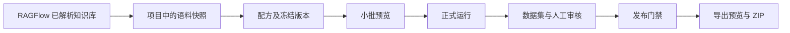
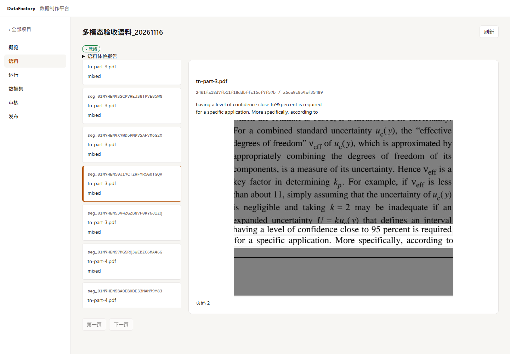
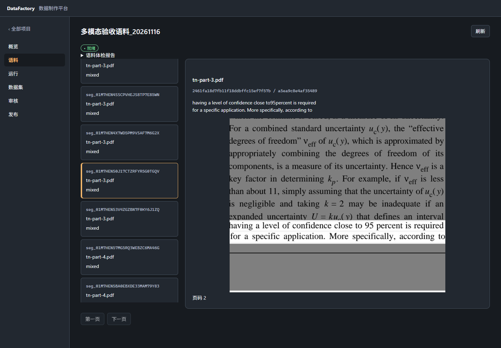
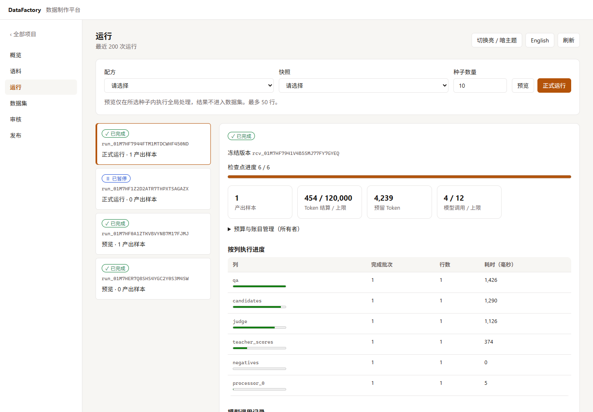
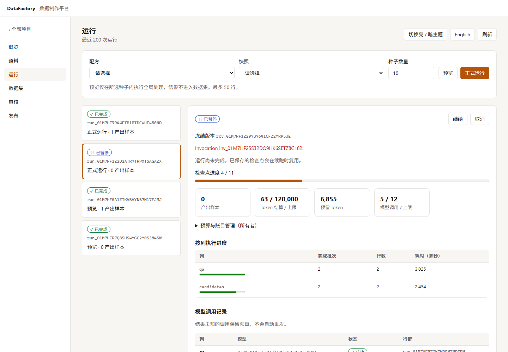
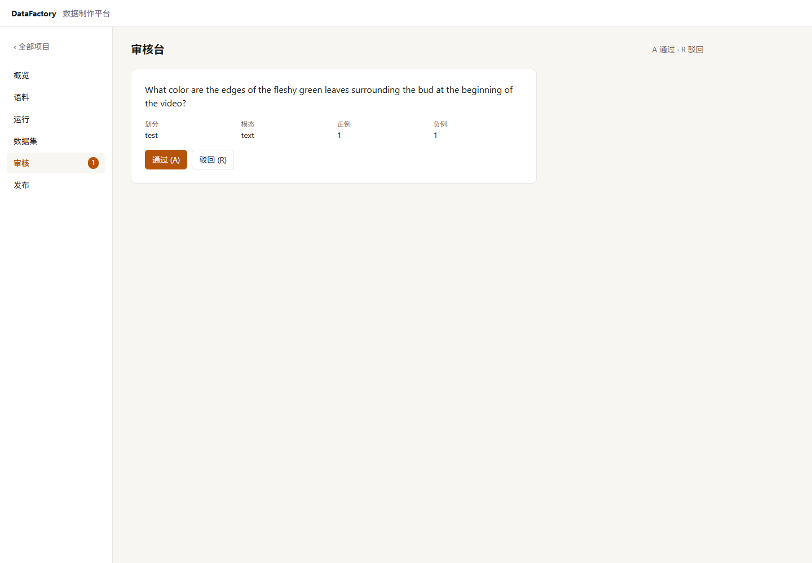
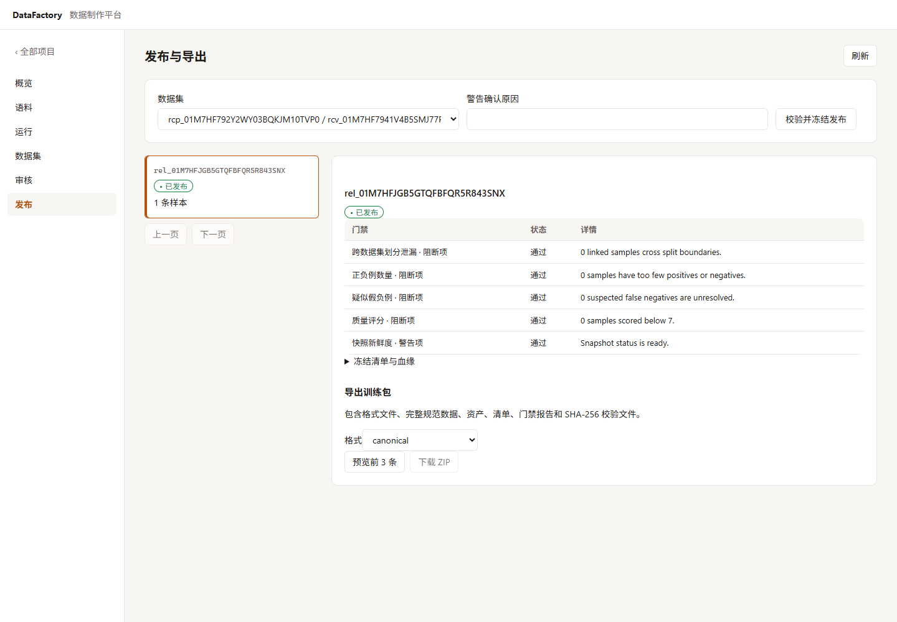
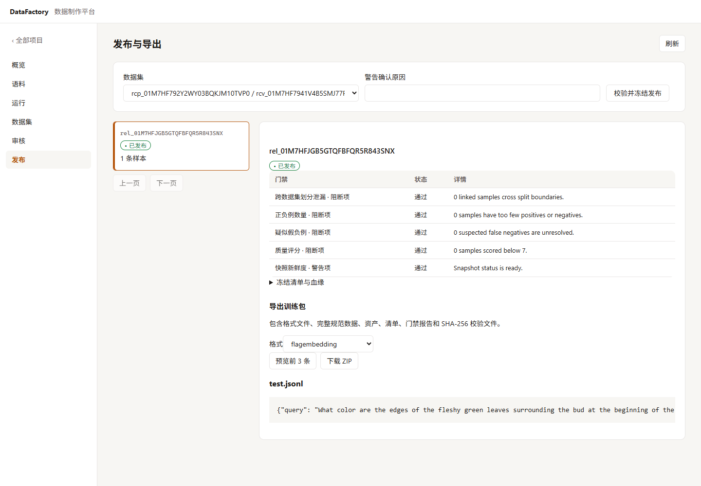

# DataFactory 数据制作平台使用手册

适用版本为本仓库 2026-11-17 的开发部署。入口 <http://192.168.88.91:9391/factory/>。未开放的设计功能见第 12 节。实际测试项目和下载校验见 [验收报告](VALIDATION_REPORT.md)，部署、诊断和回退见 [运维操作](../files/operations.md#datafactory-real-gateway) 与 [问题记录](../files/issue.md#datafactory-real-20261116)。

## 1. 平台用途和工作流程

DataFactory 从 RAGFlow 读取已经解析的知识库，冻结语料，再用配方生成查询、召回候选、计算教师分数、挖掘负例，经过人工审核和发布门禁，输出训练文件。



几个容易混淆的对象：

| 对象 | 含义 |
| --- | --- |
| RAGFlow 知识库 | 原始知识来源，包含文档、切片和检索向量 |
| 项目 | DataFactory 的协作、权限及资源边界 |
| 快照 | 当次复制的切片内容和图片字节；不复制向量，也不随原知识库更新 |
| 配方 | JSON 配置：种子、模型角色、列、处理器、预算和运行参数 |
| 配方版本 | 运行绑定的不可变配置；后续运行可绑定已有版本 |
| 预览 | 使用相同执行器的小批运行，有模型开销，但不创建数据集 |
| 数据集 | 正式运行产出的样本，包含查询、正负例引用、划分及审核状态 |
| 发布 | 冻结已通过审核的样本、配方、语料来源、门禁和调用指纹 |

RAGFlow 负责解析、OCR、切片、语料编码及模型凭据。DataFactory 不修复源文档、不回写知识库、不保存模型 API Key；模型调用都通过 Corpus Gateway。

## 2. 登录与访问

1. 打开上述 91 开发入口。
2. 在“登录 DataFactory”卡片输入 RAGFlow 应用账号的邮箱和密码，再点击“登录”。密码框右侧的图标可切换密码显示。
3. 登录成功进入项目列表。
4. 在项目的“语料”页选择自己有权访问的 RAGFlow 知识库。

浏览器向 DataFactory `POST /api/factory/v1/session` 提交邮箱和加密后的密码。Gateway 只验证 RAGFlow 账号，DataFactory 签发有效期 1 小时的 `df_session` HttpOnly Cookie。RAGFlow 的登录令牌和 DataFactory 的会话各自独立。

当前 9391 与 RAGFlow 的 8088 是不同浏览器源，首次访问 9391 需要登录。同源部署时，尚未建立平台会话的浏览器可以通过 `/me` 复用当前 RAGFlow 登录身份。API 和 Worker 使用服务端的 Gateway 服务密钥和用户 ID，用户只需提供 RAGFlow 账号。过期后重新登录，后台已提交的运行继续执行。

## 3. 项目和角色

项目列表点击“新建项目”，输入名称，再点击项目卡片进入。左侧提供“概览、语料、运行、数据集、审核、发布”。概览显示当前样本、数据集、待审核、运行中和已发布数量。

| 角色 | 当前允许的操作 |
| --- | --- |
| viewer | 浏览项目、快照、运行、样本、发布及下载已发布包 |
| reviewer | viewer 权限，以及访问审核队列、通过/驳回样本 |
| editor | reviewer 权限，以及修改项目、创建快照/配方、控制运行、发布 |
| owner | editor 权限，以及管理成员、删除空项目、调整运行预算、核账 |

当前成员管理和项目改名通过 API 操作，没有设置工作台。成员列表更新是**整体替换**，必须包含现有 owner 且不能转移所有权。已有快照、配方或运行的项目不能删除。加入 DataFactory 项目不会自动获得源知识库或模型的 RAGFlow 权限；创建快照和执行运行时仍使用操作者在 RAGFlow 中的身份。

## 4. 构建和查看语料快照

### 4.1 页面操作

1. 进入项目 →“语料”。
2. 在“知识库”下拉框中明确选择来源；验收使用 `数据制作多模态验收_20261104`。
3. 点击“从知识库创建快照”，等待“构建中…”结束。
4. 点击新快照名称进入详情，检查文档数、切片数、模态分布、体检报告和具体内容。
5. 点击切片查看来源和 ContentPart；图片按需加载，表格 HTML 会净化后显示。用下一页继续浏览，每页最多 100 条。



<details>
<summary>暗色主题示例</summary>



</details>

页面当前按整个知识库创建快照。只选择部分文档需要 API 的 `sources[].doc_ids`。构建仍在 HTTP 请求中完成，不能按后台进度作业理解；大库遇到超时先检查快照列表，避免连续重复点击。

### 4.2 状态和体检

| 状态/指标 | 应如何理解 |
| --- | --- |
| ready | 构建完成，可作为新运行输入 |
| failed | 构建失败，先定位 Gateway、源资产或存储问题，再新建快照 |
| stale | 主动检查发现源文档哈希变化或文档消失；已有内容保持冻结 |
| not_ready | 源文档尚未解析完成，本次未纳入 |
| skipped | 不可用切片、目录、RAPTOR 摘要或空内容等过滤统计 |
| short/long/garbage ratio | 内容长度与乱码体检，供决定是否回到 RAGFlow 修复 |
| exact/near duplicate ratio | 完全重复、近重复检查 |
| family_count | 用于降低跨划分泄漏的文档家族数量 |

快照不修改原知识库。源内容有问题，应在 RAGFlow 修复并重新解析，再创建新快照。过期检测接口为 `POST /projects/{project}/snapshots/{snapshot}:check-staleness`；当前页面没有独立按钮。检测受源系统内容哈希可用性约束，不能代替人工检查解析配置或向量版本。

### 4.3 多模态边界

当前能冻结切片文本、表格类型及 `img_id` 指向的图片，图片保存为 `sha256:<摘要>` 资产引用。资产下载要求项目成员权限，并验证字节哈希；支持 ETag 和单段 Range。

音视频文档的转写/描述可能作为文本切片进入快照。**这不等于原始音视频被完整冻结，也不等于已经具备音视频训练数据生产能力。** 图片模型输入、图片查询和专门的多模态训练适配器尚未完成，不应依据页面出现图片就判定 M2 已验收。

## 5. 配方：当前如何创建可用配置

“语料”页的“新建检索配方”只创建一个复制原文为查询的最小表达式配方，用于检查执行链路。它没有教师评分、负例挖掘或质量评审，不能直接作为可发布的训练配方。

当前还没有配方画布、JSON 编辑器或草稿修改接口。实际生产配置通过 `POST /projects/{project}/recipes` 提交；需要修改时创建一个名称清楚的新配方。运行时会冻结版本，也可用 `POST /projects/{project}/recipes/{recipe}/versions` 主动冻结。完整字段以仓库的 [OpenAPI](web/openapi.json) 和 [配方定义](backend/src/datafactory/engine/recipe.py) 为准。

核心配置：

| 字段 | 当前用法 |
| --- | --- |
| task_type | 正式执行入口当前仅接入 `retrieval` |
| seed | `type=ragflow_snapshot`、`unit=segment`、已就绪快照 ID |
| models | 角色名映射到 RAGFlow `model_id` 和 `gen_conf`，不得填 API Key |
| columns | 列名、类型、参数、提示词、模型角色、错误策略 |
| processors | 全局去重、过滤和 split 等配置 |
| budget | `max_invocations`、`max_tokens`、`on_exceed=pause或fail` |
| run | `seed` 为整数；`batch_size` 为 1–64 |

模型列表经 `GET /ragflow/models` 获取。使用返回的 `model_id`，不能用显示名称替代。查询召回自动使用知识库自身的 Embedding 模型，因此该模型也必须可访问。

文本检索配方通常按以下依赖关系组织：

1. `qa`：`llm_structured` 生成 `question` 和 `positives`，正例必须引用当前快照 segment ID。
2. `candidates`：`retrieval` 使用 `qa` 召回快照内候选。
3. `teacher_scores`：`rerank_score` 对正例与候选计算教师分数。
4. `negatives`：`processor` / `hard_negative_select` 选择不与正例冲突的难负例。
5. `judge`：`llm_judge` 返回真实质量判断，`overall` 为 0–10 分。
6. 过滤不合格行后进行确定性 split。

提示词可以引用 `seed.parts | render_parts`、`seed.id` 和上游列。依赖由模板及参数计算，不手写 `required_columns`。`expression` 输出字符串，不能把 JSON 字符串误当作数组或对象；结构化对象应使用 `llm_structured`。未知列、未实现种子模式或图像输入不能仅因 Schema 接受就视为可执行。

错误策略：`drop_row` 丢弃该行，`null` 保留行并将该列置空，`fail_run` 停止运行。初次调试建议关键列使用 `fail_run`，避免出现“运行完成但零样本”却没有检查错误的情况。预算和未知计费信号不会被错误策略吞掉。

## 6. 预览、正式运行与预算

1. 进入“运行”，明确选择配方与 ready 快照。
2. 第一次将种子数设为 1–3，点击“预览”。预览最多 50 行。
3. 在运行详情查看状态、列耗时、检查点、调用状态和预览样本。
4. 核对查询是否有依据、正例 ID 是否正确、是否有足够负例、教师分数和 judge 是否合理。
5. 确认小批效果后点击“开始运行”。正式运行完成后到“数据集”查看结果。



种子数是输入上限，不保证同样数量的输出。过滤、去重、解析错误或负例不足均可能减少样本。当前执行器读取整个冻结语料作为候选库，小种子数不能代表大语料内存开销也小。API 虽接受最多 500,000 个种子，但尚未完成该容量验收。

| 运行状态 | 下一步 |
| --- | --- |
| queued | 等待 Worker 领取 |
| running | 查看 SSE 更新、检查点和调用记录 |
| completed | 正式运行查看数据集；预览查看详情中的 preview |
| paused | 根据预算或错误原因处理后恢复 |
| blocked | 存在未知计费等阻断；先检查调用台账并处理原因 |
| failed | 先查看 error，修正配方或环境，再新建运行 |
| cancelled | 已取消，已发出的模型调用无法撤销 |

运行页可以暂停、恢复、取消；取消需要确认。断线可刷新状态，关闭页面不会取消运行。检查点按列和批次保存，恢复时校验执行代次，已成功的同运行调用可重放。

### 6.1 预算不是费用账单

调用前预留调用次数和 Token 上界，返回真实用量后结算。如果上游没有返回用量，保留预留，不能把它解释为免费或已用 0 Token。当前 chat 路径就可能出现此情况。当前实现的是**单次运行预算**，不是项目/租户总预算，也没有实际金额预算。

只有 owner 可以在停止执行的允许状态调整预算，必须填写原因；新上限不能低于已经使用和预留的数量。不能通过改小数字清空已经发生的消耗。

### 6.2 未知计费

发送模型请求后发生超时或连接中断，调用会被记为 `billed_unknown` 并暂停，系统不自动重发。owner 应查上游调用记录，确认实际用量，再填写 `actual_tokens` 和核账原因。核账释放相应预留并记入审计；它不生成丢失的模型响应，也不使该调用重新发送。恢复后的行处理仍取决于错误策略，因此可能需要修正配方后新建运行。



## 7. 数据集与人工审核

“数据集”列出正式运行结果，点击名称查看查询、split、模态、正负例数量及审核状态。当前页面是基础表格，没有分面图表、样本编辑、原文/Trace 五页签详情。

进入“审核”：检查当前样本，点击“通过 (A)”或“驳回 (R)”；审核区域获得焦点后可用 A/R。队列按项目展示待审核样本，操作后进入下一条。当前页面不显示完整正负例正文；严肃审核应结合快照/API 返回的 segment 引用核对内容，而不只看数量。

API 支持提交审核原因；当前按钮提交空原因。审核只记录决定，不修改样本正文。错误样本应驳回并修正配方重新制作，不能假设已有修订、负例提升为正例或自动重验功能。



split 由文档家族、共享正例及近重复查询的关联关系确定性分配，不允许手动改 split。小批样本可能全部落在同一划分，不能据此认为划分失效，也不能声称小批已覆盖 train/val/test。

## 8. 发布与导出

1. 进入“发布”，明确选择目标数据集。
2. 如有可接受的警告，填写“警告放行原因”；这不能绕过 blocker。
3. 创建发布，检查每项门禁。
4. 只有 `released` 能导出；`blocked` 留作排查记录，修复后创建新发布。
5. 选中发布及适配器，点击“预览前 3 条”，核对文件内容后“下载 ZIP”。

当前门禁：

| 门禁 | 条件 |
| --- | --- |
| cross_split_leakage | 关联样本不得跨 split |
| example_counts | 每条至少 1 个正例、1 个负例，双方不重叠 |
| false_negatives | 没有未解决的疑似假负例 |
| judge_score | 有有效的 overall 数值，且 7–10 分 |
| snapshot_fresh | 过期快照产生 warning，须有放行原因 |

发布只冻结已通过人工审核的样本。人工“通过”不会自动绕过质量门禁；不能写固定高分冒充模型评审。发布内容不可变，后续审核变化不会修改已发布包。



| 适配器 | 输出及限制 |
| --- | --- |
| canonical | 按 split 输出规范样本；保留引用，ZIP 中提供完整语料和资产 |
| beir | `corpus.jsonl`、`queries.jsonl`、`qrels/test.tsv`；query 仅来自 test，因此没有 test 样本时查询文件为空 |
| sentence_transformers | 每个正例展开一行，字段 anchor、positive、negative_1…；各行负例数量必须相同且非零 |
| flagembedding | query、pos、neg、pos_scores、neg_scores；分数来自已记录的教师调用 |

后三种是文本适配器，会检查正例和负例的模态；含图片等内容时明确拒绝，不自动删掉资产。当前页面/API 没有“仅导出文本子集”开关。若需要纯文本训练，应选择或制作纯文本数据，而不是改写模态标签骗过校验。



### 8.1 ZIP 内容与完整性

- `data/`：所选适配器的文件。
- `release/samples.jsonl`：发布的完整冻结样本。
- `release/corpus.jsonl`：完整冻结语料，不只包含样本引用的部分。
- `assets/`：冻结图片等被纳入快照的资产字节。
- `manifest.json`：配方/来源/调用指纹、门禁、分布、文件大小及哈希。
- `report.md`：交付报告。
- `SHA256SUMS`：包内校验清单。

解压到独立目录，在 Linux 中运行 `sha256sum -c SHA256SUMS`。Windows PowerShell 可用 `Get-FileHash -Algorithm SHA256 <文件>` 与清单逐项比对。保留整个包及 manifest，不只复制训练 JSONL。相同发布与适配器的重复下载应字节一致；导出目前在请求内组装 ZIP，大包先做小规模验证。

## 9. API 操作入口

下表路径都以 `/api/factory/v1` 为前缀。API 需要平台 Cookie。浏览器登录后，可在同源页面的开发者控制台使用下面的辅助函数；它使用 HttpOnly Cookie，不需要复制密码或服务密钥：

```javascript
async function df(path, method = 'GET', body) {
  const response = await fetch('/api/factory/v1' + path, {
    method,
    credentials: 'same-origin',
    headers: { 'Content-Type': 'application/json' },
    body: body === undefined ? undefined : JSON.stringify(body),
  });
  if (!response.ok) throw new Error(await response.text());
  return response.status === 204 ? null : response.json();
}
const projects = await df('/projects');
const knowledgeBases = await df('/ragflow/datasets');
const models = await df('/ragflow/models');
```

### 9.1 使用示例配方完成小批制作

仓库提供 [retrieval-text.json](examples/retrieval-text.json)。它包含真实模型生成与评分、1 个负例及过滤条件，不使用固定质量分。先将文件读入变量 `recipeBody`（例如在控制台粘贴 `const recipeBody =` 后跟完整 JSON），然后：

```javascript
const projectId = '替换为项目 ID';
const snapshotId = '替换为纯文本快照 ID';
recipeBody.config.seed.snapshot_id = snapshotId;
recipeBody.config.models.generator.model_id = '替换为 chat 模型 ID';
recipeBody.config.models.teacher.model_id = '替换为 rerank 模型 ID';
const recipe = await df(`/projects/${projectId}/recipes`, 'POST', recipeBody);
const preview = await df(`/projects/${projectId}/recipes/${recipe.id}:preview`,
  'POST', { snapshot_id: snapshotId, limit: 1 });
console.log(preview.id); // 到运行页查看，完成后核对 preview 样本
```

预览确认后，正式提交：

```javascript
const run = await df(`/projects/${projectId}/runs`, 'POST', {
  recipe_id: recipe.id, snapshot_id: snapshotId, limit: 2,
});
console.log(run.id);
```

示例预算只适合小批。模型、上下文长度和候选数会影响开销；有些模型不支持提示词中的 `/no_think` 指令，可在创建配方前删去。负例不足或 judge 不达标的行会被过滤，空输出应检查检查点与候选召回，不能通过删除门禁或虚构高分来“通过验收”。

对指定验收知识库，纯文本子集可按文档 ID 创建：

```javascript
const snapshot = await df(`/projects/${projectId}/snapshots`, 'POST', {
  name: '小批文本快照',
  sources: [{ kb_id: '替换为知识库 ID', doc_ids: ['文档 ID 1', '文档 ID 2'] }],
});
```

先使用文档列表接口获取真实 ID，并检查快照 `modality_counts`。不要通过重写模态字段把带图片的切片变成纯文本。正式训练仍需单独确认语料授权、源文档质量和样本规模；这份示例只说明当前执行配置。

| 目的 | 方法与路径 |
| --- | --- |
| 登录和身份 | POST `/session` 使用登录页加密后的密码，GET `/me` 查询当前身份 |
| 知识库和模型 | GET `/ragflow/datasets`、`/ragflow/models?types=chat,embedding,rerank` |
| 知识库文档 | GET `/ragflow/datasets/{kb}/documents?cursor=...` |
| 项目 | GET/POST `/projects`；GET/PATCH/DELETE `/projects/{project}` |
| 成员 | GET/PUT `/projects/{project}/members` |
| 快照 | GET/POST `/projects/{project}/snapshots` |
| 快照内容 | GET `/projects/{project}/snapshots/{snapshot}/segments?limit=100&after=...` |
| 体检/过期检查 | GET `.../{snapshot}/health`；POST `.../{snapshot}:check-staleness` |
| 配方 | GET/POST `/projects/{project}/recipes`；GET `.../recipes/{recipe}` |
| 冻结版本/预览 | POST `.../recipes/{recipe}/versions`；POST `.../recipes/{recipe}:preview` |
| 运行 | GET/POST `/projects/{project}/runs`；GET `.../runs/{run}` |
| 监控 | GET `.../runs/{run}/metrics`、`.../runs/{run}/events`（SSE） |
| 控制 | POST `.../runs/{run}:pause`、`:resume`、`:cancel` |
| 预算/核账 | PUT `.../runs/{run}/budget`；POST `.../runs/{run}/invocations/{invocation}:reconcile` |
| 数据集/样本 | GET `.../datasets`、`.../datasets/{dataset}/samples?split=train` |
| 审核 | GET `.../review-queue`；POST `.../samples/{sample}/reviews` |
| 发布 | POST `.../datasets/{dataset}/releases`；GET `.../releases`、`.../releases/{release}` |
| 导出 | POST `.../releases/{release}:export?adapter=canonical`；GET `.../releases/{release}/package?adapter=canonical` |

部分文档/切片/调用接口支持游标，其余当前返回列表，不能假定所有资源都已服务端分页。项目、运行和预览创建支持 Idempotency-Key；不要假定快照、配方、审核或发布创建都具备重试去重。

## 10. 常见问题

| 现象 | 检查与处理 |
| --- | --- |
| 登录提示失败或返回登录页 | 确认 RAGFlow 账号。管理员检查 `/session` 的凭据验证结果与 `/me` 的平台会话状态，复测步骤见 [登录诊断](../files/operations.md#datafactory-login-diagnosis) |
| 没有目标知识库 | 检查当前 RAGFlow 用户/租户权限，刷新语料页；平台项目成员不等于源知识库成员 |
| gateway_unavailable / 502 | 检查 Gateway 健康、服务密钥及 API/Worker 地址；记录错误 code/message，交管理员排查 |
| 快照切片数少于源知识库 | 检查 not_ready、skipped，以及解析是否完成 |
| 图片加载失败 | 检查会话、项目成员、快照状态和资产哈希；不要修改数据库跳过资产校验 |
| 运行完成但零样本 | 查看调用和列错误；检查 query 是否为空、结构化解析、过滤及 drop_row |
| Dense search requires… | 知识库模型 ID/向量维度未解析，或跨库使用不同向量空间；先修复 RAGFlow 配置 |
| paused / billed_unknown | 查真实调用记录并核账，不连续点击重试 |
| 审核通过仍 blocked | 看具体门禁；审核状态不能替代负例、judge 或泄漏检查 |
| adapter_incompatible | 样本或正负例存在非文本模态，或 ST 负例数不一致；按输出目标修正制作输入 |
| BEIR 查询为空 | 当前发布没有 test 样本；BEIR 只导出 test 查询 |
| 刷新后项目仍不可访问 | 重新登录确认用户；由 owner 检查成员列表，不共享服务密钥 |

## 11. 管理员交接与数据保护

91 是开发环境，DataFactory 的 MySQL、Redis、MinIO 和对象桶独立部署。业务用户只使用 9391 入口。模型凭据保留在 RAGFlow；不要把登录密码、Token、Cookie、服务密钥或完整私有环境文件写进文档、工单或导出数据。

部署更新涉及前端构建、API/Worker、迁移和 Gateway，必须按 [operations.md](../files/operations.md) 中当前 91 操作执行。不要使用生产机作为测试写入目标，也不要执行 `docker compose down -v` 清空开发成果。Gateway 的开发加载方式与主应用启动有区别，详见运维记录。

## 12. 当前未开放或未完成的设计功能

以下不属于当前可交付的完整功能：配方画布/检查器、完整快照向导、资源模板库、种子成束和完整过滤采样、Query/Judgment 事实层、完整审核分配与修订、数据集图表/虚拟化、项目/租户预算、分布式 AIMD、Redis Streams、跨运行持久缓存、发布差异和后台导出、图片模型输入/图片查询/专用多模态适配器及容量验收。

Reranker 模型已可用作文本检索任务的教师，但独立 Reranker 数据制作任务不等于已开放。M3、M4、M5 按本次工程范围排除。M0/M1/M2 也不能仅凭服务启动或小样本链路通过就判定全部完成。逐项工程状态见 [IMPLEMENTATION_STATUS.md](design/IMPLEMENTATION_STATUS.md)。
