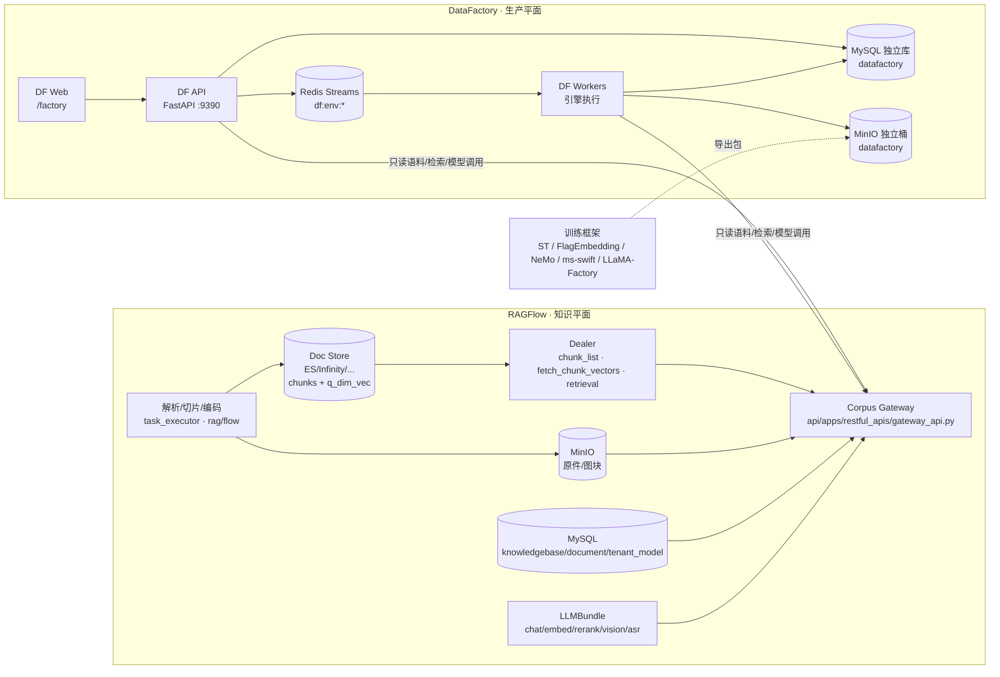
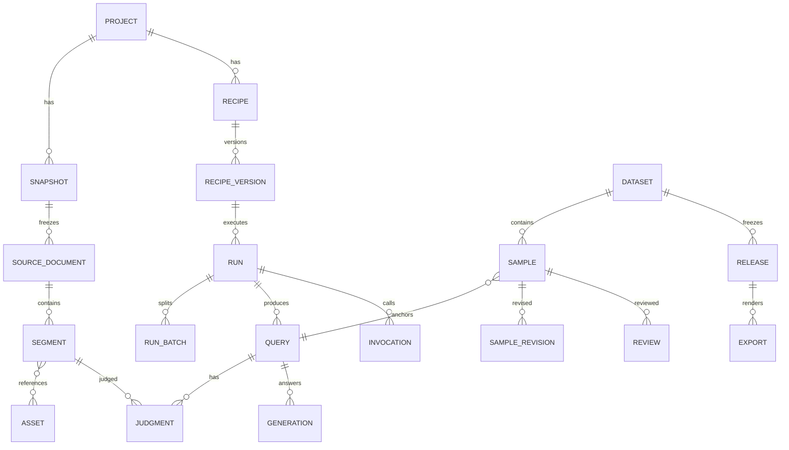
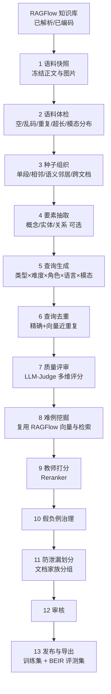

# RAGFlow DataFactory 数据制作平台 · 产品与架构设计

| 项 | 内容 |
|----|----|
| 文档状态 | 设计基线 v1.0（待评审） |
| 日期 | 2026-11-12 |
| 适用代码基线 | 本地 ragflow 开发分支 `fade581`（官方 v0.27.2 衍生） |
| 首期范围 | Embedding（含多模态）微调训练数据制作；架构预留 Reranker、LLM（SFT / 偏好） |
| 关联文件 | [datafactory/CLAUDE.md](../CLAUDE.md)（工程开发指导）、[datafactory/web/CLAUDE.md](../web/CLAUDE.md)（前端开发指导） |

本文以当前代码为准。凡写明"代码位置"的结论均已对照本地源码核对；外部框架格式（训练框架数据格式）在实现适配器时须再次对照其官方文档。

2026-11-16 实施范围为 M0、M1、M2，M3–M5 不在本次范围。本文中的目标能力不等同于已交付功能；完整核查、已修复项、未完成项及验证证据集中记录在 [实施与验收记录](IMPLEMENTATION_STATUS.md)。当前已实施基础纠偏、可恢复运行/调用台账、资产与划分治理、冻结发布包，并部署到 91 独立开发环境；指定真实知识库的小预算文本链路和图片冻结已验证，尚未通过 M0–M2 整体验收。实际操作见 [使用手册](../USER_GUIDE.md)，测试边界与待核实账目见 [验收报告](../VALIDATION_REPORT.md)。

---

## 目录

1. [背景、目标与非目标](#1-背景目标与非目标)
2. [用户角色与核心场景](#2-用户角色与核心场景)
3. [RAGFlow 现状分析与可复用能力盘点](#3-ragflow-现状分析与可复用能力盘点)
4. [总体架构：两个系统的关系](#4-总体架构两个系统的关系)
5. [Corpus Gateway：RAGFlow 侧的唯一新增面](#5-corpus-gatewayragflow-侧的唯一新增面)
6. [核心数据模型（多模态、框架无关）](#6-核心数据模型多模态框架无关)
7. [数据制作引擎（参照 NeMo Data Designer）](#7-数据制作引擎参照-nemo-data-designer)
8. [Embedding 数据制作标准流程](#8-embedding-数据制作标准流程)
9. [Reranker 与 LLM 的扩展设计](#9-reranker-与-llm-的扩展设计)
10. [质量体系与人工审核](#10-质量体系与人工审核)
11. [版本、发布与导出适配器](#11-版本发布与导出适配器)
12. [前端产品设计](#12-前端产品设计)
13. [DataFactory 对外 API](#13-datafactory-对外-api)
14. [非功能设计：性能、安全、可观测、部署与环境隔离](#14-非功能设计)
15. [里程碑与验收标准](#15-里程碑与验收标准)
16. [关键决策记录（ADR）与风险](#16-关键决策记录adr与风险)
17. [附录：术语与参考资料](#17-附录)

---

## 1. 背景、目标与非目标

### 1.1 背景

RAGFlow 已具备完整的知识库构建链路：文件接入 → DeepDOC / Pipeline 解析 → 切片 → 向量化 → 多引擎索引（ES / Infinity / OpenSearch / OceanBase / GaussDB 等）→ 混合检索与重排 → 统一的多厂商模型调用。Embedding 微调数据制作所需的"解析、切片、向量化、检索"与此高度重合。若另起一套解析切片与向量库，会带来三类代价：重复计算（解析与编码最贵）、语料不一致（训练所见切片 ≠ 线上检索切片）、模型凭据与调用适配重复维护。

另一方面，训练数据制作本身有 RAG 系统不具备的需求：声明式生成配方、批量 LLM 合成、质量评审、难例挖掘、假负例治理、防泄漏划分、人工审核、不可变版本和面向多训练框架的导出。这些不应塞进 RAGFlow 的知识库业务表与任务执行器。

### 1.2 目标

| 编号 | 目标 | 衡量方式 |
|----|----|----|
| G1 | 零重复解析/切片/语料编码：语料直接取自 RAGFlow 已完成的切片与向量 | 平台不包含任何解析器、切片器；语料侧编码调用数为 0（仅生成的 query 需编码） |
| G2 | 统一模型能力：所有模型调用经 RAGFlow 已配置的模型实例，平台不保存任何模型密钥 | 平台数据库与配置中无 API Key 字段 |
| G3 | 底层数据结构原生支持多模态（文本、图片、表格、音频、视频、结构化），且不绑定训练框架或模型 | Canonical 结构中无框架字段；所有框架格式由适配器生成 |
| G4 | 引擎可扩展到 Reranker、LLM SFT / 偏好数据，复用同一套原子事实与流程 | 新增任务类型只新增"任务视图 + 适配器 + 配方模板"，不改核心表 |
| G5 | 可复现、可追溯、可审计 | 每条样本可追溯到语料快照、配方版本、模型指纹、调用 trace、审核修订 |
| G6 | 专业级制作体验：预览驱动的配方设计、实时运行监控、键盘优先的审核工作台 | 见第 12 章验收清单 |

### 1.3 非目标

- 不做模型训练与训练后评测编排（只导出训练/评测数据；可选提供"基线检索评测"，见 8.10）。
- 不替代 RAGFlow 的知识库管理、解析配置与重解析操作；语料问题回到 RAGFlow 修复后重新快照。
- 首期不向 RAGFlow 回写任何数据（例如把合成问题写回 `question_kwd`），见 ADR-08。
- 不提供通用的"任意表格合成"产品；引擎具备该能力，但产品面向模型微调数据。

---

## 2. 用户角色与核心场景

### 2.1 角色

| 角色 | 职责 | 平台权限 |
|----|----|----|
| 数据工程师（Owner/Editor） | 选择语料、设计配方、预览迭代、执行运行、发布版本 | 项目内全部写权限 |
| 审核员（Reviewer） | 按队列审核样本、修订、标注假负例 | 审核与修订，不可改配方、不可发布 |
| 算法工程师（Consumer） | 选择发布版本、按目标框架导出、读取评测集 | 只读 + 导出 |
| 平台管理员 | 配额、预算、模型白名单、项目成员 | 租户级管理 |

### 2.2 核心用户旅程（Embedding）

```
① 在 RAGFlow 建库、解析（已有流程，不变）
        │
② DataFactory 创建项目 → 选择 RAGFlow 知识库/文档 → 生成"语料快照"（只读引用 + 内容冻结）
        │
③ 从模板创建配方（如"图文检索 · 单跳+多跳"）→ 调整采样维度、提示词、模型
        │
④ 预览 10 行 → 查看每个单元格的 trace → 改提示词 → 仅重跑受影响列（增量预览）
        │
⑤ 正式运行（批次化、可暂停/续跑、预算守护）→ 运行监控
        │
⑥ 自动处理：去重 → LLM 评审 → 难例挖掘（复用 RAGFlow 向量）→ 教师打分 → 假负例检测 → 防泄漏划分
        │
⑦ 审核工作台：按"低分 / 边界 / 疑似假负例"队列抽检与修订
        │
⑧ 质量门禁通过 → 发布不可变版本 → 选择适配器导出（Sentence-Transformers / FlagEmbedding / BEIR …）
```

---

## 3. RAGFlow 现状分析与可复用能力盘点

### 3.1 可复用能力（已核对代码）

| 能力 | 代码位置 | 复用方式 | 限制与注意 |
|----|----|----|----|
| 切片存储与字段 | `rag/svr/task_executor.py`、`rag/flow/chunker/token_chunker.py`；索引名 `rag/nlp/search.py::index_name` = `ragflow_{tenant_id}` | 快照直接读取切片 | 字段见 3.2 |
| 按文档全量取切片 | `rag/nlp/search.py::Dealer.chunk_list(doc_id, tenant_id, kb_ids, fields, sort_by_position, retrieve_all)` | Gateway 扫描切片的唯一路径 | 按文档迭代，避开 ES 深分页 |
| 取切片向量 | `Dealer.fetch_chunk_vectors(chunk_ids, tenant_ids, kb_ids, dim)` | 难例挖掘、语义邻居、多跳成束 | 已兼容 Infinity 的制表符字符串向量 |
| 稠密检索表达式 | `Dealer.get_vector` → `MatchDenseExpr("q_{dim}_vec", …)`；`DocStoreConnection.search(...)`（`common/doc_store/doc_store_base.py`） | 以向量/文本/切片 ID 做 KNN | 跨库 KNN 要求同一 Embedding 模型与维度 |
| 生产等价混合检索 | `Dealer.retrieval(question, embd_mdl, tenant_ids, kb_ids, …, rerank_mdl, must_not, doc_ids)` | "线上检索器视角"的难例挖掘与基线评测 | 启用 rerank 时只允许 page=1 |
| 统一模型调用 | `api/db/services/llm_service.py::LLMBundle`：`encode / encode_queries / similarity / describe / describe_with_prompt / transcription / async_chat` | Gateway 模型调用代理 | 部分厂商 Embedding 支持图片输入（如 `JinaMultiVecEmbed`），需按能力声明 |
| 租户模型解析 | `api/db/joint_services/tenant_model_service.py::get_model_config_by_id / get_tenant_default_model_by_type` | 按模型 ID 构造 LLMBundle | |
| 图片资产 | `img_id = {bucket}-{object_key}`（`rag/utils/base64_image.py`）；`GET /api/v1/documents/images/<image_id>`；`settings.STORAGE_IMPL.get` | 快照时拷贝原图到平台资产库 | |
| 知识库与文档元数据 | `api/db/db_models.py::Knowledgebase / Document`（`embd_id`、`tenant_embd_id`、`parser_id`、`pipeline_id`、`content_hash`、`chunk_num`、`run`、`progress`） | 快照与过期检测 | `content_hash` 为 xxhash128 |
| 访问控制 | `KnowledgebaseService.accessible(kb_id, user_id)`；`api/apps/__init__.py::login_required` | Gateway 鉴权 | |
| 路由注册 | `api/apps/__init__.py::register_page`：`restful_apis/*.py` 自动注册到 `/api/v1` | 新增一个 Gateway 文件即可 | 不改现有路由 |
| 队列 | `rag/utils/redis_conn.py::RedisDB`；`common/settings.py::get_svr_queue_name`；dev/prod 前缀隔离 | 平台独立前缀，不进入 RAGFlow 解析队列 | 见 14.6 |

### 3.2 切片字段与语义（制作平台必须理解的事实）

| 字段 | 含义 | 对数据制作的意义 |
|----|----|----|
| `id` | `xxhash64(content_with_weight + doc_id)` | **内容寻址**：重解析或修改内容后 ID 变化，快照必须冻结内容而非仅存 ID |
| `content_with_weight` | 切片正文（表格为 HTML；图片切片为 VLM 描述文本） | 正例文本；表格需保留 HTML 并另存纯文本视图 |
| `doc_type_kwd` | `text` / `image` / `table` / `video` | 模态判断 |
| `img_id` | 切片配图（含图块、表格截图） | 多模态正例/查询 |
| `page_num_int`、`position_int`、`top_int` | 页码与版面坐标 | 前端原文高亮、相邻切片成束 |
| `mom_id` | 父子切片关系 | 父块可作上下文，子块作正例 |
| `question_kwd`、`important_kwd` | 自动问题/关键词 | 已有问题可作为种子或去重参照 |
| `available_int` | 0 表示不参与检索（如 TOC、父块） | 快照默认排除 |
| `raptor_kwd`、`toc_kwd` | RAPTOR 摘要、目录 | 默认排除，可选纳入为"摘要类正例" |
| `q_{dim}_vec` | 切片向量 | 见 3.3 |

### 3.3 关键发现（影响设计的约束）

1. **公开 Chunk API 不能满足制作需求。** `api/apps/restful_apis/chunk_api.py::_strip_chunk_runtime_fields` 会剔除 `*_vec`、`*_tks` 字段；分页受 `api/utils/pagination_utils.py::REST_API_MAX_PAGE_SIZE = 100` 限制。因此需要专用的内部 Gateway（第 5 章），而不是用公开 API 搬运语料。
2. **RAGFlow 存储的向量不是"纯正文向量"。** `rag/svr/task_executor.py::embedding` 中：若切片有 `question_kwd` 则编码问题而非正文；最终向量为 `filename_embd_weight`（默认 0.1）× 标题向量 + 0.9 × 正文向量；表格标签在编码前被去除。结论：
   - 用它做**难例召回**是正确且有利的——它就是线上检索器的视角，挖出的负例正是线上会混淆的；
   - 不能把它当作**教师分数**或去重相似度，教师分数统一用 Reranker 或独立编码计算，且在快照中记录 `vector_semantics`。
3. **知识库之间 Embedding 模型可能不同。** 跨库 KNN 只在 `embd_id` 与维度一致时允许；否则按库分别挖掘再合并，由 Reranker 统一打分。
4. **91/92 共享存储。** 历史部署中 91 与 92 共用 92 的业务库与账号，仅解析队列隔离（见 `files/operations.md#layout`）。平台开发期对 RAGFlow 只读访问；平台自身的数据库、桶、队列前缀必须按环境独立。
5. **"解析完成 ≠ 语义正确"。** 二期记录中 ASR 输出解释性文字、OCR 将 ∞ 识别为 8。平台必须提供原件对照与驳回理由，并将语料问题回流到 RAGFlow 修复。
6. **表单与执行参数双表示曾导致画布崩溃**（`files/issue.md#data-factory-pipeline-ui`）。平台配方只有一种持久化表示，UI 布局与配置分离，见 7.2。

### 3.4 历史实施经验（一期/二期）沉淀为设计约束

当前代码中已无一期/二期的制作服务（`files/issue.md` 2026-11-12 静态核对）。以下经验转为本设计的硬约束：

| 经验 | 设计约束 |
|----|----|
| 图块正文被误挖为负例（Rerank≈0.996） | 难例挖掘必须做包含/近重复过滤与高分隔离，见 8.6 |
| 多文档重复导致划分泄漏 | 以"文档家族"连通分组后再划分，见 8.8 |
| 不确定的模型调用重复计费 | 预算预留 + 幂等键 + 不确定结果不自动重试，见 7.7 |
| HTTP 内网缺少 `crypto.randomUUID` | 前端统一使用 `uuid` 库 |
| Worker 重启需重新提供凭据 | 改为服务密钥 + 代理用户身份，不在库中存用户凭据，见 5.3 |
| 开发 API 提交的任务被生产 Worker 消费 | 队列名强制包含环境与主机标识，见 14.6 |

---

## 4. 总体架构：两个系统的关系

### 4.1 定位：知识平面与生产平面

- **RAGFlow = 知识平面（Knowledge Plane）**：拥有文件、解析、切片、向量、索引、检索、模型注册与调用。是语料与模型能力的唯一事实来源。
- **DataFactory = 生产平面（Production Plane）**：拥有配方、运行、生成结果、评审、审核、版本与导出。只通过 Corpus Gateway 读取语料、调用检索与模型。



### 4.2 边界原则

1. **单向依赖**：DataFactory 依赖 RAGFlow；RAGFlow 不感知 DataFactory 的任何业务概念。Gateway 只暴露语料、检索和模型这三类通用能力。
2. **不共享代码与表**：DataFactory 不 `import` RAGFlow 的 Python 模块，不读写 RAGFlow 的数据库表、索引或桶。所有访问走 Gateway 的版本化契约。
3. **只读语料**：首期 Gateway 不提供任何写入 RAGFlow 的接口。
4. **一套模型能力**：模型的厂商适配、密钥、Langfuse 追踪、额度均由 RAGFlow 统一管理；平台只引用 `model_id`。
5. **内容冻结**：快照时冻结切片正文与图片字节（按 SHA-256 去重），后续生成、审核、发布不依赖 RAGFlow 数据保持不变。

### 4.3 方案比较（为何选择"独立服务 + 窄 Gateway"）

| 方案 | 描述 | 优点 | 问题 | 结论 |
|----|----|----|----|----|
| A 内嵌模块 | 在 RAGFlow `api/` 与 `rag/` 中直接实现制作功能 | 直接访问 Dealer、LLMBundle | 侵入知识库业务表与任务执行器；发布节奏绑定；与 Go 后端双轨问题叠加；违反"围绕所属抽象重构" | 否 |
| B 纯 HTTP 客户端 | 平台只调用 RAGFlow 公开 API | 零侵入 | 拿不到向量、分页受限、无模型统一调用接口、需保存用户 API Key | 否 |
| C 独立服务 + 窄 Gateway | 平台独立部署；RAGFlow 只新增一个只读 Gateway 蓝图 | 复用全部计算结果；RAGFlow 改动集中在 2 个新文件；平台可独立演进 | 需维护 Gateway 契约 | **采用** |

### 4.4 部署形态

- 平台代码位于本仓库 `datafactory/`（与 RAGFlow 同仓、同路径同步到 91），但为独立的 Python 包、独立镜像与独立 Compose 项目 `ragflow-datafactory`。
- 平台前端构建为独立静态站点，由 RAGFlow 现有 Nginx 在同源路径 `/factory/` 提供，API 路由 `/api/factory/` 反代到 DF API。同源使登录态可复用（见 12.3）。
- Gateway 只在 RAGFlow 的 Python API（9380）实现；Go 后端不在首期范围。DataFactory 通过 Docker 网络直连 Python API，不经过前端 Nginx 的 Go/Python 分流。

---

## 5. Corpus Gateway：RAGFlow 侧的唯一新增面

### 5.1 文件与职责

| 文件 | 职责 |
|----|----|
| `api/apps/restful_apis/gateway_api.py` | 路由与鉴权装饰器（自动注册到 `/api/v1/gateway/...`） |
| `api/apps/services/gateway_service.py` | 组合 `Dealer`、`LLMBundle`、`KnowledgebaseService`、`DocumentService`、`STORAGE_IMPL`；不新增数据表 |
| `test/unit_test/api/test_gateway_*.py` | 契约测试（鉴权、越权、分页完整性、向量维度、模型调用记账） |

不修改 `chunk_api.py`、`login_required` 或任何既有服务签名。若实现中发现需要的能力只存在于私有函数，应在所属模块内收敛为一个公开函数，而不是在 Gateway 中复制逻辑。

### 5.2 端点契约（v1）

知识库和模型请求携带 `X-DF-Service-Key`、`X-DF-User-Id` 与 `X-DF-Request-Id`。会话端点按下表认证。响应统一为 `{"code": 0, "data": ..., "message": ""}`。

| 方法与路径 | 输入 | 输出 | 实现 |
|----|----|----|----|
| `GET /gateway/session` | 用户 `Authorization`（JWT） | `user_id, tenant_ids, nickname, lang` | 平台校验前端登录态，`login_required(auth_types=[AUTH_JWT])` |
| `POST /gateway/session` | `X-DF-Service-Key`、邮箱和 RSA 密文密码 | `user_id, tenant_ids, nickname, lang` | 调用 RAGFlow 的密码校验，只读账号和租户身份 |
| `GET /gateway/datasets` | — | 用户可访问知识库：`id, name, tenant_id, embd_id, tenant_embd_id, vector_dim, parser_id, pipeline_id, doc_num, chunk_num, similarity_threshold, vector_similarity_weight` | `KnowledgebaseService` + 维度探测 |
| `POST /gateway/documents:list` | `kb_id, doc_ids?, page_cursor` | `id, name, suffix, type, size, content_hash, chunk_num, run, progress, update_time, parser_id, pipeline_id` | `DocumentService` |
| `POST /gateway/chunks:scan` | `kb_id, doc_ids[], fields[], include_vector, include_unavailable` | NDJSON 流，每行一个规范化切片，末行 `{"_eof": true, "doc_id": ..., "count": n}` | 按文档 `chunk_list(retrieve_all=True, sort_by_position=True)` |
| `POST /gateway/chunks:vectors` | `kb_id, chunk_ids[] (≤1024)` | `{chunk_id: [float]}` + `dim` | `fetch_chunk_vectors` |
| `POST /gateway/search:dense` | `kb_ids[], query{vector｜text｜chunk_id}, top_k, filters{doc_ids, exclude_chunk_ids, doc_types}, min_score` | `[{chunk_id, doc_id, score}]` | `MatchDenseExpr` + `dataStore.search` |
| `POST /gateway/search:production` | `kb_ids[], question, top_k, use_rerank, doc_ids?, must_not?` | 与线上一致的混合检索结果（含 `similarity / vector_similarity / term_similarity`） | `Dealer.retrieval`，参数取知识库配置 |
| `GET /gateway/assets/{img_id}` | — | 图片字节、`Content-Type`、`ETag`=SHA-256 | `STORAGE_IMPL.get` |
| `GET /gateway/models` | `types?` | 用户可用模型：`model_id, type, factory, name, max_tokens, capabilities{vision, image_embedding, audio}` | `tenant_model_service` |
| `POST /gateway/models:invoke` | `model_id, op, inputs, gen_conf, idempotency_key` | `outputs, usage{prompt_tokens, completion_tokens, total_tokens}, latency_ms, model_fingerprint` | `LLMBundle` |

`op` 取值：`chat`（含 `images`/`video_bytes` 多模态输入）、`embed_documents`、`embed_query`、`rerank`、`describe`、`transcribe`。Gateway 不做任何提示词模板化，模板化属于平台引擎。

### 5.3 鉴权与授权

- **服务认证**：`X-DF-Service-Key` 与 RAGFlow 环境变量 `DATAFACTORY_SERVICE_KEY` 常量时间比较；未配置该变量时 Gateway 全部返回 404（功能不存在而非错误）。
- **代理身份**：`X-DF-User-Id` 指明代表的用户；每次访问知识库都调用 `KnowledgebaseService.accessible(kb_id, user_id)`；模型调用校验模型属于该用户所在租户。
- **不存用户凭据**：平台后台 Worker 以服务密钥 + 用户 ID 调用，Worker 重启无需用户重新登录；用户被移出租户或知识库被删除时，后续调用即失败，运行进入 `blocked_by_permission`。
- **最小暴露**：Gateway 端口不对外，平台经 Docker 内网访问；Nginx 不转发 `/api/v1/gateway/`（在 Nginx 配置中显式 `return 404`）。

### 5.4 容量与隔离

- Gateway 内对 `models:invoke` 设并发信号量（环境变量 `DATAFACTORY_GATEWAY_MAX_INFLIGHT`，默认 32），超限返回 429，由平台自适应并发退避。
- 大规模制作时可启动一个专用的 RAGFlow API 进程（同镜像、只服务 Gateway 流量），避免影响在线问答；首期使用同一进程。
- `chunks:scan` 以流式输出，单文档切片在内存中不超过一次 `chunk_list` 结果；超大文档（>10 万切片）分批返回。

### 5.5 契约版本

响应头 `X-Gateway-Version: 1`。平台启动时校验版本；不兼容即拒绝启动，不做多版本并存。

---

## 6. 核心数据模型（多模态、框架无关）

### 6.1 分层

```
L0  Asset           内容寻址的媒体字节（SHA-256），图片/音频/视频/页图
L1  Corpus          语料快照 Snapshot → SourceDocument → Segment（冻结的切片）
L2  Facts           原子事实：Query、Judgment(query↔segment)、Generation(answer/rationale)、Conversation
L3  Sample          任务视图：RetrievalSample / RerankSample / ChatSample / PreferenceSample
L4  Release         不可变版本：样本集合 + 语料 + 清单（manifest）+ 导出包
```

核心思想：**事实与视图分离。** "query 与 segment 的相关性判断（Judgment）"是 Embedding、Reranker、RAG-SFT 共同的原子事实；不同任务只是同一批事实的不同组织方式。新增任务类型 = 新增视图与适配器，不改 L0–L2。

### 6.2 实体关系



### 6.3 ContentPart：唯一的多模态内容单元

所有"内容"（切片正文、查询、回答、对话消息）都是 `ContentPart[]`。

```json
{
  "type": "text | image | audio | video | table | json",
  "text": "仅 text/table(纯文本视图) 使用",
  "html": "仅 table 使用，保留原结构",
  "asset_id": "sha256:…，image/audio/video 使用",
  "mime": "image/png",
  "region": {
    "page": 7,
    "bbox": [x0, y0, x1, y1],
    "time_span_ms": [0, 5000]
  },
  "lang": "zh",
  "meta": {}
}
```

规则：

- 不存储框架专用占位符（如 `<image>`、`<|vision_start|>`），由适配器插入。
- 媒体只以 `asset_id` 引用，业务库不存 Base64。
- `region` 表达"同一资产的局部"（页内区域、视频片段），避免为裁剪生成大量派生资产；需要裁剪图时生成派生资产并记录 `derived_from`。

### 6.4 L0 Asset

| 字段 | 说明 |
|----|----|
| `id` | `sha256:<hex>`，租户内去重 |
| `modality` | image / audio / video / page_image / document |
| `mime`, `bytes`, `width`, `height`, `duration_ms` | 基本属性 |
| `storage_uri` | `s3://datafactory/assets/<tenant>/<sha256前2位>/<sha256>` |
| `derived_from` | 父资产 + 变换描述（crop/resize/frame） |
| `origin` | `{system: "ragflow", img_id, kb_id, doc_id}` 或 `{system: "upload"}` / `{system: "generated", invocation_id}` |

### 6.5 L1 语料快照

**Snapshot**：`id, project_id, name, status(building|ready|failed|stale), sources[{kb_id, doc_ids|all, filters}], vector_profile[{kb_id, embd_id, dim, vector_semantics{title_weight, question_substitution}}], stats, created_by, created_at, frozen_at`。

**SourceDocument**：`id, snapshot_id, kb_id, doc_id, name, suffix, content_hash, chunk_count, family_id`。`family_id` 在快照完成后由近重复聚类计算，用于防泄漏划分。

**Segment**（冻结的切片）：

```json
{
  "id": "seg_…（平台 ID）",
  "snapshot_id": "snap_…",
  "origin": {"kb_id": "…", "doc_id": "…", "chunk_id": "…", "content_hash": "…"},
  "modality": "text | image | table | video | mixed",
  "parts": [ContentPart, ...],
  "title": "文档名",
  "position": {"page": 7, "order": 12, "top": 330},
  "parent_segment_id": "由 mom_id 映射",
  "hash": "sha256(规范化 parts)",
  "minhash": "用于近重复",
  "tokens": 412,
  "meta": {"important_kwd": [], "question_kwd": [], "tags": {}}
}
```

快照**不复制向量**：向量留在 RAGFlow，按需通过 `chunks:vectors` / `search:dense` 使用；`origin.chunk_id` 在快照生命周期内用于检索结果映射回 Segment。过期检测：定期比对 `content_hash` 与 `chunk_id` 存在性，标记 `stale`，不自动更新（快照不可变，更新即新建快照）。

### 6.6 L2 原子事实

**Query**

```json
{
  "id": "q_…",
  "run_id": "run_…",
  "parts": [ContentPart],
  "instruction": "可选：面向指令型 Embedding 的任务描述",
  "attributes": {"query_type": "multi_hop", "difficulty": 4, "persona": "运维工程师", "lang": "zh", "modality_pair": "text→image"},
  "seed_segment_ids": ["seg_…"],
  "hops": [{"n": 1, "segment_ids": ["seg_a"], "summary": "…"}],
  "dedup": {"cluster_id": "…", "kept": true},
  "lineage": {"recipe_version_id": "…", "column": "query", "invocation_id": "inv_…"}
}
```

**Judgment**（query ↔ segment 的一次相关性判断，同一对可有多个来源的判断）

| 字段 | 说明 |
|----|----|
| `query_id`, `segment_id` | 对象 |
| `label` | `positive` / `negative` / `hard_negative` / `false_negative_suspect` / `irrelevant` |
| `grade` | 0–3 分级相关性（BEIR qrels 与 Listwise 用） |
| `source` | `generator`（生成时的证据）/ `miner`（检索挖掘）/ `teacher`（Reranker/LLM 打分）/ `human` |
| `scores` | `{retriever: 0.82, retriever_rank: 7, teacher: 0.31, llm_judge: 1}`，各分数附 `model_fingerprint` |
| `mining` | `{method: "dense_topk_percpos", range: [5, 50], pos_score: 0.88, margin: 0.06}` |
| `superseded_by` | 被人工或更高优先级判断覆盖 |

**Generation**：针对 query 的回答、推理、摘要等文本/多模态产物，用于 LLM 任务；Embedding 任务中用于"答案可由正例支撑"的评审。

**Conversation**：多轮消息 `[{role, parts[], tool_calls?}]`，LLM SFT 使用。

### 6.7 L3 任务视图（Sample）

Sample 是可审核、可修订、可发布的单位。`payload` 结构由 `task_type` 决定，引用 L1/L2 对象 ID，审核修订以新 `SampleRevision` 记录。

```json
{
  "id": "smp_…",
  "dataset_id": "ds_…",
  "task_type": "retrieval | rerank | chat_sft | preference",
  "status": "candidate | in_review | approved | rejected | needs_fix",
  "split": "train | val | test",
  "group_key": "family_…",
  "quality": {"judge": {"overall": 8.5, "groundedness": 9}, "flags": ["near_dup_positive_removed"]},
  "payload": { "…": "见下" },
  "revision": 3,
  "lineage": {"run_id": "…", "snapshot_id": "…", "recipe_version_id": "…"}
}
```

RetrievalSample（Embedding）：

```json
{
  "query_id": "q_…",
  "positives": [{"segment_id": "seg_a", "grade": 3}, {"segment_id": "seg_b", "grade": 2}],
  "negatives": [{"segment_id": "seg_x", "kind": "hard", "retriever_score": 0.79, "teacher_score": 0.12}],
  "instruction": "Given a technical question, retrieve passages that answer it"
}
```

RerankSample：`{query_id, candidates:[{segment_id, grade, teacher_score}]}`；ChatSample：`{conversation_id, context_segment_ids, distractor_segment_ids}`；PreferenceSample：`{prompt_parts, chosen_generation_id, rejected_generation_id}`。

### 6.8 存储放置

| 数据 | 位置 | 原因 |
|----|----|----|
| 项目、快照元数据、配方、运行、Sample、审核、发布 | MySQL 独立库 `datafactory` | 事务、并发审核、筛选 |
| Segment / Query / Judgment | MySQL（JSON 列 + 生成列索引） | 审核与筛选需要随机访问 |
| 运行批次原始列输出（含被丢弃列、trace） | MinIO `runs/{run_id}/batches/{n}.parquet` | 审计与调试，体量大，追加写 |
| 资产 | MinIO `assets/…` | 内容寻址 |
| 发布与导出 | MinIO `releases/{release_id}/…` | 不可变 |
| 生成 query 的向量（去重/分析用） | MinIO parquet（`runs/{run_id}/vectors/`） | 不进入 RAGFlow 索引 |

### 6.9 ID 与幂等

- 平台 ID：`<prefix>_<ulid>`，可排序。
- 内容哈希：Segment/Asset 使用 SHA-256；Query 去重使用规范化文本哈希 + 向量近重复。
- 所有创建类 API 支持 `Idempotency-Key` 头；运行批次以 `(run_id, batch_index, attempt_generation)` 防旧任务回写。

---

## 7. 数据制作引擎（参照 NeMo Data Designer）

### 7.1 概念映射

NeMo Data Designer（下称 DD）以"声明式列 + 自动依赖 DAG + 预览/正式生成 + 处理器 + 校验 + 评审 + 插件"组织合成数据。平台引擎沿用这一范式，并针对"基于真实语料、可审核、多模态、模型调用统一"补充能力。

| DD 概念 | DataFactory 对应 | 差异与增强 |
|----|----|----|
| Seed Dataset / Seed Reader | `SeedSource`：`ragflow_snapshot`、`release`（基于既有版本再加工）、`upload`（JSONL/Parquet） | 原生 RAGFlow 快照，提供单段、相邻成束、语义邻居成束、跨文档成束 |
| Sampler Column | `sampler` 列：category / subcategory / uniform / bernoulli / weighted_mix / persona | 条件采样；按运行种子确定性 |
| LLM-Text / LLM-Structured / LLM-Code | `llm_text` / `llm_structured`（JSON Schema 约束） | 多模态上下文由 `ContentPart` 引用自动拼装 |
| LLM-Judge | `llm_judge`：评分维度 + 量表 + 阈值 | 结果进入 Sample.quality 与门禁 |
| Embedding Column | `embedding` 列 | 经 Gateway 调用，向量写入批次 parquet |
| Expression Column（Jinja2） | `expression` 列 | 使用 Jinja2 SandboxedEnvironment |
| Validation Column | `validator` 列：rule（内置规则）、regex、json_schema、remote（HTTP） | 不提供任意 Python 代码执行；自定义逻辑走插件 |
| Custom Column / Plugin | `plugin` 列 + 插件注册 | 插件为平台代码内注册的类，无运行时上传代码 |
| Processors | `processor`：drop、explode、dedup（exact/minhash/embedding）、filter、split、to_facts | `to_facts` 把列结果落成 Query/Judgment 事实 |
| preview() / create() | 预览运行 / 正式运行 | 增量预览：只重跑改动列及下游 |
| Traces（`__trace`） | Invocation 记录（提示词、原始响应、用量、延迟、重试） | 每单元格可在 UI 追溯 |
| 自适应并发 | 按模型的 AIMD 并发控制 | 叠加 Gateway 429 信号与预算守护 |
| Workflow Chaining | 运行链：Release → 新配方的 SeedSource | 以版本为界，不可变输入 |

平台另有 DD 不覆盖的领域列：`retrieval`（经 Gateway 召回候选）、`rerank_score`（教师打分）、`false_negative_check`、`asset_ref`（媒体引用与裁剪）。

为何不直接内嵌 DD 作为执行器：DD 的模型调用面向 OpenAI 兼容端点并自行管理密钥，与"模型能力统一在 RAGFlow"冲突；其记录模型以 DataFrame 列为中心，而平台需要 ContentPart、事实层、审核状态与逐单元格血缘。平台保持概念兼容（列类型、配置字段命名尽量一致），后续可提供 DD 配置的导入器，见 ADR-03。

### 7.2 配方（Recipe）

配方是唯一的持久化配置表示，Pydantic 模型定义、JSON 存储、版本化（`RecipeVersion` 不可变，编辑生成草稿，运行必须引用已保存版本）。画布布局存放在独立字段 `ui_layout`，**不参与执行，也不允许从执行结果反写配置**（避免 3.3-6 的双表示问题）。

```yaml
schema_version: 1
task_type: retrieval
seed:
  type: ragflow_snapshot
  snapshot_id: snap_01J…
  unit: segment            # segment | adjacent_bundle | semantic_bundle | cross_doc_bundle
  filters: {modalities: [text, image, table], min_tokens: 50}
  sample: {strategy: stratified, by: [modality, doc], limit: 5000}
models:
  generator: {model_id: tm_qwen_flash, gen_conf: {temperature: 0.7, max_tokens: 1024}}
  judge:     {model_id: tm_qwen_plus,  gen_conf: {temperature: 0}}
  embedder:  {model_id: kb_default}    # 默认取快照知识库的 Embedding 模型
  teacher:   {model_id: tm_rerank}
columns:
  - name: query_type
    type: sampler
    params: {kind: category, values: {factoid: 0.35, how_to: 0.2, multi_hop: 0.2, keyword: 0.15, comparison: 0.1}}
  - name: difficulty
    type: sampler
    params: {kind: category, values: {2: 0.3, 3: 0.4, 4: 0.3}}
  - name: qa
    type: llm_structured
    model: generator
    system_prompt: "@prompt/retrieval_query_system.zh.j2"
    prompt: |
      根据以下资料生成 {{ difficulty }} 级难度、类型为 {{ query_type }} 的独立检索问题……
      {{ seed.parts | render_parts }}
    multimodal_context: [seed.images]
    output_schema: {$ref: "schema://retrieval_qa_v1"}
  - name: qa_dedup
    type: processor
    params: {kind: embedding_dedup, field: qa.question, threshold: 0.92, model: embedder}
  - name: judge
    type: llm_judge
    model: judge
    rubric: "@rubric/retrieval_grounded_v1"
  - name: candidates
    type: retrieval
    params: {mode: dense, top_k: 100, exclude: positives}
  - name: teacher_scores
    type: rerank_score
    model: teacher
    params: {targets: [positives, candidates]}
  - name: negatives
    type: processor
    params: {kind: hard_negative_select, strategy: topk_percpos, rank_range: [3, 60], max_ratio_to_pos: 0.95, n: 7}
  - name: fn_check
    type: false_negative_check
    params: {teacher_threshold: 0.8, llm_confirm: true}
processors:
  - {kind: filter, expr: "judge.overall >= 7 and qa.positives | length >= 1"}
  - {kind: split, by: family, ratios: {train: 0.9, val: 0.05, test: 0.05}, seed: 42}
  - {kind: to_samples, view: retrieval}
budget: {max_invocations: 50000, max_tokens: 30000000, on_exceed: pause}
run: {batch_size: 64, seed: 20261112}
```

提示词与评分量表作为平台内置可版本化资源（`@prompt/…`、`@rubric/…`），项目可覆盖为项目级资源；运行时固化其内容哈希到 RecipeVersion。

### 7.3 依赖解析与 DAG

- 每列的 `required_columns` 由引擎从 Jinja 模板 AST、`multimodal_context`、显式 `params` 引用中**自动推导**，不允许手填；循环依赖在保存时报错。
- 列分为三类执行粒度：`cell`（逐行，如 LLM 列）、`batch`（整批向量化，如 embedding、dedup）、`global`（跨全部数据，如 split、跨批去重）。`global` 列在所有批次完成后执行，形成运行的"汇合阶段"。
- 配置校验（保存/运行前）：引用未定义、模型类型不匹配（如给 `llm_structured` 选了 Embedding 模型）、模态能力不足（含图片上下文但模型无视觉能力）、输出 Schema 非法、预算估算超过上限。

### 7.4 执行模型

```
Run(pending) → Planning(采样种子、分批) → Executing(批次并行, cell/batch 列) → Converging(global 列)
           → Materializing(to_facts/to_samples 写库) → Completed
           ↘ Paused(预算/手动) ↘ Failed ↘ Cancelled ↘ BlockedByPermission
```

- **批次**：种子单元按 `batch_size` 分批，批次是重试、续跑与并发的单位；每批产物写 `runs/{id}/batches/{n}.parquet` 后提交检查点。
- **续跑**：重启后从最后已提交批次继续；批次带 `attempt_generation`，取消或重试会使旧 attempt 的回写被拒绝。
- **单元格缓存**：键 = `hash(column_config, 依赖列值, model_fingerprint, gen_conf, 提示词资源哈希)`；预览与正式运行共享，使"改一列只重跑一列"成立。
- **确定性**：采样器的随机数 = `hash(run_seed, row_key, column_name)`；行键基于种子单元 ID，与批次划分无关。
- **失败策略**：单元格失败按列配置 `on_error: drop_row | null | fail_run`；失败行的 trace 保留，供"失败分析"视图展示。

### 7.5 预览

- 预览行数 1–50（默认 10），走独立的快速队列，结果不进入 Dataset。
- 预览使用与正式运行相同的执行器与缓存，保证所见即所得。
- 返回列级耗时、Token、单元格 trace；`global` 列在预览中以"预览集内执行"近似（如在预览集合内去重），UI 明确标注。

### 7.6 模型调用层

- 引擎内唯一的 `ModelClient` 实现，经 Gateway `models:invoke`。上层列只依赖 `ModelClient` 接口。
- **自适应并发（AIMD）**：每个 `model_id` 初始并发 4，成功窗口内线性加 1，遇 429/超时乘以 0.5；上限受项目配额与 Gateway 信号量约束。并发令牌存于 Redis，跨 Worker 共享。
- **结构化输出**：优先使用模型的 JSON 模式；否则"约束提示 + JSON Schema 校验 + 有限次修复重试（默认 2）"，修复重试同样记账。
- **多模态输入拼装**：`ContentPart(image)` → 读取资产字节 → Gateway `chat(images=…)`；音视频按模型能力传入，能力不足时配置校验阶段即报错。

### 7.7 预算与计费

- 每次调用前在事务内预留"调用次数 + Token 上界（输入估算 + max_tokens）"，返回后按实际用量结算差额。
- 结果不确定（超时后连接断开等）记为"已计费、结果未知"，**不自动重试**，由运行策略决定跳过或人工重试。
- 运行、项目、租户三级预算；超限按配置 `pause | fail`。
- 预算看板展示：预留、实际、按列与按模型分布、预计剩余成本。

### 7.8 Trace 与血缘

- 每次模型调用写 `Invocation`：`run_id, batch, row_key, column, model_fingerprint, request_digest, request(脱敏、可截断), response_raw, parsed, usage, latency, attempt, status`。
- 每个 Query/Judgment/Sample 记录产生它的 Invocation 与配方版本；Release 的 manifest 汇总全部血缘摘要。

### 7.9 插件机制

- 插件类型：`ColumnGenerator`、`SeedReader`、`Processor`、`Validator`、`ExportAdapter`、`TaskView`。
- 插件以 Python 入口点注册于平台代码库内（`datafactory/backend/src/datafactory/plugins/`），声明 `config_schema`（Pydantic）与 `capabilities`；前端据 `config_schema` 自动生成配置表单。
- 不支持在线上传任意代码执行。

---

## 8. Embedding 数据制作标准流程

### 8.1 流程总览



### 8.2 语料快照（步骤 1）

1. 用户选择知识库（可多选）与文档（全部/勾选/按元数据过滤）。
2. 平台校验：文档 `run` 已完成且 `progress=1`；未完成的文档列入"未就绪"清单，默认不纳入。
3. 经 `chunks:scan` 按文档流式拉取，规范化为 Segment；图片经 `assets/{img_id}` 拉取、算 SHA-256、去重入库。
4. 记录每个知识库的 `vector_profile`（`embd_id`、维度、标题权重、是否存在 `question_kwd` 替代编码）。
5. 计算 `minhash`、近重复簇与文档家族 `family_id`。
6. 默认排除：`available_int=0`、`toc_kwd`、`raptor_kwd`、空正文且无图片的切片。

### 8.3 语料体检（步骤 2）

自动报告并在 UI 中可跳转至问题切片：长度分布、过短/过长占比、乱码率（不可打印字符比例）、重复与近重复率、模态构成、表格/图片切片中无文本描述占比、每文档切片数异常。问题处理原则：语料问题回到 RAGFlow 修正（重解析或改切片）后重新快照；平台只提供"本快照排除"开关，不修改语料内容。

### 8.4 种子组织（步骤 3）

| 单元 | 构造 | 产出的查询类型 |
|----|----|----|
| `segment` | 单切片 | 单跳事实、关键词、概念解释 |
| `adjacent_bundle` | 同文档按 `position` 相邻 2–4 段；或父块（`mom_id`）+子块 | 过程型、跨段推理 |
| `semantic_bundle` | 以 RAGFlow 向量 KNN（`search:dense` by chunk_id）取同库语义邻居 | 对比型、多跳 |
| `cross_doc_bundle` | 语义邻居限定不同文档，按 `doc_balanced` 采样 | 跨文档多跳 |

语义成束直接使用 RAGFlow 已有向量，无需重新编码语料。

### 8.5 查询生成与多模态（步骤 4–5）

采样维度（可在配方中自定义权重与条件）：

| 维度 | 取值示例 |
|----|----|
| `query_type` | factoid、how_to、definition、multi_hop、comparison、keyword、negation、troubleshooting |
| `difficulty` | 1–5（影响措辞抽象度、是否避免原文词汇） |
| `persona` | 来自项目配置的用户画像 |
| `lang` | 与语料同语种 / 跨语种（中→英查询） |
| `style` | 口语、短关键词、完整问句、长描述 |
| `modality_pair` | 见下表 |

| `modality_pair` | 查询 | 正例 | 生成方式 |
|----|----|----|----|
| text→text | 文本 | 文本切片 | 标准 |
| text→image | 文本 | 图片切片（图 + VLM 描述） | 视觉模型看图生成"会检索到这张图"的问题，禁止直接复述描述文本 |
| text→table | 文本 | 表格切片 | 生成需要表格数值/结构才能回答的问题 |
| image→text | 图片（页内区域/图块） | 解释该图的文本切片 | 以图片作查询，正例为同页相邻正文；需人工抽检 |
| text→mixed | 文本 | 图文混合段 | 正例为多个 ContentPart |
| audio/video→text | 由 ASR/帧描述生成文本查询 | 片段 | 首期仅支持"转写文本 + 人工复核"，自动切段不在首期 |

生成约束（写入内置提示词并由评审复核）：问题必须独立可理解（不得出现"根据上文""该段落"）；不得大段照抄原文；多跳问题需在 `hops` 中给出每跳证据；输出 `positives` 必须是种子单元内的 Segment 引用。

### 8.6 去重、评审（步骤 6–7）

- 精确去重：规范化文本哈希。
- 近重复去重：对生成的查询经 Gateway `embed_query` 编码（这是唯一需要新编码的内容），余弦阈值默认 0.92，组内贪心保留高评审分者。
- LLM 评审维度：`relevance`、`groundedness`（答案能否仅由正例支撑）、`standalone`、`clarity`、`hop_validity`（多跳是否真的需要多段）、`overall`；量表 1–10；默认过滤 `overall < 7`。
- 评审未通过的样本不删除，标记 `auto_rejected`，供"失败模式分析"。

### 8.7 难例挖掘、教师打分与假负例治理（步骤 8–10）

**召回（复用 RAGFlow）**

- `dense`：查询向量经 `embed_query`（使用该知识库的 Embedding 模型，保证与库内向量同空间）→ `search:dense` 取 top 100。
- `production`：`search:production` 以知识库自身的阈值与权重做混合检索，得到"线上检索器真正会给出的候选"。
- 两者可合并，记录各自 rank 与 score。

**筛选策略（`hard_negative_select`）**

| 策略 | 规则 | 适用 |
|----|----|----|
| `topk_range` | 取 rank ∈ [a, b] 的候选 | 基线 |
| `topk_percpos`（默认） | 候选分数 < 正例分数 × `max_ratio_to_pos`（默认 0.95），再取 top-n；参照 NV-Retriever 的"正例感知"挖掘 | 抑制假负例 |
| `topk_margin` | 候选分数 < 正例分数 − margin | 与上类似，绝对阈值 |
| `teacher_band` | 教师分数位于 [low, high] 区间 | 有可靠 Reranker 时 |
| `mixed` | 难负例 + 同文档负例 + 随机负例按比例 | 训练稳定性 |

**排除规则（硬性）**

1. 正例本身、正例的父/子切片（`mom_id`）。
2. 与任一正例近重复（minhash Jaccard ≥ 0.8）或互为包含（图块正文与其所在文本段）。
3. 同一 query 的其他正例（多正例）。

**假负例治理**

- 教师 Reranker 对 "正例 + 候选" 统一打分；候选教师分 ≥ 正例教师分 × 0.9 或 ≥ 绝对阈值（默认 0.8）标记 `false_negative_suspect`。
- 可选 LLM 复核（"该段是否同样回答了问题"），确认即转为正例（`grade` 2）或移出负例。
- 疑似项进入"疑似假负例"审核队列，审核员可一键"提升为正例"。

**教师分数用途**：写入 Judgment.scores.teacher；导出时供 FlagEmbedding `pos_scores/neg_scores` 或 MarginMSE 蒸馏使用。教师分数不用 RAGFlow 存储向量计算（见 3.3-2）。

### 8.8 防泄漏划分（步骤 11）

1. 构建分组图：同一 `family_id` 的文档相连；共享任一正例 Segment 的查询相连；近重复查询簇相连。
2. 连通分量即 `group_key`；按一致性哈希 `hash(group_key, split_seed)` 分配 train/val/test。
3. test（评测集）文档的 Segment 不出现在 train 的正例中；但评测语料库（BEIR corpus）包含快照全部 Segment，使评测具有真实干扰。
4. 发布门禁校验：跨 split 的正例 Segment 交集 = 0；跨 split 的近重复查询 = 0。
5. 人工修订后重新校验所属 split，不允许直接改 split 字段绕过。

### 8.9 审核与发布（步骤 12–13）

见第 10、11 章。Embedding 发布默认产出两部分：训练集（train/val）与 BEIR 评测集（test 查询 + 全量语料 + qrels）。

### 8.10 基线评测（可选，P2）

对 test 集用 `search:production` 跑当前线上检索配置，计算 Recall@k、nDCG@10、MRR@10，作为微调前基线附在发布报告中。微调后模型的评测由外部训练工程读取 BEIR 包完成；若微调模型重新注册到 RAGFlow 并建了新库，也可复用同一功能对比。

---

## 9. Reranker 与 LLM 的扩展设计

扩展遵循"复用 L0–L2，新增 L3 视图、配方模板与适配器"。

### 9.1 Reranker

- **事实复用**：Embedding 流程已产出 Query 与多来源 Judgment（正例、难负例、教师分）。Reranker 数据直接由这些事实组织成 `RerankSample`，无需重新生成。
- **新增内容**：分级相关性（0–3）标注队列；Listwise 候选集规模控制（默认 1 正 + 15 负）；教师分作为蒸馏目标。
- **适配器**：pointwise（query, passage, label/score）、pairwise、listwise（FlagEmbedding reranker 格式、Sentence-Transformers CrossEncoder 格式）。

### 9.2 LLM（SFT / RAG-SFT / 偏好）

- **RAG-SFT（RAFT 风格）**：`ChatSample` = 问题 + 正例上下文 + 难负例作干扰文档 + 带引用的回答（`Generation`）。难负例直接复用 Embedding 挖掘结果，这是三类任务共享事实的主要收益。
- **多模态 SFT**：消息 `parts` 中包含图片资产；适配器负责插入框架占位符。
- **偏好数据**：同一提示的多个 Generation 经 LLM-Judge 排序或人工比较 → `PreferenceSample`（chosen/rejected）。
- **新增列类型**：`conversation`（多轮生成）、`citation_check`（引用是否落在给定上下文）。
- **适配器**：OpenAI messages、ShareGPT、Alpaca、LLaMA-Factory、ms-swift、DPO 对。

### 9.3 扩展检查清单（新增任务类型时）

1. 定义 `TaskView` 插件：`payload` Pydantic 模型 + 从事实组装的函数 + 校验规则。
2. 定义质量门禁项。
3. 提供至少一个配方模板。
4. 提供至少一个导出适配器与其黄金样例测试。
5. 前端：Sample 详情渲染器（按 `task_type` 注册）与审核快捷操作。

---

## 10. 质量体系与人工审核

### 10.1 自动质量指标

| 层级 | 指标 |
|----|----|
| 语料 | 近重复率、短切片率、乱码率、模态构成、无描述图片率 |
| 查询 | 去重率、评审分分布、类型/难度/模态覆盖与目标比例偏差、平均长度、与正例词汇重叠率（过高表示照抄） |
| 正负例 | 每样本正例数、负例数、正负分差（margin）分布、疑似假负例率 |
| 划分 | 跨 split 泄漏数、各 split 分布偏移（类型/模态） |
| 人工 | 抽检通过率、修订率、驳回原因分布、审核员一致性（Cohen's κ，双人审核时） |

### 10.2 发布门禁（Embedding 默认，可在项目内调整并记录理由）

| 门禁 | 默认阈值 | 级别 |
|----|----|----|
| 跨 split 正例/近重复泄漏 | 0 | 阻断 |
| 每样本正例 ≥ 1、负例 ≥ 配置下限 | 100% | 阻断 |
| 未处理的疑似假负例 | 0 | 阻断 |
| 评审分 `overall` | ≥ 7 | 阻断 |
| 人工抽检通过率（样本量 ≥ min(200, 5%)） | ≥ 95% | 阻断 |
| 查询近重复率 | ≤ 1% | 警告 |
| 类型/模态覆盖偏差 | ≤ 10 个百分点 | 警告 |
| 快照处于 `stale` | — | 警告（需确认） |

### 10.3 审核流程

- **队列**：随机抽检、低评审分、边界 margin、疑似假负例、多模态专项、被驳回待修。
- **动作**：通过、驳回（必选原因码）、修订（编辑查询文本/正例集合/负例集合/分级）、提升候选为正例、标记语料问题（生成 RAGFlow 文档链接与说明，回流修复）。
- **修订**：每次修订生成 `SampleRevision`（差异 + 审核员 + 时间 + 原因）；修订后重新执行该样本的规则校验与划分校验。
- **双人审核（可选）**：同一样本分配两人，冲突进入仲裁队列。
- **原因码**：`not_standalone`、`unsupported_by_positive`、`wrong_positive`、`false_negative`、`copy_of_source`、`low_value`、`source_parse_error`、`policy`。

---

## 11. 版本、发布与导出适配器

### 11.1 Dataset 与 Release

- **Dataset**：项目内可变的样本集合（运行结果的物化目标），支持多次运行追加。
- **Release**：从 Dataset 按筛选条件冻结，生成 `R{n}`；不可修改、不可删除（只能标记弃用）。内容：
  - `samples/{split}.parquet`（Canonical）
  - `corpus/segments.parquet`、`assets/`（仅被引用的资产）
  - `manifest.json`：发布 ID、来源快照与 RAGFlow 知识库/文档/`content_hash` 列表、配方版本与资源哈希、模型指纹、门禁结果、统计、所有文件 SHA-256
  - `report.html`：统计与质量报告
- **Release Diff**：与上一版本比较新增/移除/修订样本数及分布变化。

### 11.2 适配器接口

```python
class ExportAdapter(Protocol):
    name: str                       # "flagembedding"
    task_types: set[TaskType]       # {RETRIEVAL}
    modalities: set[Modality]       # {TEXT} 或 {TEXT, IMAGE}
    options_schema: type[BaseModel]
    def validate(self, release: ReleaseReader, options) -> list[Issue]: ...
    def export(self, release: ReleaseReader, options, sink: ExportSink) -> ExportSummary: ...
```

规则：

- 能力不匹配（如文本适配器遇到图片正例）在 `validate` 阶段**拒绝并列出样本**，不静默丢弃；用户可选择"仅导出文本子集"作为显式选项。
- 媒体输出为相对路径 + 资产文件，不内嵌 Base64（适配器明确要求时除外）。
- 每个适配器有黄金样例测试（固定 Release → 固定输出字节）。

### 11.3 内置适配器（首期与规划）

| 适配器 | 任务 | 模态 | 产出（实现时以官方文档为准） | 阶段 |
|----|----|----|----|----|
| `canonical` | 全部 | 全部 | Release 原样 Parquet/JSONL | M1 |
| `beir` | retrieval 评测 | 文本 | `corpus.jsonl`、`queries.jsonl`、`qrels/test.tsv` | M1 |
| `sentence_transformers` | retrieval | 文本 | `anchor, positive, negative_1..n` 列的 Parquet/JSONL | M1 |
| `flagembedding` | retrieval | 文本 | `{"query","pos":[],"neg":[],"pos_scores","neg_scores","prompt"}` JSONL | M1 |
| `nemo_retriever` | retrieval | 文本 | `train.json`/`val.json` + `corpus/` parquet（对齐 DD retrieval-sdg 转换产物） | M2 |
| `mm_retrieval_jsonl` | retrieval | 文本+图片 | `{"query":{"text","image"},"pos":[…],"neg":[…]}` + `images/` | M2 |
| `ms_swift_embedding` | retrieval | 文本+图片 | messages / positive_messages / negative_messages + images | M2 |
| `flag_reranker` / `ce_pointwise` | rerank | 文本 | query-passage-label/score | M3 |
| `openai_messages` / `sharegpt` / `llamafactory` / `ms_swift_sft` | chat_sft | 文本+图片 | 各自消息格式 + 占位符 | M4 |
| `dpo_pairs` | preference | 文本+图片 | prompt/chosen/rejected | M4 |

---

## 12. 前端产品设计

### 12.1 设计原则

1. **工作台而非表单堆砌**：核心页面是"可操作的数据视图"（配方画布、样本浏览器、审核台），表单只出现在检查器面板中。
2. **预览驱动**：任何配置改动在 5 秒内可见效果（增量预览）。
3. **证据在场**：每个数字、每个样本都能一键追溯到原文、原图、调用 trace 与配方版本。
4. **密度与可读兼顾**：表格行高 36px、13px 正文、等宽字体展示 ID/JSON；关键状态用颜色+图标+文字三重编码（不依赖颜色）。
5. **键盘优先**：审核台全键盘；全局命令面板 `Ctrl/⌘+K`。
6. **长任务友好**：所有长操作可离开页面，进度经 SSE 实时推送，完成发通知。
7. **中文优先、双语完整**：zh/en 全量词条；术语表统一（见附录）。

### 12.2 信息架构

```
/factory
├─ 概览 Overview                      项目级 KPI、漏斗、运行、告警
├─ 项目 Projects  /projects/:pid
│   ├─ 语料 Corpus                    快照列表 → 快照详情（体检、切片浏览）
│   ├─ 配方 Recipes                   列表 → 配方设计器（画布/列表、检查器、预览）
│   ├─ 运行 Runs                      列表 → 运行监控（阶段、吞吐、成本、错误、日志）
│   ├─ 数据集 Datasets                样本浏览器（分面、分布图、详情抽屉）
│   ├─ 审核 Review                    队列总览 → 审核台
│   ├─ 发布 Releases                  列表 → 发布详情（门禁、报告、Diff、导出）
│   ├─ 评测 Evaluation（P2）          基线指标、版本对比
│   └─ 设置 Settings                  成员与角色、预算、默认模型、提示词/量表资源
├─ 模板库 Templates                   内置与团队配方模板
└─ 管理 Admin                         租户预算、模型白名单、用量
```

### 12.3 全局框架

```
┌────────────────────────────────────────────────────────────────────────────┐
│ ◧ DataFactory  ▾ 项目: 设备手册检索  ›  配方 › 图文检索v3      ⌘K  🔔  ◐  👤 │  顶栏 48px
├──────────┬─────────────────────────────────────────────────────────────────┤
│ ▣ 概览    │                                                                 │
│ ▤ 语料    │                       页面内容区                                 │
│ ✎ 配方    │       （页面标题行 56px：标题 · 状态徽标 · 主要操作按钮组）        │
│ ▶ 运行    │                                                                 │
│ ☰ 数据集  │                                                                 │
│ ✓ 审核 12 │                                                                 │
│ ⬢ 发布    │                                                                 │
│ ◔ 评测    │                                                                 │
│ ⚙ 设置    │                                                                 │
│──────────│                                                                 │
│ 预算 62% ▮▮▮▮▮▯▯ │                                                         │
└──────────┴─────────────────────────────────────────────────────────────────┘
  侧栏 220px，可折叠为 56px 图标栏；审核数为待办徽标；底部常驻项目预算条
```

- 登录页沿用 RAGFlow 的品牌图标、青绿色线条背景、居中表单卡片与金属渐变主按钮，默认使用深色外观。页面标题标识 DataFactory，提供中英文、窄屏布局、密码显隐及登录状态反馈。
- 登录守卫优先使用有效的 DataFactory `df_session`。首次使用时，同源页面可由 `/me` 验证 RAGFlow `Authorization` 后建立平台会话。登录表单提交到 DataFactory `POST /api/factory/v1/session`，平台经 Gateway 校验账号并签发有期限的 HttpOnly Cookie。两个平台各自管理会话。
- RAGFlow 主导航增加一个"数据工厂"入口（外链到 `/factory`），这是 RAGFlow 前端的唯一改动。

### 12.4 概览

```
┌ KPI 卡片 ────────────────────────────────────────────────────────────────────┐
│ 已发布样本 18,240 ↑12% │ 待审核 312 │ 运行中 2 │ 本月花费 ¥1,284 / ¥3,000     │
└──────────────────────────────────────────────────────────────────────────────┘
┌ 生产漏斗（最近 30 天）────────────────┐ ┌ 告警 ─────────────────────────────┐
│ 种子 52k → 生成 41k → 去重 37k →       │ │ ⚠ 快照 snap_07 已过期：3 文档变化  │
│ 评审通过 31k → 挖掘完成 30k →         │ │ ⚠ 运行 run_88 预算剩余 8%          │
│ 审核通过 18k                           │ │ ⛔ 门禁失败：R7 存在 4 条泄漏       │
└──────────────────────────────────────┘ └───────────────────────────────────┘
┌ 运行动态（表格：名称/配方/状态/进度/花费/开始时间/负责人）──────────────────────┐
```

### 12.5 语料快照

- **新建向导**（3 步抽屉）：① 选择 RAGFlow 知识库（卡片显示 Embedding 模型、维度、文档/切片数、未就绪文档数；不同 Embedding 模型并选时提示"跨库 KNN 不可用，将分库挖掘"）② 文档筛选（树 + 元数据过滤 + 模态过滤 + 预计切片数实时计算）③ 确认（排除规则开关、命名）。
- **快照详情**：顶部统计带（文档、切片、图片、表格、Token 总量）；体检卡片（每项问题数可点击筛选）；切片浏览器为左右分栏——左侧虚拟列表（模态图标、长度、页码），右侧原文预览（文本/表格 HTML 渲染/图片 + 页内位置标注）。
- 过期状态：显示变化文档列表与"基于当前 RAGFlow 数据新建快照"按钮。

### 12.6 配方设计器（核心页面）

```
┌ 标题：图文检索 v3（草稿·未保存修改 3） [校验 ✓] [预估 ¥42 / 3.1M tok] [保存版本] [预览 ▶] [运行 ▶▶] ┐
├──────────────┬──────────────────────────────────────────────┬────────────────────────────┤
│ 列库          │  画布（xyflow）  ⟷ 列表视图切换               │ 检查器：qa（LLM 结构化）    │
│ ─ 种子        │                                              │ ─ 模型  [qwen-flash ▾] 👁  │
│ ─ 采样器      │   [seed]──►[query_type]──┐                    │ ─ 系统提示词 (Monaco)       │
│ ─ LLM 文本    │        └──►[difficulty]──┼──►[qa]──►[dedup]   │   变量补全 {{ seed. … }}    │
│ ─ LLM 结构化  │                          │      └──►[judge]   │ ─ 用户提示词 (Monaco)       │
│ ─ 评审        │                          └──►[candidates]──►  │ ─ 多模态上下文 [seed.images]│
│ ─ 检索/教师   │                [teacher]──►[negatives]──►[fn]  │ ─ 输出 Schema（JSON 编辑）  │
│ ─ 处理器      │                                              │ ─ 推理参数 temperature…    │
│ ─ 校验        │   节点徽标：⚠ 校验问题 · ⏱ 耗时 · ¥ 成本       │ ─ 出错策略 drop_row ▾       │
│ 搜索列…       │                                              │ 依赖：seed, query_type…（只读）│
├──────────────┴──────────────────────────────────────────────┴────────────────────────────┤
│ 预览抽屉（可拖拽高度）  行数 [10▾]  ⟳ 仅重跑已变更列(2)  上次 4.2s · 31k tok              │
│ ┌──┬────────────┬──────┬───────────────────────┬─────────┬────────────┬────────────┐  │
│ │# │ seed       │ type │ qa.question           │ judge   │ negatives  │ fn_check   │  │
│ │1 │ 🖼 p7 图3   │ how_to│ 更换滤芯前需要…？      │ 8.5 ✓   │ 7 · Δ0.11  │ ok         │  │
│ │2 │ ¶ p12 §4.2 │ multi │ 对比 A 与 B 的…        │ 5.0 ✗   │ —          │ —          │  │
│ └──┴────────────┴──────┴───────────────────────┴─────────┴────────────┴────────────┘  │
│ 单元格悬停 → trace 浮层（提示词/原始响应/用量/重试）；点击行 → 样本详情侧栏            │
└──────────────────────────────────────────────────────────────────────────────────────────┘
```

交互要点：

- 画布节点由配置推导（依赖边不可手连，避免与配置不一致）；画布只决定布局。列表视图与画布是同一配置的两种视图。
- Jinja 编辑器提供：变量补全、未定义变量红线、渲染预览（选中预览行实时渲染最终提示词）。
- 模型选择器显示能力徽标（视觉/图片向量/音频/最大 Token）；能力不足的选项灰显并说明原因。
- 校验面板列出全部问题，点击定位到节点与字段。
- 版本：保存生成不可变版本；版本对比（配置 JSON Diff + 提示词文本 Diff）。
- 模板入口：新建配方时以画廊展示模板（缩略 DAG + 适用任务 + 模态标签 + 预估单样本成本）。

### 12.7 运行监控

- 头部：状态、进度（批次 n/N、行数）、已用/预留预算、预计完成时间；操作：暂停、继续、取消（二次确认，说明已发出的调用不可撤销）。
- 阶段时间线：每列一条泳道，显示批次执行块与失败点。
- 吞吐图（行/分钟）与并发曲线（每模型 AIMD 并发值）、429/超时计数。
- 错误分桶：按列 × 错误类型聚合，点击查看失败行与 trace。
- 漏斗：本运行各处理器前后行数。
- 日志：结构化日志流（级别筛选、按批次过滤）。

### 12.8 数据集浏览器

```
┌ 分面栏 240px ──────┐┌ 工具条：搜索 · 视图[表格|卡片] · 列设置 · 批量操作 · 创建发布 ──────────┐
│ 状态  ☑候选 ☑通过  ││ ┌ 分布图带（可折叠）：评审分直方图 · 正负 margin 散点 · 类型/模态堆叠条 ┐│
│ 划分  train/val/test││ └────────────────────────────────────────────────────────────────────┘│
│ 类型  factoid …    ││ 虚拟表格：ID · 查询 · 模态 · 类型 · 难度 · 正例数 · 负例数 · 评审分 ·   │
│ 模态  text→image … ││           最小 margin · 状态 · 划分 · 标记                              │
│ 评审分 [7 ━━● 10]  ││                                                                        │
│ 标记  疑似假负例…   ││                                                                        │
│ 来源  文档/快照    ││                                                                        │
└───────────────────┘└────────────────────────────────────────────────────────────────────────┘
```

样本详情抽屉（宽 720px，Tab）：

- **样本**：查询卡片（文本/图片）、属性标签；正例列表（原文片段、图片缩略、分级）；负例排序列表（检索分条形 + 教师分条形 + 与正例的 margin；疑似假负例黄色标注）。
- **原文**：PDF 页图 + 切片位置高亮（基于 `page_num_int/position_int`），图片原图。
- **血缘**：快照 → 文档 → 切片 → 配方版本 → 运行 → 调用（可跳转）。
- **Trace**：所有相关调用的提示词与响应。
- **修订历史**：差异对比。

散点图（正例分 vs 最难负例分）支持框选 → 筛选样本，是发现假负例与过易样本的主要入口；万级点用 Canvas 渲染。

### 12.9 审核台

```
┌ 队列：疑似假负例（剩余 47） 进度 ▮▮▮▮▯▯ 53/100   快捷键 ?   [跳过 S] [驳回 R] [通过 A] ┐
├────────────────────────────────────┬─────────────────────────────────────────────────┤
│ 查询                                 │ 候选（按教师分降序）                              │
│ 「更换滤芯前需要先关闭哪个阀门？」      │ 1 ● 正例  教师 0.93 检索 0.86                     │
│ 类型 how_to · 难度 3 · text→text     │   「…更换滤芯前，关闭进水阀 V2…」 [原文]         │
│                                    │ 2 ◐ 疑似  教师 0.88 检索 0.84   [N 提升为正例]   │
│ 正例证据 / 原文预览                   │   「…维护前应关闭 V2 阀门并泄压…」               │
│ （页图 + 高亮）                      │ 3 ○ 负例  教师 0.21 检索 0.80                     │
│                                    │ 4 ○ 负例  教师 0.15 检索 0.79                     │
├────────────────────────────────────┴─────────────────────────────────────────────────┤
│ 驳回原因：[not_standalone][unsupported][wrong_positive][false_negative]…  备注 ______ │
└──────────────────────────────────────────────────────────────────────────────────────┘
```

快捷键：`J/K` 上下样本；`↑/↓` 选择候选；`A` 通过；`R` 驳回（弹出原因码，数字键选择）；`E` 编辑查询；`N` 候选提升为正例；`X` 移出负例；`1–4` 设置分级；`O` 打开原文；`Z` 撤销上一操作；`?` 快捷键帮助。操作即时乐观更新，失败回滚并提示。

### 12.10 发布与导出

- 创建发布：选择 Dataset 与筛选条件 → 门禁检查清单（每项通过/警告/阻断，阻断项可点击定位问题样本）→ 填写说明 → 发布。
- 发布详情：概要（样本数按 split/模态/类型）、门禁结果、质量报告、与上一版本 Diff、血缘（快照与配方版本）、清单 SHA-256。
- 导出对话框：选择适配器（卡片显示支持任务与模态；不兼容的显示原因）→ 选项表单（由 `options_schema` 生成）→ **输出预览**（前 3 条渲染结果）→ 生成（后台任务）→ 下载（附 manifest 与校验和）。

### 12.11 视觉规范

| 项 | 规范 |
|----|----|
| 字体 | 界面 Inter / 思源黑体（系统回退 PingFang SC、Microsoft YaHei）；代码与 ID 用 JetBrains Mono |
| 字号 | 12（辅助）/ 13（表格正文）/ 14（正文）/ 16（区块标题）/ 20（页标题）/ 28（KPI 数值，等宽数字） |
| 间距 | 4px 栅格；卡片内边距 16；区块间距 24 |
| 圆角 | 6（控件）/ 10（卡片、抽屉） |
| 颜色 | 中性灰阶为主；品牌主色 1 种用于主操作；语义色：成功、警告、危险、信息；模态色：文本、图片、表格、音频、视频各 1 个（低饱和）；全部定义为 CSS 变量 token，亮/暗两套 |
| 状态 | 徽标 = 图标 + 文本 + 色；进度用细条；不使用纯色块表达状态 |
| 图表 | 统一调色板与坐标轴样式；数值使用千分位与单位；空数据显示说明而非空白坐标 |
| 动效 | 150–200ms 缓动；抽屉与面板展开；尊重"减少动态效果"系统设置 |

### 12.12 状态设计

每个数据视图必须设计四种状态：加载（骨架屏，与真实布局一致）、空（说明 + 下一步主操作，如"还没有快照 → 从 RAGFlow 知识库创建"）、错误（错误原因 + 可执行的补救，如"无权访问知识库 X，请联系其所有者"）、部分（如运行进行中仅部分批次完成，明确标注）。

### 12.13 可用性验收清单

- 首次使用者在 15 分钟内基于模板完成"快照 → 预览 10 行"。
- 审核台单样本平均操作 ≤ 3 次按键（通过类）。
- 10 万样本的数据集浏览器首屏 < 1.5s，滚动 60fps。
- 所有交互元素可键盘到达，焦点可见；对比度满足 WCAG AA。

---

## 13. DataFactory 对外 API

前缀 `/api/factory/v1`。JSON；列表统一 `cursor` 分页；创建类支持 `Idempotency-Key`；长任务返回 `job_id`，进度经 `GET /events?topics=` SSE 推送。

| 资源 | 端点 |
|----|----|
| 会话 | `GET /me` |
| 项目 | `GET/POST /projects`；`GET/PATCH/DELETE /projects/{pid}`；`GET/PUT /projects/{pid}/members` |
| RAGFlow 资源 | `GET /ragflow/datasets`；`GET /ragflow/datasets/{kb_id}/documents`；`GET /ragflow/models` |
| 快照 | `POST /projects/{pid}/snapshots`；`GET …/snapshots`；`GET …/snapshots/{sid}`；`GET …/snapshots/{sid}/segments`；`GET …/snapshots/{sid}/health`；`POST …/snapshots/{sid}:check-staleness` |
| 资产 | `GET /assets/{asset_id}`（鉴权后流式返回，支持 Range） |
| 配方 | `GET/POST /projects/{pid}/recipes`；`GET/PATCH …/recipes/{rid}`（草稿）；`POST …/recipes/{rid}/versions`；`GET …/recipes/{rid}/versions/{vid}`；`POST …/recipes/{rid}:validate`；`POST …/recipes/{rid}:estimate` |
| 预览 | `POST …/recipes/{rid}/previews`；`GET …/previews/{prev_id}` |
| 运行 | `POST /projects/{pid}/runs`；`GET …/runs/{run_id}`；`POST …/runs/{run_id}:pause｜resume｜cancel`；`GET …/runs/{run_id}/metrics`；`GET …/runs/{run_id}/errors`；`GET …/runs/{run_id}/logs` |
| 调用 | `GET /invocations/{inv_id}` |
| 数据集与样本 | `GET /projects/{pid}/datasets`；`GET …/datasets/{did}/samples`（过滤、排序、分面）；`GET …/datasets/{did}/facets`；`GET …/samples/{smp_id}`；`POST …/samples/{smp_id}/revisions`；`POST …/samples:bulk` |
| 审核 | `GET …/review-queues`；`POST …/review-queues/{qid}:next`；`POST …/samples/{smp_id}/reviews` |
| 发布 | `POST …/datasets/{did}/releases:check`（门禁预检）；`POST …/releases`；`GET …/releases/{rel_id}`；`GET …/releases/{rel_id}/diff?base=` |
| 导出 | `GET /adapters`；`POST …/releases/{rel_id}/exports`；`GET …/exports/{exp_id}`；`GET …/exports/{exp_id}/download` |
| 资源库 | `GET/POST /projects/{pid}/prompts`、`/rubrics`；`GET /templates` |
| 预算 | `GET /projects/{pid}/budget`；`GET /usage?group_by=` |

OpenAPI 文档由后端自动生成，是前端类型的唯一来源（见前端 CLAUDE.md）。

---

## 14. 非功能设计

### 14.1 容量目标（首期）

| 维度 | 目标 |
|----|----|
| 单快照 | ≤ 200 万 Segment；扫描速率 ≥ 2,000 切片/秒（受 Doc Store 限制） |
| 单运行 | ≤ 50 万种子单元；批次检查点 ≤ 64 行粒度 |
| 数据集浏览 | 100 万样本下分面查询 P95 < 800ms |
| 预览 | 10 行、含 LLM 列，P50 < 15s（受模型延迟限制） |

### 14.2 安全与权限

- 平台不存储模型密钥、用户密码或 RAGFlow API Key；仅存服务密钥于环境变量。
- 项目角色：owner / editor / reviewer / viewer；访问知识库时再经 Gateway 校验 RAGFlow 侧权限（双重校验）。
- Jinja 模板使用 `SandboxedEnvironment`，禁用属性访问逃逸；远程校验器 URL 白名单。
- 资产下载经鉴权代理；导出包下载使用一次性签名 URL（MinIO presigned，短时效）。
- 审计日志：发布、导出、成员与预算变更。

### 14.3 可观测性

- 结构化日志（JSON），关联 `request_id / run_id / batch / invocation_id`。
- 指标（Prometheus 格式）：队列滞留、批次耗时、模型调用延迟/错误率/并发、预算消耗速率。
- 模型调用同时由 RAGFlow 侧 Langfuse 记录（如租户已配置）。

### 14.4 部署拓扑

```
91（开发）                                   92（生产）
┌──────────────────────────────┐            ┌──────────────────────────────┐
│ ragflow-app (dev)  :8088/9380│            │ ragflow-app (prod) :8088/9380│
│  └ Gateway（dev 服务密钥）    │            │  └ Gateway（prod 服务密钥）   │
│ ragflow-datafactory (dev)    │            │ ragflow-datafactory (prod)   │
│  ├ df-api :9390（仅内网）     │            │  ├ df-api  ├ df-worker ×N    │
│  ├ df-worker ×1              │            │  └ 静态前端（Nginx /factory） │
│  └ Vite dev（/factory 热更新）│            └──────────────────────────────┘
└──────────────────────────────┘                         │
            └─────────── 共享存储（92：MySQL/Redis/MinIO/ES）──┘
```

### 14.5 Compose 与 Nginx 改动

- 新增 `datafactory/docker/compose.yml`（项目名 `ragflow-datafactory`），接入 `ragflow-app_default` 网络，通过服务名访问 RAGFlow Python API。
- RAGFlow Nginx 配置新增 `location /factory/`（静态站点）与 `location /api/factory/`（反代 df-api），以及 `location /api/v1/gateway/ { return 404; }`。
- 所有部署操作按 `files/operations.md` 的规范补充章节，不复用 RAGFlow 的 `docker/docker.sh` 隐式行为。

### 14.6 环境隔离（强制）

| 资源 | 开发（91） | 生产（92） |
|----|----|----|
| 数据库 | `datafactory_dev_<host>` | `datafactory` |
| MinIO 桶 | `datafactory-dev-<host>` | `datafactory` |
| Redis 键前缀 | `df:dev:<host>:` | `df:prod:` |
| Gateway 服务密钥 | 独立 | 独立 |
| 访问 RAGFlow | 只读 + 模型调用（产生费用，受开发预算限制） | 同左 |

启动时校验：`DF_ENV=dev` 时数据库名、桶名、前缀必须包含 `dev`，否则拒绝启动。开发期间不连接、不发布、不重启 92 的任何服务。

---

## 15. 里程碑与验收标准

| 里程碑 | 内容 | 验收 |
|----|----|----|
| M0 基座 | Gateway v1；平台骨架（API、Worker、DB 迁移、前端框架、登录）；环境隔离校验 | Gateway 契约测试通过；平台能列出用户可访问知识库与模型；越权访问返回 403 |
| M1 文本 Embedding 闭环 | 快照与体检；配方引擎（sampler、expression、llm_text、llm_structured、llm_judge、embedding、retrieval、rerank_score、处理器）；预览与运行；数据集浏览；审核台；发布门禁；`canonical/beir/sentence_transformers/flagembedding` 适配器 | 1 个真实知识库从快照到导出全流程；1025+ 切片分页完整性；续跑/取消；泄漏校验；适配器黄金样例 |
| M2 多模态 Embedding | 图片/表格正例与图片查询；视觉模型列；多模态适配器；原文页图高亮 | 图文样本可预览、审核、导出且媒体相对路径与 SHA-256 一致 |
| M3 Reranker | RerankSample 视图；分级标注；Reranker 适配器 | 复用 M1 事实零新增生成即可导出 |
| M4 LLM | 对话列、引用校验、RAG-SFT、偏好；LLM 适配器 | RAFT 样本含难负例干扰；多模态 SFT 占位符由适配器插入 |
| M5 评测与闭环 | 基线评测、版本对比、主动学习（按线上检索失败采样） | 基线指标随发布报告生成 |

每个里程碑的发布记录写入 `files/update.md`，排查过程写入 `files/issue.md`，部署与运维操作写入 `files/operations.md`。

---

## 16. 关键决策记录（ADR）与风险

| 编号 | 决策 | 理由 | 代价 |
|----|----|----|----|
| ADR-01 | 独立服务 + 窄 Gateway | 复用计算、隔离演进、RAGFlow 改动最小 | 维护 Gateway 契约 |
| ADR-02 | 快照冻结内容不冻结向量 | 切片 ID 内容寻址、重解析会变；向量体量大且 RAGFlow 已存 | 快照过期后挖掘需新快照 |
| ADR-03 | 自研引擎、概念对齐 DD | 统一模型调用、多模态 ContentPart、事实层、审核与血缘 | 自研成本；以概念兼容保留导入 DD 配置的可能 |
| ADR-04 | 事实层与任务视图分离 | Embedding/Reranker/LLM 共享事实，避免重复生成 | 视图组装逻辑需测试覆盖 |
| ADR-05 | 难例召回用 RAGFlow 向量，教师分数用 Reranker | 召回贴近线上检索器；教师分数不受标题混合与问题替代影响 | 需要 Reranker 模型 |
| ADR-06 | 配方单一表示，画布布局独立 | 杜绝表单/执行参数双表示缺陷 | 画布无法表达配置外的信息（有意为之） |
| ADR-07 | 前端独立站点、同源部署 | 独立迭代，不受 RAGFlow 前端双后端约束；同源复用登录 | 需一套自己的设计系统 |
| ADR-08 | 首期不回写 RAGFlow | 回写会改变向量与线上检索结果，需单独评审 | 合成问题暂不能增强线上检索 |
| ADR-09 | 业务库 MySQL、批次产物 Parquet | 审核/筛选需事务与索引；原始产物追加写、体量大 | 两处存储需明确职责（见 6.8） |

| 风险 | 影响 | 缓解 |
|----|----|----|
| Gateway 模型调用压力影响在线问答 | 线上延迟 | 信号量 + 平台 AIMD；必要时专用 API 进程 |
| 知识库 Embedding 模型更换导致向量空间变化 | 挖掘结果失效 | 快照记录 `vector_profile`；变更即标记过期 |
| 语料解析错误进入训练集 | 训练污染 | 体检、原件对照、`source_parse_error` 原因码回流 |
| LLM 评审偏差 | 误杀/误放 | 人工抽检门禁；评审模型与生成模型分离 |
| 共享存储下误写 RAGFlow | 生产数据受损 | Gateway 无写接口；平台不连 RAGFlow 数据库 |

---

## 17. 附录

### 17.1 术语

| 中文 | 英文 | 说明 |
|----|----|----|
| 语料快照 | Snapshot | 冻结的 RAGFlow 切片集合 |
| 段 | Segment | 快照中的单个切片 |
| 配方 | Recipe | 声明式数据生成配置 |
| 列 | Column | 配方中的一个生成/处理步骤 |
| 运行 | Run | 配方版本的一次执行 |
| 判断 | Judgment | 查询与段的相关性事实 |
| 样本 | Sample | 可审核的任务视图记录 |
| 发布 | Release | 不可变的数据版本 |
| 适配器 | Adapter | 发布 → 训练框架格式的转换器 |
| 难负例 | Hard negative | 检索得分高但不相关的段 |
| 假负例 | False negative | 被误当作负例的实际相关段 |
| 教师分数 | Teacher score | Reranker 等更强模型给出的相关性分数 |

### 17.2 参考资料

- RAGFlow 官方仓库：https://github.com/infiniflow/ragflow
- RAGFlow HTTP API（v0.27.2）：https://ragflow.io/docs/v0.27.2/http_api_reference
- RAGFlow DeepWiki：https://deepwiki.com/infiniflow/ragflow
- NeMo Data Designer 文档索引：https://docs.nvidia.com/nemo/datadesigner/latest/llms.txt
- NeMo Data Designer · Columns：https://docs.nvidia.com/nemo/datadesigner/latest/concepts/columns.md
- NeMo Data Designer · Retriever SDG Plugin：https://docs.nvidia.com/nemo/datadesigner/latest/dev-notes/retriever-sdg-toolkit.md
- NeMo Data Designer 源码：https://github.com/NVIDIA-NeMo/DataDesigner
- NV-Retriever（正例感知难负例挖掘）：https://arxiv.org/abs/2407.15831
- BEIR 基准格式：https://github.com/beir-cellar/beir
