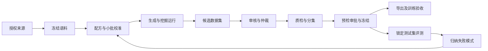

# DataFactory 训练数据制作平台产品设计

评审稿 v1.0 · 2026 年 11 月 17 日 · [打开前端交互原型](prototype/index.html#/overview)

实施依据见 [技术架构](TECHNICAL_ARCHITECTURE.md)、[开发计划](DEVELOPMENT_PLAN.md)与 [DataFactory 开发总则](../CLAUDE.md)。

面向检索与生成模型团队，将已授权的知识库、文档、查询和会话加工成可审核、可复现、可交付的微调数据。一个项目可以并行制作 Embedding、Reranker、LLM SFT 和 LLM 偏好数据。数据工程师从小批预览开始，领域专家核对证据并处理争议，质量负责人冻结版本，训练工程师按指定训练器格式接收。

原型以一个虚构的设备维护项目演示。打开 `prototype/index.html` 即可使用，页面导览列出全部 26 个入口。原型状态保存在当前浏览器，导览中的“清除演示变更”可恢复初始数据。

## 1. 商用产品调研

证据来自产品方公开文档、界面说明和演示。公开资料能确认产品提供的流程及数据输入约束。表中“设计转化”是本方案的产品决策。训练框架文档单列为数据契约依据。

| 商用产品与场景 | 公开可核对的产品能力 | 设计转化 |
| --- | --- | --- |
| Google Cloud Gemini Enterprise Agent Platform · Embedding 微调 | 微调工作流接收语料 JSONL、查询 JSONL 与查询到文档的相关性 TSV。可以提供单独验证和测试标签。 [Embedding 微调与数据集](https://docs.cloud.google.com/gemini-enterprise-agent-platform/models/tuning/embeddings) | 语料、查询与判定分别存储和版本化。交付页预览外键及数据划分。面向配对训练另外提供展开正负例的 JSONL。 |
| Amazon OpenSearch Service LTR · 商用重排 | 使用 judgment list 和查询侧特征。文档明确训练集构建与模型训练由外部系统完成。该 LTR 使用 XGBoost 或 Ranklib。 [LTR 工作流](https://docs.aws.amazon.com/opensearch-service/latest/developerguide/learning-to-rank.html) | 把相关性标签、特征和训练格式分开。冻结候选组并保存原始召回序位。用独立适配器交付 Cross-Encoder 或树模型所需数据。 |
| Elastic · 检索排序评价 | Rank Evaluation API 对一组查询及人工标级文档计算检索指标。Elastic Labs 说明了构建 judgment list 的工作方式。 [Rank Evaluation API](https://www.elastic.co/docs/api/doc/elasticsearch/operation/operation-rank-eval) · [Judgment lists](https://www.elastic.co/search-labs/blog/judgment-lists-search-query-relevance-elasticsearch) | 从指标钻取到查询、候选和相关性分级。基线与候选在相同数据和协议下比较。 |
| NVIDIA NeMo Platform Data Designer · 合成数据 | 可从已有数据集种子定义列、依赖与约束，由服务调度生成、批处理和验证。 [Data Designer Service](https://docs.nvidia.com/nemo/microservices/latest/design-synthetic-data-from-scratch-or-seeds/docker-compose.html) · [种子数据教程](https://docs.nvidia.com/nemo/microservices/26.3.1/data-designer/tutorials/seeding.html) | 使用类型化配方构建可重复的生成步骤。预览与正式运行绑定相同配置和版本，分别记录执行结果。 |
| Labelbox · 商业数据制作服务 | 请求标注时定义本体和指南，经小批校准进入规模生产。服务覆盖 SFT、偏好排序和模型评测。 [标注服务工作流](https://labelbox.com/blog/labeling-services-at-your-fingertips-discover-the-new-labelbox-workflow/) | 配方投入生产前先检查代表性样本。将不一致、低置信和敏感样本分派给专门队列。 |
| Scale AI Generative AI Data Engine · LLM 后训练 | 产品公开提供指令制作、人类反馈、偏好排序及质量运营。其偏好评测案例展示并排比较和跳过。 [数据引擎](https://scale.com/generative-ai-data-engine) · [偏好评测技术报告](https://static.scale.com/uploads/6019a18f03a4ae003acb1113/SEAL_Showdown_Tech_Report.pdf) | 偏好审核给同一输入的回答做匿名对照。保留平局、均不合格与证据不足，另设可裁决的队列。 |
| Label Studio Enterprise · 检查与复核 | 支持审核流、任务级与维度级一致度、质量看板，可跳到具体任务。 [审核流](https://docs.humansignal.com/guide/quality.html) · [一致度统计](https://docs.humansignal.com/guide/stats.html) | 工作台同屏展示样本和证据。质量规则带分母、状态、修复入口。抽检和多人标注版本化。 |
| Databricks MLflow · 反馈到评测 | 标注会话围绕已保存轨迹组织反馈。评测集可由轨迹、已有数据或合成例构建，具备受管版本和血缘。 [标注会话](https://docs.databricks.com/aws/en/mlflow3/genai/human-feedback/concepts/labeling-sessions) · [评测数据集](https://docs.databricks.com/aws/en/mlflow3/genai/eval-monitor/build-eval-dataset) | 将失败样本、专家反馈和版本比较纳入闭环。回流时创建制作候选，并保持锁定测试集独立。 |
| Microsoft Foundry / Amazon Bedrock · 微调入口 | Foundry 的 DPO 输入由共享对话和两条偏好输出组成。Bedrock 的 SFT 训练和验证数据由目标模型定义格式。 [Foundry DPO 格式](https://learn.microsoft.com/en-us/azure/foundry/openai/how-to/fine-tuning-direct-preference-optimization?view=foundry-classic) · [Bedrock 数据准备](https://docs.aws.amazon.com/bedrock/latest/userguide/model-customization-prepare.html) | 目标训练器、输入能力与格式版本是发布配置。导出标题同时显示任务、适配器和版本，校验失败时定位具体记录。 |

检索与重排训练器的官方资料分别证实了难负例采样、点式和组式训练输入的差别。FlagEmbedding Reranker 的蒸馏分数需要与正负例一一对应。TRL 的偏好数据可用结构化消息表示 prompt、chosen、rejected。 [Sentence Transformers 难负例](https://www.sbert.net/docs/package_reference/util/hard_negatives.html) · [Cross-Encoder Loss](https://sbert.net/docs/cross_encoder/loss_overview.html) · [FlagEmbedding Reranker](https://github.com/FlagOpen/FlagEmbedding/blob/master/examples/finetune/reranker/README.md) · [TRL 数据格式](https://huggingface.co/docs/trl/dataset_formats)

商用重排 API 与微调可用性要分别核对。Cohere 的文档仍列出历史 Rerank 微调入口，同时标明微调功能于 2025 年 9 月 15 日弃用。本方案的 Reranker 交付以可验证的本地训练器格式和明确的标签契约为基准。 [Cohere 微调状态](https://docs.cohere.com/docs/fine-tuning)

## 2. 产品定位与成功指标

### 使用者与工作目标

| 使用者 | 需要解决的问题 | 看到结果的地方 |
| --- | --- | --- |
| 项目管理员 | 接入资料与服务，授权成员，限制预算和内容出域 | 来源详情、模型连接、授权与预算、审计记录 |
| 数据工程师 | 按目标任务构建数据，发现来源、配置和运行错误，按版本重跑 | 语料快照、配方设计器、预览与运行详情、数据集 |
| 领域标注员 | 在有原文和明确量表的情况下完成判定 | 分配给我的队列、审核工作台 |
| 复核与质量负责人 | 处理高风险分歧，确认测试隔离和交付资格 | 质量中心、划分冲突、发布预检 |
| 训练工程师或服务账号 | 取得可消费、可检查和可追溯的训练数据，并对比模型效果 | 冻结版本、导出预览、评测报告 |

平台交付语料快照、标注后的数据版本、可验证的发布包和固定协议的比较报告。训练系统消费发布包，可将基线和候选结果回传评测。首批交付支持文本、表格/OCR 文本与多轮工具调用的结构化记录。图像、音频等资产表达为带类型、权限和哈希的引用，由目标适配器校验是否可用。

### 度量与验收目标

| 指标 | 定义与采集 | 评审建议 |
| --- | --- | --- |
| 首次预览耗时 | 新用户从已授权数据源进入，到检查 20 条样例的中位耗时 | 可用性测试目标 ≤ 15 分钟，分别记录操作和等待时间 |
| 可追溯率 | 已发布记录中可解析至语料版本、配方、运行和有效判定的比例 | 每次发布必须为 100%，证据失效进入阻断 |
| 小批采纳率 | 已校准样本中符合任务量表的样本数／有效复核样本数 | 分任务、语言、来源报告分母和区间，用首轮校准决定扩量门槛 |
| 假负例与分歧 | 人工确认假负例数／已抽检负例，及双人不一致数／重叠标注数 | 与来源、模型版本和置信度分桶联动，可钻取每项记录 |
| 单位制作成本 | 每千条通过审核样本的生成、筛查和人工工时 | 模型用量与人工工时分开显示，未知费用单列 |
| 导出可消费率 | 通过目标 schema 并能用固定训练器版本读取的条数／文件中的样本条数 | 正式发布 100%，不符合的样本在预检报告里定位 |
| 泄漏检查 | 同组或违规内容跨集合的数量 | 强制隔离策略下发布须为 0，允许的共享评测语料在协议中显式标明 |

## 3. 共用流程与领域模型

### 主流程

1. 项目管理员选择已处理的知识库、S3 兼容对象存储、CSV/JSONL 或脱敏日志。接入向导预览结构、可见文档、使用权、敏感分类和失败行。凭据使用服务端引用，授权到来源和对象范围。
2. 数据工程师冻结语料，选任务模板，指定种子分层、模型、量表、采样和预算。保存配方草稿，发起小批预览。
3. 领域专家核对代表性样本和标注量表。通过校准后锁定快照、配方、策略和模型记录，创建正式批次。失败可从已提交检查点继续，产出先进入候选数据集。
4. 人工处理冲突和低置信记录，复核高风险抽样。质量中心显示本次候选版本相关的检测结果，分配或撤回训练、验证、测试集合冲突。
5. 发布负责人确认预检，授权角色审批后冻结版本。训练工程师选目标适配器，预览文件映射，下载经过校验的包。
6. 使用冻结测试集比较基线与候选。可将待查失败模式登记为新制作需求，下一版使用独立的训练样本覆盖同类型问题。

RAGFlow 或其他上游负责原始文档解析、OCR、切片、语料向量化和建索引。DataFactory 接收已处理的片段及资产，或导入结构化数据，通过字段映射、冻结和划分来制作训练样本。源文档的切片规则作为上游元数据记录。

连接 RAGFlow 知识库时，项目管理员在 DataFactory 发起授权申请，资源所有者在 RAGFlow 批准指定库、文档范围和用途。项目可分别连接不同上游账号，将各自授权的语料纳入一个快照。使用已配置的模型时，从「模型连接」单独发起模型授权。账户、范围、有效期和撤回状态在项目内可查。 [跨账户连接设计](TECHNICAL_ARCHITECTURE.md#ragflow-connection)



### 对象与版本

| 对象 | 必须记录的内容 | 变更规则 |
| --- | --- | --- |
| 工作区、项目 | 所有者、成员、服务身份、区域、预算、出域策略 | 项目是权限边界，跨项目共享通过可审计授权 |
| 来源与授权 | 连接类型、对象范围、服务凭据引用、权利用途、有效期、最后检查时间 | 首次导入、派生训练、外部传输和下载分别授权 |
| 来源版本与语料快照 | 源对象 ID、授权连接、修订、捕获时间、上游解析/切片元数据、脱敏规则、稳定文档组键、内容哈希、资产引用 | 仅成功授权且校验后冻结。源更新产生新快照 |
| 文档、片段、素材 | 版本、语言、模态、位置、页码/行号/时间段、内容摘要与哈希、敏感级别 | 证据链接使用快照 ID 和片段定位。只读访问受当前权限约束 |
| 查询、候选、判定 | 允许多个正例和标签等级，保存召回通道、原始排序、模型分数及其模型与标尺、裁决依据 | 模型评分、人类标注和最终裁决各自保存。未判定单列 |
| 配方与运行 | 步骤依赖、Schema、模板/提示版本、快照、模型指纹、随机种子、调用预算与检查点 | 运行引用确定版本。修改草稿产生新运行输入版本 |
| 样本、数据集候选版 | 任务类型、来源、结构化标签、原始产出与修订历史、split、当前裁决版本 | 修订保留前版。有效输出用最新批准修订 |
| 审核项目与量表 | 负责人、分配范围、参考范例、量表版本、一致度、已完成数量和审查记录 | 隔离初审和仲裁。重审生成新记录，保留当时上下文 |
| 质量策略与报告 | 检测项、阈值、适用任务、分母、命中样本、警告豁免审批 | 变更策略后重新预检，发布记录冻结当时报告 |
| 冻结版本与导出任务 | 语料、样本和标注散列、策略、集合清单、适配器版本、产物哈希、消费方 | 冻结版为只读，可撤回分发。更正创建新版本 |
| 基准、评测运行 | 测试数据及 hash、基线和候选、评估器、召回协议、指标、样本层结果 | 基准独立锁定，有污染风险时停止出具该对比结论 |

每条样本含 `sample_id`、`task_type`、`schema_version`、`split`、`provenance_id`。血缘可解析到 `snapshot_id`、`recipe_version`、`run_id`、`review_revision` 和每段证据。内部用稳定引用减少复制，导出时按适配器解引用并校验。默认保留生成器条件、采样种子和实际输出。第三方模型可能存在非确定性，复现训练包时取冻结产物。

### 状态与恢复

| 对象 | 正常状态 | 异常与用户可执行动作 |
| --- | --- | --- |
| 来源 | 待授权 → 可访问 → 同步中 → 已同步 | 授权取消后停止新导入，拦截受限读取与发布。结构漂移时预览差异并确认新映射 |
| 运行 | 草稿 → 校准中 → 待确认 → 排队 → 运行中 → 已完成 | 失败、暂停、取消分别记录原因和当前批次。权限恢复或预算批准后复查并续跑。已完成批次复用，未结算调用按调用 ID 核账 |
| 样本 | 候选 → 待审 → 已标注 → 可用 | 待仲裁、退回、隔离各自计数。原因清楚地显示在来源和样本详情，修订后再次校验 |
| 发布 | 待预检 → 待审批 → 已冻结 → 可导出 | 未通过时跳到阻断源。输入修订使旧预检失效。撤回时禁用新下载并审计，保存已有交付记录 |
| 导出与评测 | 排队 → 执行 → 可下载／报告就绪 | 重投用相同版本与参数。权限复查失败时阻断，租约中断时复用已验证产物 |

## 4. 四类制作任务

| 任务 | 数据生产策略 | 审核人员看到的内容 | 发布前确认 |
| --- | --- | --- | --- |
| Embedding 检索 | 实际查询或基于证据的合成查询，支持同义改写与多正例。混合检索产生候选，按难度采样可验证的负例 | 查询、可高亮的原文、召回通道、正负难度、疑似假负例。词面相近但条件不符与可替代正例分开 | 每个有效查询有正例，正负不相交。需要显式负例的适配器检查数量。未审候选保留观察状态 |
| Reranker 重排 | 以查询和固定候选池为单位制作用于点式、对式、列表式训练的标签。保留同一查询候选组及原始召回次序 | 按等级和模型分数排列候选，可圈选证据和并排比较，允许并列、缺标和争议 | 候选组 ID、冻结池去重、标签量表、版本有效。导出对式数据时只生成不同等级且审批通过的对 |
| LLM 监督微调 SFT | 依据已授权语料、纯指令或经脱敏的多轮会话构造回答。每个 assistant 目标保留证据，可添加已验证的工具调用 | 时间顺序消息流、高亮证据、每轮是否训练、工具协议与请求返回，可编辑目标并送审 | 角色和消息次序合法，目标存在，引用可解，工具 schema 合法，私密字段已处理 |
| LLM 偏好 DPO | 针对同一上下文获得两条或多条候选，先去重和排除不合格输入，再匿名分派比较 | 相同提示并排 A/B，支持 A、B、平局、均不合格、需重写或证据不足。确认后可看闭合的争议记录 | 只有有效偏好进入 chosen/rejected；共享上下文、工具环境和消息序列一致，两条输出不同 |

### Embedding 的查询与负例

- 种子来源分清真实检索日志、人工编写、基于片段的生成和改写。标注语言、领域、查询意图、设备型号/版本、覆盖的证据集合。靠点击推断相关性的记录在审核前标成弱标签。
- 校验每条生成查询能从指定证据作答，剔除直接复述长段、泄漏目标答案、过度模板化、跨权限证据和无法恢复原文的记录。对短查询保留适用条件。
- 在同集合的候选池生成稀疏和稠密候选并记录各通道排行，教师模型评分用于候选排序和分桶。对已知正例、同族重复、包含或同义覆盖者做排除或转审核。在型号或时间条件有冲突时以具体证据判定。补充少量清晰负例用于校准分布。
- 分桶参数按已审样本校准。原始分值保留模型、尺度和指纹，多个模型的数值需分别校准。人工可以把疑似负例提升为正例、明确负例或隔离；操作可追溯并触发训练包预检。

### Reranker 的候选与标签

- 相关性量表建议为 0 无关、1 同主题无证据、2 补充证据或部分回答、3 明确回答且条件满足。未判定单列，不能自动转成 0。在候选中同时保留可直接回答、主题近似和明显无关的记录。
- 冻结检索快照、索引或候选清单、融合算法和 Top-K。验证持久的查询 ID 和候选组 ID，记录并列和候选重复折叠前后的序位。教师评分以建议展示，盲审阶段可隐藏它。
- 点式交付 query、passage、grade，成对交付同查询下优先与次选，列表交付候选数组和有效等级。对蒸馏输出保存同一教师批内的数值尺度，按数组顺序输出。传统 LTR 若要加入请求时特征，另冻结特征 Schema 与产出时间。
- 评测区分条件重排性能与端到端结果。固定线上候选并报告正例未召回数，单列注入正例的诊断实验。在同一个统计口径下用 nDCG@K、MRR@K 或已定义的业务分级比较。

### LLM 的证据、工具和偏好

- SFT 目标可以是指令遵循、证据问答、结构化抽取、工具调用或拒答。录入 `system`、`user`、`assistant` 与 `tool` 角色，显示哪些轮次参与训练。敏感日志脱敏并做唯一性和证据检查。已知答案和证据若矛盾，送人工回看并可修订。
- 工具定义、允许参数、标识符、调用与返回配对、超时/失败分支和输出 Schema 都按版本保存。运行校验在隔离环境用固定返回值，避免样本校验触发实际业务操作。
- 偏好标签包含具体维度和证据，建议包括事实性、完整度、任务约束、引用正确性和安全性。同一上下文经内容哈希校验，A/B 顺序按记录与标注者确定并归档。两个答案都不合格进入退回，平局留作统计与后续制作。
- 每个争议保留两次独立的标注及最终仲裁，删除敏感内容后重建配对。评测采用锁定提示、相同工具环境和评分量表，覆盖模型判分与人工校准。一致度和胜率披露分母、弃权比例与抽样方式。

### 交付契约示例

下面是一条检索训练记录的内部形态。其他任务保留相同版本与血缘字段，payload 结构由任务 schema 限定。

```json
{
  "sample_id": "E-0317",
  "task_type": "embedding_retrieval",
  "schema_version": 1,
  "split": "train",
  "provenance_id": "lineage-0317",
  "query": { "query_id": "q-317", "text": "收到 E17 超温报警后，应先检查什么？" },
  "positives": [{ "segment_id": "seg-64", "grade": 3 }],
  "negatives": [{ "segment_id": "seg-71", "grade": 0, "reason": "不同故障码" }]
}
```

| 导出适配器 | 输出最小结构 | 合同检查 |
| --- | --- | --- |
| Google Cloud Embedding / 检索相关性包 | `corpus.jsonl`、`queries.jsonl`、各集合 `query-id\tcorpus-id\tscore` | JSONL 引用的 ID 存在、唯一且符合分集策略。实际调用前检查目标平台当前参数和训练规模。 [Google Cloud 数据集规格](https://docs.cloud.google.com/gemini-enterprise-agent-platform/models/tuning/embeddings) |
| Embedding 训练 JSONL | 物化 `query`、`pos[]`、`neg[]`，供明确配置的训练器使用 | 记录选择正例和从批次取负例的规则，保护多正例。 [FlagEmbedding 数据加载契约](https://github.com/FlagOpen/FlagEmbedding/blob/master/FlagEmbedding/abc/finetune/embedder/AbsDataset.py) |
| Reranker / FlagEmbedding | 候选组、有等级的对或 JSONL `query`、`pos[]`、`neg[]` 和可选同序教师分 | 预检最小组大小、分数数组与语料字段兼容性。 [FlagEmbedding Reranker 数据格式](https://github.com/FlagOpen/FlagEmbedding/blob/master/examples/finetune/reranker/README.md) |
| LLM SFT | 按选定训练器的 `messages[]` 或提示与完成对象 | 按模型模板验证长度、角色、工具、多模态和训练轮次。 [TRL 数据格式](https://huggingface.co/docs/trl/dataset_formats) |
| LLM 偏好 / TRL 或 Foundry | TRL 输出 `prompt/chosen/rejected`；Foundry 输出 `input/preferred_output/non_preferred_output` | 两个目标从同一上下文转写，拒绝平局、等价重复和超长样本。 [TRL DPO](https://huggingface.co/docs/trl/main/dpo_trainer) · [Foundry DPO 数据规格](https://learn.microsoft.com/en-us/azure/foundry/openai/how-to/fine-tuning-direct-preference-optimization?view=foundry-classic) |

## 5. 质检、划分和交付

### 质量规则

| 规则 | 检查口径 | 反馈和处置 |
| --- | --- | --- |
| 权利与内容安全 | 每个源对象的训练、模型出域、导出许可，针对内容扫描敏感字段和来源风险 | 缺权利、待审敏感信息或外部请求受限是阻断。由来源负责人重授或脱敏，预检后恢复 |
| 结构和引用 | JSON Schema、段落与附件可读、版本归属、消息角色和目标格式限制 | 字段级错误定位到样本、对象和行号。可以修订或隔离受影响样本 |
| 语料覆盖 | 分语言、模态、来源、业务主题、问题难度与集合计数 | 显示有效分母及缺失类别，抽取补足样本。阈值来自业务校准 |
| 证据与标签 | 正例符合问题条件、可解引用、负例排除，重排等级经核验，SFT 有效目标，偏好上下文一致 | 待裁决和不合格样本阻断或移出交付范围，变更记录和重新送审可审计 |
| 一致度与复核 | 分层抽检、固定重叠任务、审核员和标签版本、争议类别 | 比对维度级结果并复核误差。裁决阈值可在项目校准。硬性审批项无直接豁免 |
| 重复和污染 | 规范化哈希、同族、近重复、同查询或共享祖先的派生关系，含训练与锁定测试重合 | 报告组、受影响集合和证据。改分组策略须预览差异并重算受影响版本 |
| 目标训练器 | 将所选版本序列化并用固定加载器读回，校验编码、长度、分割、模态、权重、外键及行数 | 按适配器出具可消费报告。支持按批准子集重新冻结。每种格式单独通过 |

质量报告区分阻断、需要确认的告警和建议，并显示频数、受影响的候选行数、检查时间、规则版本。告警豁免绑定具体候选版与审批人，有到期时间。质量负责人至少能从一项失败跳到相应样本或授权范围，修复后只重算受影响的检查。界面显示最后一次成功检查的时间及其输入版本。

### 划分与防污染

1. 在生成和挖掘前确定候选语料与锁定测试集。对源修订、同一文档家族、已确认近重复片段、同一查询家族及同会话派生物计算关联组。相似边可由人工核验，显示组过大和互联原因，避免低质量匹配合并大量文档。
2. 按组而非按样本稳定分配，默认目标 80/10/10 和可复查的随机种子。语言、主题和难度分层，记录实际比例、无法满足的最小组及偏差。微调样本的所有正例、负例及上下文引用检查与目标集合兼容。
3. 固定评测允许配置“隔离语料”或“共享检索语料”协议。共享协议下测试查询和人工判断保持隔离，允许共享的索引版本和文档范围显式记录。默认采用隔离语料。评测结果始终显示协议和固定候选数。
4. 新增记录或改判时沿用已有组与集合，冲突进入策略复审。评测回流只使用抽象错误模式或重新采集的训练组，原测试内容和派生改写继续锁定。维护与冻结版本有关的分组哈希和相交检查记录。

### 发布与交付清单

发布审批基于精确候选版本。预检通过后把样本有效修订、来源权利、分组、量表、模型、脱敏策略与报告绑定为一次签名申请。审批中的记录变更使申请需要更新。多人提交同一申请复用发布 ID，冻结阶段再次核验权限与版本。

交付包包含 `manifest.json`、每集合的训练文件、可分发资产、数据卡、质检报告和 `checksums.sha256`。清单记录项目与版本、创建和审批主体、目标格式版本、实际样本数、缺省规则、语言、限制用途、许可摘要、血缘索引和文件哈希。每个文件可在页面按字节和行数核对。资产绑定相同访问控制。训练工程师先预览前几条与排除样本，再发起后台打包。

相同冻结版本与导出配置应得到相同的数据文件哈希。下载按授权发短期链接并记审计。撤回记录说明原因、影响版本和已交付对象，供数据负责人通知消费方并处理保存的副本。更正后重新审批并发布新版本。

## 6. 导航与界面规范

左侧按工作阶段组织，顶栏显示项目、路径和页面导览。资源列表与详情使用可分享的筛选定位，返回列表保留原页和查询。页头给名称、版本/用途和一个主要操作。列表中状态、时间和大小可扫描，概览的统计和待办链接到具体可执行页面。

| 区域 | 设计 |
| --- | --- |
| 工作区 | 项目总览显示语料、候选样本、待审和冻结版。最近运行和待处理阻断占据首屏 |
| 数据准备 | 数据源、语料快照、配方库。侧边导航在详情页保持父级选中 |
| 数据生产 | 运行、数据集、标注审核、质量中心。同一数据任务的切换入口使用一致顺序 |
| 交付与治理 | 发布、导出、评测、模型连接、项目设置。设置下有成员授权、预算和审计 |

桌面布局采用深蓝导航与浅灰工作区。主操作用深青色，内容区以白底卡片区分任务。列表使用密度适中的行高，详情桌面为内容与上下文双列，样本详情留足文本宽度。审核判定与原文证据同屏。宽度不足时导航折叠，详情单列，长表在自身区域滚动。移动端优先保证查看、筛选、审核和预检，复杂多列对照采用上下排列。

字体优先使用 Inter 和系统中文字体。桌面一级标题约 34px，内容 14px，表格 13px，标识符用等宽字体。控件、卡片使用统一圆角和边距，文本字号与层级保持一致。状态以文字和圆点同时表达，常规正文及表单文字的对比度按 WCAG AA 验收。保留可见焦点、原生表单校验、跳到主内容、可关闭弹窗和语义表头，表格滚动容器可用键盘聚焦。主要操作在提交后显示进度与失败重试。列表骨架保留几何结构，空表提供创建或清除筛选的入口，部分失败显示成功数、失败数和复查链接。

## 7. 逐页设计与交互

每行的入口链接指向原型中的对应页面。页级规范同时覆盖正式产品需求和原型的演示场景。登录、数据授权、模型调用、数据生产和审批在原型里以本地状态演示。

### 数据准备与运行

| 页面 | 页面结构和关键操作 | 页面验收条件 |
| --- | --- | --- |
| [01 登录](prototype/index.html#/login) | 左侧品牌和产品名称，右侧组织账户入口。存在多个组织时显示组织选择和最近项目。会话过期后回到原操作位置 | 登录失败、连接中、授权不足与回跳均有明确提示。原型按钮进入设备知识库项目 |
| [02 项目总览](prototype/index.html#/overview) | 顶部四项指标。左中区显示制作阶段，右中区显示当前阻断，底部分布与最近运行。主按钮选任务进入配方 | 待处理项可定位到审核或划分，完成处置后计数更新。空项目主操作为接入来源 |
| [03 数据源列表](prototype/index.html#/sources) | 名称、类型、范围、文档数、状态与同步时间。支持按名称、类型或状态筛选，连接行可打开详情 | 无匹配显示空状态。挂起授权的来源保留状态和请求授权入口 |
| [04 接入数据源](prototype/index.html#/source-new) | 选择知识库、对象存储、CSV/JSONL 或脱敏日志。RAGFlow 来源按实例创建批准链接，在当前页面查看状态、批准账号及可选库；文件导入预览字段和失败行 | 对象范围改变需重新批准。两个账户分别授权后可独立选库和撤回。原型展示接入页与确认布局 |
| [05 来源详情](prototype/index.html#/source/kb) | 上方来源名称与同步状态，左侧预览/差异/导入记录，右侧权利、版本、归属、最近同步。允许重新验证和创建快照 | 待授权来源不可检视语料；更新源保留冻结版本；部分同步展示失败原因和可重试对象 |
| [06 语料快照](prototype/index.html#/corpus) | 列表显示语料数、来源、冻结时间、版本及权利状态。“冻结快照”弹窗按连接选择已授权库、已处理文档和版本，确认权限范围及名称 | 支持一次冻结多个已授权来源。来源不可用或版本变化时标明影响的连接与资源 |
| [07 快照详情](prototype/index.html#/snapshot/snap-013) | 语言、模态、长度与重复率指标；可按来源、模态、敏感级别、语言筛选文档；列表可钻取语料 | 冻结页面可见输入来源版本与内容哈希；源更新时显示可创建新版本 |
| [08 语料检视](prototype/index.html#/document/doc-126) | 左侧按位置定位原文、片段或媒体；右侧元数据、权限、家族 ID、相似段和下游引用 | 样本证据可跳到对应组成和位置。权限取消显示原因，证据不可用状态可进入质量报告 |
| [09 配方库](prototype/index.html#/recipes) | 按任务、版本和作者筛选。支持打开、从现有稳定版复制和归档草稿 | 被引用旧版可查看。归档与修改保留引用，删除不使已冻结运行断链 |
| [10 模板库](prototype/index.html#/templates) | 四类任务卡片说明输入、步骤和输出。支持语言覆盖、行业模板和目标适配器说明 | 选择模板后打开类型对应的配方，默认任务字段和输出示例相符 |
| [11 配方设计器](prototype/index.html#/recipe?type=embed) | 左栏按顺序呈现节点，右栏编辑节点参数、模型、标注规则、提示和输出契约。校验缺失依赖，提供预算与小批预览 | 可看步骤错误和字段级提示。运行弹窗固定选择的快照、模型版本和限额。原型展示模板步骤和配置表单 |
| [12 运行列表](prototype/index.html#/runs) | 状态、任务、版本、运行模式、进度、开销。可筛选，失败或暂停支持定位到原因 | 预览和正式批次有明确标识。运行结果保留分页筛选和状态更新时间 |
| [13 运行详情](prototype/index.html#/run/RUN-104) | 进度与输入固定显示；步骤时间线、产出预览与调用明细分标签。暂停、继续、终止根据状态可用 | 支持部分完成、可恢复失败和未知费用展示。暂停后续跑复用检查点，到达阈值阻止继续发起模型调用 |

### 数据集、审核与发布

| 页面 | 页面结构和关键操作 | 页面验收条件 |
| --- | --- | --- |
| [14 数据集列表](prototype/index.html#/datasets) | 四类任务卡片或表格，显示候选、待审、已发布和最近运行，按任务过滤 | 数据集卡片链接到对应类型详情。无数据时指向适用模板或导入 |
| [15 数据集详情](prototype/index.html#/dataset?type=rerank) | 样本、分布、版本与血缘。表格按样本 ID、内容、问题、状态、语言与集合筛选。支持保存视图和批量入队 | 查询、对话和偏好记录使用各自列布局，待审核和隔离数量可核对；分页筛选一致 |
| [16 样本详情](prototype/index.html#/sample/S-0093) | 左侧任务样式的记录内容和编辑历史。右侧评分、集合、来源证据和版本。预览原始输出与最终判定 | 可从查询、候选、每轮或偏好结果定位对应证据。历史修订可比对，失效引用可报告 |
| [17 标注审核队列](prototype/index.html#/queues?type=dpo) | 按任务、风险、指派人、积压、原因和状态筛选。运营可创建分层抽检并配置双标 | 冲突与高风险可升级仲裁。领取与到期释放可审计，重复领取会显示当前持有人 |
| [18 审核工作台](prototype/index.html#/review/E-0317) | 样本及证据在左，规则和提交在右。Embedding 显示正负候选，Reranker 显示等级决策，SFT 显示对话及工具，偏好显示匿名 A/B | 退回、修订、跳过和仲裁均有明确状态。并发修订会提示复核最新版本，快捷键在表单输入时禁用 |
| [19 质量中心](prototype/index.html#/quality) | 计数、规则状态、类目/版本对照、受影响分母和定位链接。支持重跑检测与告警审批 | 每项阻断可钻取具体任务，修复后指标随候选版刷新。旧预检留档 |
| [20 数据划分](prototype/index.html#/split) | 选择分组策略、集合比例、种子和锁定测试集，查看实际分布、冲突组和影响样本，再应用 | 百分比求和错误被拦截。锁定测试不得被普通重分配覆盖。原型可将同族记录归到同一集合 |
| [21 发布与导出](prototype/index.html#/releases) | 显示各数据集的候选状态、已冻结版本、撤回状态和下载任务，能比较版本的新增与排除 | 仅授权的可下载版本显示导出入口。可独立查看候选预检和冻结包 |
| [22 发布预检](prototype/index.html#/release?type=embed) | 主区显示阻断或通过状态和检查表，右侧显示快照、策略、审核与待冻结版本。责任人确认范围和审批 | 先通过阻断后允许审批。预检后内容改变时需更新申请。已有冻结版保留历史报告 |
| [23 导出预览](prototype/index.html#/export?type=embed) | 切换目标格式、集合与文件。显示字段映射、样本、可用资产、预估大小和拒收行。发布包异步打包 | 缺冻结版本提示返回预检，格式不支持时精准提示原因。原型可下载选定格式的一条样例 |

### 比较、连接与治理

| 页面 | 页面结构和关键操作 | 页面验收条件 |
| --- | --- | --- |
| [24 基准评测](prototype/index.html#/evaluation?type=rerank) | 选择任务、测试版本、基线与候选和指标协议。对比指标与样本，按误差类型筛选并创建制作需求 | 两组输入数据或评估器版本不一致时禁止直接比较。可定位每项差异对应的样本和评测协议 |
| [25 模型连接](prototype/index.html#/models) | 为项目单独申请 RAGFlow 模型授权。连接列出已批准模型、能力、版本、速率、输入上限、成本和出域边界。支持连接诊断 | 配方只选择已授权且满足能力的模型。过期、撤回、模型变化和额度不足能定位。仍由 RAGFlow 管理供应商凭据 |
| [26 项目设置](prototype/index.html#/settings) | 成员与授权、出域政策与预算、审计事件。改变关键策略需预览受影响范围。审计支持按事件主体、对象和时间筛选 | 最小权限、预算分层及回滚历史策略可查。原型可更改演示预算并查看审计记录 |

审核专用布局预留证据行标记和下一条导航。正式版本推荐用 J/K 浏览任务、数字做等级标签，显式按钮和二次确认处理退回及仲裁。不同任务的字段、输入限制和操作状态在工作台内呈现，避免操作者切去设置查找量表。

## 8. 权限、运行 API 与系统约束

### 权限和数据安全

| 操作 | 项目管理员 | 数据工程师 | 标注员 | 质量负责人 | 训练工程师 |
| --- | --- | --- | --- | --- | --- |
| 授权来源和模型、变更项目预算 | 管理 | 可申请 | 无 | 可申请 | 无 |
| 查看原文 | 按授权范围 | 按授权范围 | 仅分配任务的证据 | 按复核范围 | 仅允许交付的内容 |
| 配方、运行、候选样本修订 | 可授权 | 管理 | 仅提交标注 | 可指派复查 | 只读 |
| 裁决、审批、冻结 | 可分配 | 可提交申请 | 无 | 可审批，双人策略分离身份 | 只读 |
| 导出与评测 | 管理范围 | 可申请 | 无 | 可检查 | 读取批准版本与运行评测 |

校验从工作区到项目再到资源、数据用途和访问主体。DataFactory 使用独立 OIDC 登录及项目角色。连接凭据存入服务端密钥系统，异步作业使用受限服务身份及发起人权限。多个来源逐一验证授权范围，组合样本按各来源用途限制的交集处理。日志记录主体、范围、对象和诊断码，可审计变更、审批与数据访问。

处理外部模型调用前，按任务检查模型的提供方、所在区域、输入能力、最大长度、速率和许可出域的字段。图片等资产访问使用临时令牌，撤权后失效。隔离来源变更和分发撤回均显示受影响项目、作业和版本。组织设置记录保留期、复核周期和批准的导出对象。

### 产品接口边界

| 能力 | 建议资源与交互 | 并发和失败语义 |
| --- | --- | --- |
| 来源、语料 | `POST /sources` 登记，`POST /source-imports` 预检或执行。 `POST /snapshots` 冻结， `GET /snapshots/{id}/documents` 分页 | 导入批次可重放，持久化对象版本，部分失败可按对象重试。授权撤销时阻断 |
| 配方与运行 | `PUT /recipes/{id}/draft` 保存草稿，`POST /runs` 绑定不可变输入和模式，`GET /runs/{id}/events` 返回有序增量 | 修改草稿需要修订号，重复创建按幂等键返回同一记录。请求超时可查作业 ID 和账目，无需重新发起 |
| 数据集与审核 | `GET /datasets/{id}/samples` 游标筛选，`POST /review-tasks` 入队，`POST /reviews` 保存意见与证据 | 标注、修订和仲裁分别写记录。过期修订响应冲突并返回最新记录，用户核对再提交 |
| 质检与发布 | `POST /quality-checks` 获取版本化报告，`POST /split-proposals` 预览，`POST /releases` 提交冻结申请 | 预检报告绑定内容、策略和权限版本。冻结提交时重新验证，写入与报告关联原子完成 |
| 交付与评测 | `POST /exports` 指定冻结版本和适配器。 `POST /evaluations` 绑定测试集、候选集、模型和指标协议 | 幂等生成产物。页内能查看进度、错误记录、校验文件和续传入口。评测失败保留可诊断阶段 |

API 使用明确错误码和请求 ID。会话过期返回重新登录状态，资源无权和不存在可按组织策略合并。运行检查点保存分片范围、哈希、版本和执行尝试号。发起模型调用先预留预算，返回后按实际使用结算，未明确是否计费的调用列为待核账。每批写入须校验运行代次，取消后停止新调用并保留已完成产物。

后台采用任务队列、对象存储和元数据数据库，页面列表依靠服务器游标与筛选，性能目标在真实负载测试后复核。建议以十万候选记录验证分页、筛选、样本比较和导出排队，可见内容优先加载。服务监控覆盖来源失败、模型响应、待审积压、质量阻断和导出延迟。工作区能够为失败批次追溯请求与幂等键。

## 9. 分期与验收

阶段 0 至阶段 5 的实现顺序、页面分配和验证矩阵见 [开发计划](DEVELOPMENT_PLAN.md)。

| 阶段 | 交付能力 | 阶段进入条件 |
| --- | --- | --- |
| 第一阶段 · 检索闭环 | 来源授权、语料快照、Embedding 与 Reranker 文本模板、小批校准、候选审核、分组隔离、冻结与基础训练适配器 | 正负例和等级契约测试、权限测试、发布门禁与实训加载验收通过 |
| 第二阶段 · LLM 闭环 | 多轮消息与工具 schema、SFT 与 DPO 编辑、任务指派和仲裁、分层抽检，TRL/Foundry 等适配器 | 证据与工具模拟可复查、盲审一致度可计算、训练器读取通过及自定义模型边界校验通过 |
| 第三阶段 · 企业规模 | 多来源变更、批量队列、版本对比、基准评测、回流、预算和完整审计、多模态适配器 | 验证部分失败恢复、评测锁定与权限回收，完成规模、时延和数据隔离压测 |

### 正式产品验收场景

1. 从两个授权来源创建快照后更新其中一处。已有运行和发布仍解析冻结时的来源，新的预览能独立选择新快照。
2. 同一查询命中同义正确段落和编号相近的无关段落。前者转人工确认后可提升为正例，后者作为有依据的负例。人工修订、原判定和教师分均可查看。
3. Reranker 切换到标注台后以固定候选比较。缺标、重复候选、同分 pair、教师分数量错位均被识别，导出只使用审批后的标签。
4. SFT 工具调用参数超出允许范围，或 tool 结果缺调用 ID。校验定位消息与字段，拒绝发布。修复后可以用固定工具返回值复核。
5. DPO 比较双方来自不同提示时无法形成有效偏好对。相同提示下可提交 A、B 或弃权，弃权计入质量统计并排除训练对。
6. 手册不同修订和改写查询落到训练与验证两边。重分组后查看影响记录，重新预检确认交叉为零，已锁定测试集保持独立。
7. 运行中止、进程重启或预算耗尽时，已提交批次不重复生成。预算恢复后仅继续允许的批次；疑似计费先核账。
8. 发布申请通过后改变审核结论，旧申请应提示需要更新。二次提交同一个幂等请求只创建一份版本。越权账号无法打开样本证据或领取导出链接。
9. 同一冻结版本两次打包保持数据文件哈希一致。训练器能够读取夹具，导出超限记录在报告中有 ID 和原因。
10. 比较两个模型时锁定测试查询、候选快照、评估器和参数。评测的差异可回溯到记录，基准报告注明覆盖与分母。

### 原型评审路径

- 由[总览](prototype/index.html#/overview)开始，使用“新建制作任务”选择任一任务。进入配方选步骤、保存配置、发起小批预览，再切换到运行详情的“产出预览”。
- 在[Embedding 审核](prototype/index.html#/review/E-0317)输入证据依据，选择“标为正例”。接着在[数据划分](prototype/index.html#/split)执行“按家族重新分组”，回到[发布预检](prototype/index.html#/release?type=embed)确认并冻结。
- 访问[导出预览](prototype/index.html#/export?type=embed)，切换 Embedding JSONL 或检索标签 TSV，下载对应的一条示例。SFT、Reranker 和偏好同样可从各自任务标签查看不同记录样式。
- 可切换[基准评测](prototype/index.html#/evaluation?type=rerank)的指标和回归样本，在[项目设置](prototype/index.html#/settings?tab=budget)调整演示预算并观察审计事件。

本版原型已在 Chrome 从本地文件打开验证。26 页均在 1440px、390px 和 320px 宽度下完成渲染检查。交互验证覆盖来源授权、快照冻结、配置与预览、样本筛选、两处发布阻断及修复、TSV 下载、偏好裁决、独立测试样本、预算及审计。数据生产、评测结果、组织身份和权限变更均使用虚构样例。
