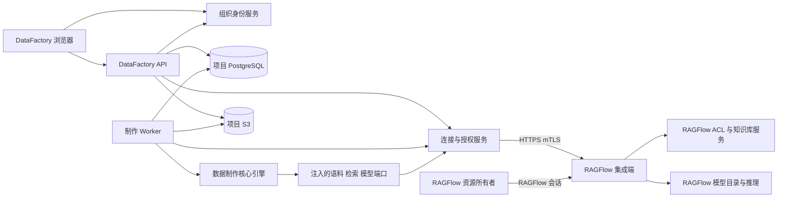
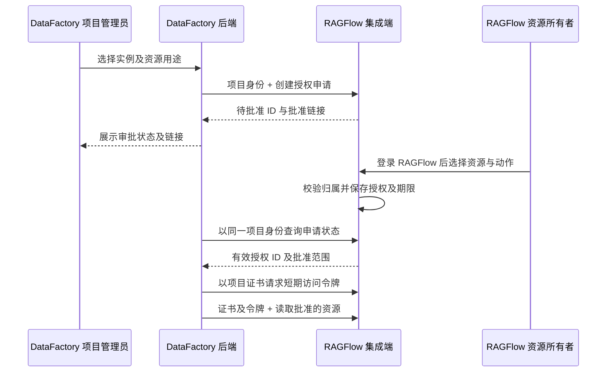

# DataFactory 产品技术架构设计

实施设计 v1.0 · 2026 年 11 月 17 日

业务范围与 26 页界面以[产品设计](PRODUCT_DESIGN.md)和[交互原型](prototype/index.html)为准。实施顺序见[开发计划](DEVELOPMENT_PLAN.md)，各模块约束见[开发总则](../CLAUDE.md)。代码核对基线为 `arch_dev` 的 `fade581`。基线含 RAGFlow 原生 API 与后端服务，DataFactory 目录提供产品设计和原型。本文中的 DataFactory 服务、授权接口及目录均为实施目标。

## 1. 系统边界与依赖

| 组件 | 职责 | 所有权 |
| --- | --- | --- |
| DataFactory Web | 项目、连接、制作、审核、质检、导出与评测工作台 | 独立 SPA，以 DataFactory OpenAPI 为数据契约 |
| DataFactory API | 独立登录与项目 RBAC、授权申请、源和模型配置、版本、队列、发布 | 自有 PostgreSQL 元数据和审计，不读取上游数据表 |
| DataFactory Worker | 领取异步作业，检验授权和预算，驱动引擎，提交检查点与产物 | 与 API 共用领域服务和仓储，进程和资源限额独立 |
| 数据制作核心引擎 | 配方编译、批处理、候选生成、标注规则、去重和分组、任务样本与门禁计算 | 独立 Python 包，以类型化端口获取语料、召回、模型和检查点 |
| DataFactory 对象存储 | 快照、媒体、批次产物、报告和冻结交付包 | 自有 S3 兼容存储。每环境独立桶及服务身份 |
| RAGFlow 集成端 | 在 RAGFlow 权限体系下批准项目授权，复用知识库读取、检索、资产和模型调用 | 独立版本的 HTTP 契约。授权记录、模型凭据和生产索引由 RAGFlow 侧管理 |

RAGFlow 或同类上游负责原文解析、OCR、切片、知识库语料向量化和建索引。DataFactory 冻结已处理内容，或直接读取结构化记录，制作训练样本。DataFactory 可编码自己生成的查询、调用教师模型和运行评测。文档切片版本来自上游，训练/验证/测试划分由制作引擎负责。



DataFactory 运行时不依赖 RAGFlow Python/Go 模块、数据库、对象桶、索引或队列。连接能力通过端口注入。文件来源可独立导入、预览、人工审核和导出；依赖模型的步骤由所选 ModelPort 提供，运行前验证可用性与授权。浏览器的数据请求均落在 DataFactory API，RAGFlow 浏览器页面仅用于用户批准 RAGFlow 资源。

### 组件与基线

- `datafactory/engine/` 是可安装的 Python 引擎包，包含领域类型、端口、配方、执行及任务适配。引擎只依赖自身领域与端口。
- `datafactory/backend/` 提供 FastAPI、SQLAlchemy、Alembic、HTTP 连接适配、对象仓储和 Worker。Python 3.13 作为计划基线。DataFactory 使用独立 uv workspace 与锁文件。
- `datafactory/web/` 使用 React、TypeScript、Vite、React Router 和 TanStack Query。按原型构建共享布局、表格、状态和证据检视组件。客户端类型由 OpenAPI 生成。
- 后台第一版统一采用 PostgreSQL 持久化队列与事件表。行级锁、租约和尝试代次用于多 Worker。事件提交随业务事务，SSE 读取有序事件。Parquet 保存批次样本，JSONL/TSV 等由交付适配器生成。
- RAGFlow 集成端先落在 Python 服务边界，基于目标实例协商其独立契约和能力。RAGFlow 现有 Go 路由也存在数据集、检索与模型路由，集成合同需各目标实现通过探针和契约测试后才登记为支持。DataFactory 的前端和引擎不按上游语言分支。 [Go 路由](../../internal/router/router.go#L343)

## 2. 数据源与快照

| 来源 | 可以读取的内容 | 接入与校验 |
| --- | --- | --- |
| RAGFlow 知识库 | 已处理且可用的知识库、文档、片段、页码/区域和获准的关联媒体 | 选择已登记实例，获得指定库授权后按修订读取。上游未处理、处理中或修订漂移的文档使该读取任务待处理或失败 |
| S3 兼容存储 | 已切片语料清单、结构化数据文件、清单引用的媒体 | 限定来源桶及前缀的只读服务身份。使用对象版本或 ETag 和内容哈希校验导入一致性。RAGFlow 来源由其集成端提供 |
| CSV / JSONL | 查询、切片、相关性、SFT 消息、偏好对及已批准标注 | 按已版本化 Schema 预览、字段映射、隔离坏行。可指定行数上限，报告具体输入行号 |
| 脱敏业务日志 | 检索和点击、工单、会话及模型反馈 | 以结构化文件批量接入。独立日志连接在后续阶段使用相同记录契约，按时间窗、水位和事件 ID 增量读取 |

PDF、Word、图片扫描件等原始文档进入 RAGFlow 或其他约定的上游处理流程。在 DataFactory 选源时显示已处理与可读取状态，原始文档可给出上游处理入口。CSV/JSONL 的行解码、规范化、脱敏检查和字段映射属于导入。每段语料用带类型的内容部件表达，二进制媒体以项目内资产 ID 与 SHA-256 引用。预览来自批准的对象副本，保留来源版本与位置。

### 身份、版本与原子冻结

1. 每个来源引用使用 `instance_id + connection_id + upstream_resource_id`。片段进一步包含库、文档、上游片段 ID 与修订。标题或单独的上游片段 ID不能充当全局主键。
2. 每个库的读取请求先绑定稳定的文档范围、修订和检索版本。RAGFlow 集成端提供带版本的捕获清单与有序游标，使用上游可验证的稳定读取视图或单调修订作校验。读取起止、每页计数、重复键、内容哈希和媒体引用均须验证。源更新中、重复页、漏页或缺稳定视图时返回显式冲突并重捕获。标题、更新时间或当前页条数不能独立证明一致性。
3. Worker 将数据流式写到源隔离的暂存前缀，记录每库修订与校验结果。所有选中来源成功且授权仍有效后，用同一事务提交清单、最终对象引用与 `READY`。失败保留可诊断条目，暂存带寿命清理；界面可明确缩小来源范围后发起新快照。多个库各自绑定已验证修订，清单分别记录捕获时间。
4. 外部证据经清单映射到冻结片段。发布和评测引用内部不变 ID，可按授权显示当时的源元信息。当上游改名、重切或停用时，冻结引用及哈希保持稳定。授权撤销的生命周期见下节。

## 3. 复用 RAGFlow 的现有能力

| 能力 | 已核对的实现 | 集成端接入方式 |
| --- | --- | --- |
| 会话和原生 API Key | Python `_load_user` 根据 API Token 查 `tenant_id`，再解析用户。Token 的管理按所有者租户。公开数据集 API 以 Bearer API Key 鉴别身份。 [鉴权](../../api/apps/__init__.py#L148) · [Token 管理](../../api/apps/restful_apis/system_api.py#L318) · [官方 HTTP API](https://ragflow.io/docs/http_api_reference#list-datasets) | 上游会话只验证资源批准者。原生 API Key 可用于隔离环境的原生接口探针；项目连接由后文的资源授权表达。 |
| 可见知识库与文档 | `GET /api/v1/datasets`、`GET /api/v1/datasets/{id}/documents`。 `KnowledgebaseService.accessible` 检查有效状态、所有者和团队可见性。 [库列表](../../api/apps/services/dataset_api_service.py#L422) · [访问检查](../../api/db/services/knowledgebase_service.py#L569) · [文档列表](../../api/apps/restful_apis/document_api.py#L721) | 复用权限和列表服务，在集成端加上已批准库/文档范围。每次读取按实际文档归属联合校验。上游可读与可委托给外部项目分别判断。 |
| 已有切片 | 文档切片 API 返回内容、文档和库 ID、可用性、图像 ID 与位置。 `Dealer.chunk_list` 默认有取数上限，可分页。 [切片接口](../../api/apps/restful_apis/chunk_api.py#L545) · [分页实现](../../rag/nlp/search.py#L817) | 由上游内部服务建立捕获和完整游标，显式过滤库与文档并核对可用性。契约测试覆盖超过默认上限的文档。 |
| 资产 | 现有图片接口基于登录并解析对象名称读取存储。 [图片读取](../../api/apps/restful_apis/document_api.py#L1831) | 新集成端只读取已授权片段清单中引用的资产，校验库、文档、片段和对象引用。DataFactory 使用本方临时授权的下载端点预览冻结资产。 |
| 检索 | `POST /api/v1/retrieval` 校验所有请求库、文档归属与 Embedding 兼容性，复用现有检索器。 [检索入口](../../api/apps/restful_apis/chunk_api.py#L335) · [模型一致性检查](../../api/db/services/knowledgebase_service.py#L62) | 调用同一底层检索服务，锁定单库与授权文档范围，捕获模型与索引版本及召回通道。图谱、TOC 扩展与隐式额外模型调用不进入首批集成能力。 |
| 模型目录 | `GET /api/v1/models` 列出账户或可访问租户模型，返回模型 ID、类型和实例信息。内部查询含确保部分内置模型登记的逻辑。 [模型路由](../../api/apps/restful_apis/models_api.py#L31) · [目录组装](../../api/apps/services/models_api_service.py#L293) | 集成端只读投影已授权且可用的模型。上游记录缺持久 ID 的内置模型在登记后通过稳定模型引用暴露。返回白名单元数据与能力。 |
| 模型执行 | 上游已有模型配置解析与 `LLMBundle.encode / encode_queries / similarity / async_chat`。原生聊天入口同时管理聊天请求及可选会话。 [模型解析](../../api/db/joint_services/tenant_model_service.py#L324) · [模型执行](../../api/db/services/llm_service.py#L158) · [聊天入口](../../api/apps/restful_apis/chat_api.py#L1240) | 在集成端按能力调用处理过授权的模型，保留调用用量。开启前核对 provider、instance、model 的归属和状态。模型密钥、上游端点和供应商原始错误留在原系统。 |

集成端复用上述 RAGFlow 业务能力，并为 DataFactory 对外提供资源范围、稳定版本、批量调用与用量契约。原生接口返回的业务码与分页规则由服务层处理，DataFactory 只消费集成协议。源库、索引和模型配置保持只读访问，授权记录与模型用量属于各自服务的受控写入。

<a id="ragflow-connection"></a>
## 4. 跨账户连接与授权

### 身份模型

| 身份与记录 | 签发与存储 | 绑定范围 |
| --- | --- | --- |
| DataFactory 人员身份 | 自有 OIDC 客户端登录，API 绑定 `issuer + subject`，签发本平台 HttpOnly 会话 | 工作区、项目及角色。相同邮箱不触发跨系统身份关联 |
| RAGFlow 资源批准者 | 使用其自己的 RAGFlow 会话 | 在 RAGFlow 侧校验账号有效、资源归属和允许委托的操作 |
| DataFactory 项目连接身份 | 由运维登记每环境、每实例、每项目的服务身份。受信 CA 签发客户端证书，私钥存密钥系统。集成端把已验证的证书身份映射至该项目登记记录 | 明确的 `client_id + instance_id + df_deployment_id + project_id`。入口移除外部身份报头后用受信通道传递证书验证结果 |
| `UpstreamGrant` | RAGFlow 集成端持久化。返回授权 ID、批准主体显示名、允许资源及动作和期限 | 绑定上述项目连接身份，分知识库和模型授权。每资源以所有者和稳定 ID 定位 |
| 访问令牌 | DataFactory 后端持项目证书，按有效授权申请短期不透明令牌。集成端存令牌摘要、证书指纹、授权版本、受众及到期时间 | 建议有效期 5 分钟。发起调用继续使用相同证书，并在线检查授权和资源当前状态 |

DataFactory 独立登录和项目连接身份分开。登录采用组织 OIDC 的授权码方式并验证重定向地址、state、nonce 和 PKCE。连接服务用 mTLS 认证和短期令牌。RAGFlow 的审批入口使用其 Web 会话与 HTTPS，机器接口使用独立的 mTLS 入口。资源批准由本项目新增的集成流程提供。 [OpenID Connect Core](https://openid.net/specs/openid-connect-core-1_0.html) · [OAuth 安全实践](https://www.rfc-editor.org/rfc/rfc9700.html) · [mTLS 令牌绑定](https://www.rfc-editor.org/rfc/rfc8705.html)

### 操作流程

1. **登记实例。** 运维登记 RAGFlow 实例 ID、批准页与集成 API 的受信地址、证书校验和允许的网络范围。后端验证版本与能力。用户从已登记实例中选择，所有分页链接和重定向按同一受信地址约束。
2. **创建申请。** DataFactory 项目管理员在「数据源 → 接入数据源 → RAGFlow 知识库」选择实例、连接名称、用途及所需动作。后端以该项目连接身份向 RAGFlow 创建短时申请，得到待审批 ID 和批准链接。前端提供复制链接。请求 ID 及邀请参数有期限，持有链接只可进入上游登录和审批。
3. **上游批准。** RAGFlow A 账号的所有者打开链接，确认目标项目、用途、期限，勾选 A 名下可委托的库及允许范围。RAGFlow 侧验证当前所有者权利、实际库状态、审批请求与项目的绑定，使用上游 CSRF 防护。首版由资源所属者批准，团队阅读权限不等同可对外委托。审批成功后的授权范围不可自动扩展。
4. **确认连接。** DataFactory 后端按项目身份读取申请状态，保存授权 ID、连接 ID、元数据和授权范围。据此列库和文档，界面展示账号别名、实例、资源、期限、用途、有效性及诊断。业务请求只接收项目内部连接和资源 ID，上游身份由授权记录解析。
5. **接入另一账户。** 项目管理员再发一份申请，由 B 账号所有者独立批准。A 与 B 可在不同浏览器分别完成。快照向导按连接分组选择各自库及文档。编译运行计划时按对应授权读取与召回，撤销 A 不会变更 B 的授权。
6. **授权模型。** 从「模型连接」创建独立的 `model` 类型申请。模型所有者在 RAGFlow 选择模型实例与允许能力、用量范围和适用限制。配方显式选择项目内已批准的模型连接和模型引用。知识库授权与模型执行许可分别记录。

授权记录的最小形态如下，业务请求由授权 ID 解析已批准范围。选择整个库时，首版冻结审批时的文档 ID 范围，随后新增文档需扩充授权。已有文档版本变化要新建捕获并验证当前权利。

```json
{
  "grant_id": "grant-a",
  "version": 1,
  "kind": "corpus",
  "instance_id": "ragflow-dev-isolated",
  "client_id": "df-device-project",
  "project_id": "project-device",
  "approved_by": "ragflow-owner-a",
  "resources": [{ "dataset_id": "manuals", "document_ids": ["manual-026"] }],
  "actions": ["list_datasets", "read_segments", "read_assets", "search"],
  "policy": {
    "purposes": ["training"],
    "allow_snapshot": true,
    "allow_export": false,
    "allowed_model_targets": ["private-network"],
    "retain_until": "2026-12-31T00:00:00Z"
  },
  "expires_at": "2026-12-31T00:00:00Z"
}
```



例如「设备维护」项目连接 RAGFlow 同一实例上的 A 私有「维护手册」和 B 私有「现场工单」。快照清单分别保留 `A/维护手册/修订 27` 和 `B/现场工单/修订 12`。两库数据可以进入同一项目和同一次制作运行。运行授权取所有来源用途限制的交集，B 未批准外发时，混合样本只能交给满足该限制的模型和交付对象。连接名称、用户提交的 `user_id` 或选中的库别名均不能改变真实上游身份。

### 授权与撤回的有效性

- `corpus` 授权包含库/文档目录、片段读取、资产读取、检索等动作，以及训练用途、允许保留到何时和允许的导出范围。选择实时检索时须包括使用该库绑定的查询编码模型的许可和额度。 `model` 授权包含获准的模型 ID、类型、请求能力、限额和出域约束。
- 集成端首先核验项目连接身份、令牌绑定、实例、授权版本与动作，再核验 RAGFlow 侧账号、库/文档可见性、模型能力及实际对象归属。证书轮换保持服务身份稳定，令牌按实际证书指纹重新签发。每次调用据当前授权判定，已签发令牌在撤销后不可继续访问。
- DataFactory 使用项目 RBAC、来源的有效用途许可和资源授权的交集。批次预留、提交、发布预检和冻结前复核对应来源。后台对常用有效授权状态设定 60 秒同步目标，已知撤销立即令相关连接与样本标记为受限。打开证据和下载时再次按权利校验。上游状态无法验证时，对受影响内容停止新的敏感访问或发布，界面区分连接故障和明确撤权。
- 短期令牌过期时用已登记项目身份重新申请。取消连接、授权到期或上游账号失权时，任务进入权限暂停，保留已提交的合法检查点。恢复需原范围重新审批并验证源版本。混合源发布在任一来源失效后阻断。续期或换账户生成新的授权版本，不自动替换运行绑定的主体。
- 撤销后冻结文件内容不变，标记对应快照、样本和释放包的访问与分发限制。服务按有效用途许可和留存规则执行下架或到期清理，保留审计记录。已有交付由项目负责人按下载记录追踪。发布包下载经过 DataFactory 授权端点，避免长期有效的直链。

<a id="retrieval-models"></a>
## 5. 检索、模型与调用成本

### 召回和评分

1. 快照冻结每个来源的检索能力、模型、维度、距离/归一化方式和索引版本。配方编译产生召回计划。v1 按 `instance + connection + kb` 单独请求，库内按冻结文档范围查询。待输出的候选必须命中该来源的冻结清单，改版后出现的新片段不会成为训练样本。
2. 每个知识库用其配置的 Embedding 表示编码查询，并用对应索引检索。支持的模式由能力探针给出，可为关键词或混合召回。跨库合并可按通道位次做 RRF 或交给同一获准教师模型重评，保留每库原始排名和模型标识。同名模型、同维度或同样的相似度数字均不足以跨空间排序。
3. Reranker 的候选清单含原始位置、模型、相似度、来源及证据。召回分、教师分与人工相关性等级分别存储。使用批准的 Reranker 做蒸馏时，锁定同一模型与输入规范，验证分数与候选顺序一致。
4. 无法查到冻结索引版本时，使用在相同源版本提前冻结且已授权的候选清单，或者创建新快照和运行。配方声明使用的召回来源类型，不在运行中隐式切换。实时检索返回的实际索引及模型版本与运行约束不符时阻断。
5. 本地结构化来源可带已标注候选或冻结检索结果。纯人工标注和离线清洗无需 RAGFlow。需要检索的本地来源有单独的 RetrievalPort 能力声明。接入 RAGFlow 的场景复用其检索和已建索引，DataFactory 不维护其生产知识库索引。

### 模型目录和调用

模型连接只返回 `model_ref, owner_label, kind, capabilities, limits, fingerprint, usage_units, region_policy` 等字段。 `model_ref` 由实例、模型授权和上游持久 ID 组成。任何执行都以服务端授权解析模型，记录实际模型及能力版本。调用者指定用途、已脱敏输入、输出 Schema、Token 上限和调用 ID。根据上游配置支持生成、查询编码、重排及结构校验。参数、模态和上下文不匹配时在配方保存或预览时提示。供应商配置信息、密钥和凭据保持在 RAGFlow。

RAGFlow 源授权只给库内检索需要的查询编码权利。将 B 库的证据送给 A 账号下的 LLM 之前，DataFactory 检查两个来源的用途和出域约束，并检查 A 的模型授权及目标地域。模型切换、更换 provider 实例、向量维度改变或策略变更会更新指纹并触发预检。临时超限按上游节流信息排队，禁止静默切换模型。

### 调用记账和恢复

| 时间点 | 处理与持久化 |
| --- | --- |
| 模型或付费检索前 | 原子核验整条来源血缘、模型授权、调用次数及项目/运行/连接限额，预留可计量的输入输出上限。写入唯一 `invocation_id`、请求指纹、授权版本和预留金额或计量值 |
| 集成端接收 | 由项目、授权、操作 ID 唯一约束查重，同 ID 同输入返回已知状态或已提交结果。同 ID 不同输入返回冲突。异步接口可查状态，可查询实际调用用量和提供方请求号 |
| 成功与拒绝 | 成功按可验证的实际用量结算，区分供应商报告和内部估算。确定未发起供应商调用时释放预留。DataFactory 台账与 RAGFlow 模型计量可由调用 ID 核对 |
| 状态未知 | 下游收到请求后的读超时、断线或进程中断无法证明未计费时，标记待核账并保留预留。查询同一调用状态；以供应商记录或明确终态解除，避免以新调用 ID 重发 |
| 再次执行 | 对明确未调用或已核实未计费的失败按契约重试。取消后停止新预留与发送，可能已发出的任务仍可结算，旧执行代次输出不能提交 |

调用结果缓存按项目隔离，键包含操作类型、输入哈希、授权范围、模型/模板指纹、参数和 schema 版本。命中时复查当前用途与资源授权。提供方可能不保证生成可重复，复现冻结版本以已保存产物为准。

## 6. 核心引擎和数据模型

### 执行与扩展

- 配方用版本化 JSON Schema 表达步骤、输入引用、参数、权限能力、输出契约和资源上限。编译器拒绝环、缺依赖、不支持模型能力、无可用来源和不合法的步骤类型。执行计划锁定快照、模型与检索版本、模板、质量策略、分组策略、种子与输入清单。
- 预览用相同节点和执行器，在冻结范围按来源、语言、意图、难度分层采样。预览记录独立，转正式生产需要校准通过和可用预算。预览已批准且指纹相同的缓存可复用。
- 使用有界分页和分片批处理，计算密集节点接收批次与控制参数。引擎通过 `CorpusPort`、`RetrievalPort`、`ModelPort` 和 `CheckpointPort` 表达 I/O。后端实现端口，负责调用授权、持久化、计量和超时。引擎用领域错误返回确定的失败原因。
- 节点暴露输入/输出类型、校验、成本估计、批处理和可追溯信息。插件随版本管理，在上线前通过类型、依赖和资源检查。受限模板只访问计划输入。来源中包含的提示语作为数据，工具调用的校验使用隔离的固定响应。

| 任务 | 执行计划要点 | 样本与门禁 |
| --- | --- | --- |
| Embedding | 可信查询和证据、稀疏/稠密候选、真阳性与近重复排除、难度分桶 | query 与正例必有，负例须明确核验；疑似假负例进入人工审核 |
| Reranker | 锁定同查询候选组，记录原序、可用性与教师模型，产出等级及可展开训练对 | 标签与候选索引一致，未标注与 0 分分开，不导出同级偏好对 |
| LLM SFT | 可追溯主题/证据构造指令、多轮结构、工具调用与答案校验 | 明确训练轮，工具调用及返回 ID 配对，引用和输出 schema 可验证 |
| LLM 偏好 | 对同一上下文生成候选、去重、随机盲审次序与争议仲裁 | 仅有效偏好进入 chosen/rejected，平局/双方不合格保留在审核统计 |

分组阶段使用稳定文档家族、同查询和对话派生关系、经核验的近重复组。固定种子分配集合，增量导入保持锁定测试集及已有组归属。每一个进入训练包的片段、图片和候选都验证分组与用途。共享检索语料需在评测协议显式声明共享范围、索引版本和隔离项。质量门禁以规则版本、候选内容哈希、审核修订、判定理由和可定位记录为证据。数据卡汇总覆盖与风险分母。

### 元数据与对象边界

| 聚合 | 主要记录与一致性约束 |
| --- | --- |
| 工作区与项目 | `principals`、`memberships`、`projects`、`audit_events`。项目作为租户边界，资源查询与写入明确带项目 ID，共用逻辑校验角色和动作 |
| 连接和授权 | `upstream_instances`、`source_connections`、`model_connections`、`grant_bindings`；每条保留批准资源、能力版本、密钥引用、到期时间与当前诊断。密钥系统保存私钥，应用表只保存引用 |
| 语料 | `sources`、`snapshots`、`snapshot_sources`、`documents`、`segments`、`assets`，独立冻结清单和范围。相同内容可在单项目去重，权限仍通过清单引用检查 |
| 运行 | `recipe_revisions`、`run_plans`、`jobs`、`checkpoints`、`invocations`、`budget_ledger`。任务、有序事件和发布提交以数据库事务保证 |
| 事实与审核 | `queries`、`candidates`、`judgments`、`messages`、`preference_pairs`、`samples`、`reviews`。模型评分和人为裁决保留各自版本，当前有效记录可通过指针快速读取 |
| 发布与评测 | `quality_reports`、`split_assignments`、`release_requests`、`releases`、`exports`、`evaluation_sets`、`evaluation_runs`。已冻结内容后续依旧可校验，审批与可分发状态分别管理 |

Worker 按队列记录领取租约，提交批次时用 `attempt` 与有效租约做条件更新。对象先写入不可变暂存键并校验，事务只提交引用和高水位。失败时旧执行可能留下对象，按未引用暂存对象清理。发布将有效样本、来源许可、策略和质量报告哈希锁定。预检后任一输入变化需要新审批，批准者与提交者按项目政策分离。交付包固定文件顺序和序列化规范，附哈希、来源清单和排除原因。适配器提供目标训练器固定版本的读取测试。

## 7. 服务契约和前端边界

### RAGFlow 集成契约 v1

下表路径在 RAGFlow 的 `/api/v1/integrations/datafactory` 之下。能力与授权版本均显式返回，版本不匹配时连接页定位实例和能力差异。

| 端点 | 认证和范围 | 返回或推进 |
| --- | --- | --- |
| `GET /capabilities` | 已登记项目连接身份 | 实例 ID、协议版本、能力、分页、捕获和操作限制 |
| `POST /authorization-requests`，`GET /authorization-requests/{id}` | 项目连接身份，申请和查询同一项目 | 短时申请、批准链接、状态、授权 ID 和政策 |
| `GET /approve/{request}`，`POST /approve/{request}` | RAGFlow 人员会话，提交带 CSRF 防护 | 列出可委托资源，确认批准、拒绝及精确范围；用户密码在上游登录流程中处理 |
| `GET /grants/{id}`，`POST /grants/{id}/tokens` | 同一项目连接身份，当前授权有效 | 状态、资源和策略版本或短时令牌，令牌响应禁止缓存 |
| `DELETE /grants/{id}` | 授权拥有者经 RAGFlow 撤回，或对应项目连接身份断开 | 幂等撤销，增加授权版本并拒绝后续令牌和通路 |
| `GET /datasets`，`GET /datasets/{id}/documents` | 证书和令牌，且允许读取相关知识库范围 | 有限字段列表、游标及文档处理状态 |
| `POST /captures`，`GET /captures/{id}`，`GET /captures/{id}/segments`，`GET /captures/{id}/assets/{asset_id}` | 指定库、文档、资产与保留许可 | 捕获进度、锁定版本、完整片段和受控媒体。游标绑定捕获与授权版本 |
| `POST /searches`，`GET /searches/{id}` | 单库检索许可、匹配捕获或索引版本，可计量调用携操作 ID | 候选、分数、来源和协议，及计量或错误状态 |
| `GET /models`，`POST /model-invocations`，`GET /model-invocations/{id}` | 模型只读目录及调用许可分别验证，调用带操作 ID、限额和预期模型指纹 | 模型能力、异步执行状态、产物和可验证用量 |
| `GET /operation-receipts/{id}` | 同一项目连接身份，必须是该付费检索或模型调用的原发起方 | 返回执行状态及脱敏用量。授权撤回后可完成核账，输入、输出与资源内容仍受当前授权约束 |

列表返回 `items`、`next_cursor`，动态捕获与调用有可查询状态。错误使用 HTTP 状态与稳定 `code`，含 `request_id` 和可展示的诊断字段。 `401 token_expired` 重新申请令牌后可继续读取请求。 `403 grant_denied` 或 `grant_revoked` 定位授权并暂停受影响任务。 `409 source_changed` 或 `model_version_changed` 提示更新快照或配方。 `422 capability_mismatch` 显示不支持的值。 `429` 尊重限流等待。模型超时先查已接收状态与账目。

### DataFactory API 与 26 页工作台

- DataFactory 接口前缀 `/api/factory/v1`。REST 资源为 `projects, sources, source-connections, model-connections, snapshots, recipes, runs, datasets, review-tasks, reviews, quality-checks, splits, releases, exports, evaluations, audit-events`。在 `/projects/{project_id}/...` 内绑定角色和资源归属。
- 创建类异步操作返回 `202 + job_id/resource_id`，有幂等键并检查有效负载指纹。编辑用修订号防并发覆盖。SSE 支持 `Last-Event-ID`，过期游标先取当前状态再恢复，页面能看到停顿和刷新操作。连接申请的批准结果由后端轮询上游，前端只读本地状态。
- 生产前端按原型页面树、内容区、控制密度和响应式规则实现。共享表格、标签、证据抽屉、双栏审核等模式用组件实现。公开 Schema 生成前端类型。登录页走本系统 OIDC，接入页外链至已登记的上游审批页，其他交互由 DataFactory API 完成。
- 「数据源」按实例、连接和授权账号分组。新增源展示待批准、已批准、过期、已撤回与故障。支持复制批准链接、刷新状态、查看范围和断开。快照向导按连接选择获准的库、文档和版本，显示所有来源权利的交集。模型连接单列用途、能力、额度及可出域限制。配方选择器按能力和授权过滤并注明禁用原因。
- 状态均区分加载、无数据、不可访问、部分完成和可恢复失败。数据集、证据详情和审核工作台保留定位与键盘焦点。公开 API 字段和状态在[开发计划](DEVELOPMENT_PLAN.md)里纳入每期验收。

## 8. 部署、可观测性和上线条件

| 环境 | 内容与写入授权 |
| --- | --- |
| 本地 / CI | 独立临时 PostgreSQL、对象存储与受控模型替身。临时证书与两账号夹具验证授权、撤销、检索、媒体及竞态 |
| 91 开发 | DataFactory API、Worker、前端以及独立开发数据、密钥和对象桶。集成准入使用确认隔离的 RAGFlow 实例和低预算测试模型 |
| 92 生产 | 独立受管部署。开发和测试使用本地及 91 的隔离环境。91 上连接到共享生产数据库、索引或模型计量的实例不作为写入测试目标 |

API 和 Worker 用独立角色连接自有数据库。启动校验环境、数据库、桶、信任根和已登记上游，外部地址按允许名单和出站网络执行。部署产物单独版本化，独立升级、重启和回退。Worker 回退前停止新领取，完成或释放有效租约，新旧版本须确认读写 schema 兼容窗口。具体运维命令在可运行环境形成后登记到 [operations.md](../../files/operations.md)。

监控指标覆盖队列最老等待时间、过期租约、分阶段失败、快照页数/字节、限流、待核账、授权撤销传播、质量阻断和导出成功率。审计带工作区、项目、连接、上游主体显示 ID、资源 ID、授权版本、运行/调用 ID、动作和结果。原文和密钥不写日志。性能验收以十万候选、分页滚动、稳定检索隔离及导出吞吐为基础，实测后记录可用限值。

实施需要先验证三个依赖。第一，目标 RAGFlow 实例具有可用的租户/资源 ACL 与稳定捕获方式。第二，项目服务身份签发、证书轮换与 RAGFlow 批准入口可在隔离环境验证。第三，模型调用能返回足够的版本和用量用于追溯，未知计费能查询或人工核账。能力不足时按资源禁用相关步骤并给出原因，方案所列集成端、授权数据和能力探针均由开发计划交付。
