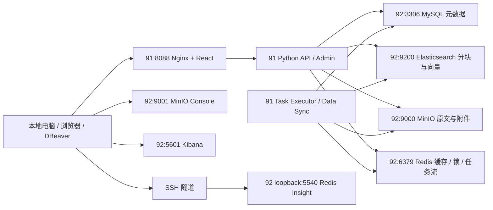

# RAGFlow 应用与存储分离部署及运维手册

更新日期：2026-10-23。本文对应本次实际部署，不是上游单机 Compose 的照搬。

## 1. 部署范围与架构结论

以 **91 上 `/home/cdky/workspace/github/ragflow` 的源码**为准，基线提交为 `a024bea0cd93f39e6652a42bf84dd20c55bc560b`，版本 v0.27.2。部署时对官方镜像内的应用目录及依赖清单与 91 源码进行了 873 个文件的比较，结果无差异；运行生成的 `conf/service_conf.yaml` 不参与源码比较。

本次独立部署，不迁移旧实例。**不要操作 91 上旧 `ragflow-server`、`ragflow-mysql`、`ragflow-minio`、`ragflow-redis`、`ragflow-es-01` 容器，也不要在旧目录 `/data/ragflow-main/docker` 执行命令。旧网页 `:8890` 保留。**



### 1.1 为什么可以拆分

源码依据：

| 路径 | 职责与拆分依据 |
| --- | --- |
| `api/db/db_models.py`、`common/settings.py` | Peewee 通过配置的 host/port 连接 MySQL；元数据不要求与 API 同机 |
| `rag/utils/storage_factory.py`、`rag/utils/minio_conn.py` | MinIO SDK 通过 S3 HTTP 接口存取对象，无数据库数据目录共享要求 |
| `common/doc_store/es_conn_pool.py`、`rag/utils/es_conn.py` | Elasticsearch HTTP 客户端、连接重试、关键词及向量检索 |
| `rag/utils/redis_conn.py` | RESP 网络连接、Redis Streams、消费组、锁和 Lua 脚本；本次与官方 Redis 7.4 实测通过 |
| `docker/entrypoint.sh` | 初始化表，再启动 API、Admin、Data Sync 和 Task Executor |
| `api/utils/health_utils.py` | 分别检查数据库、检索引擎、对象存储和 Redis |

本次使用 **Python 后端 + Elasticsearch 文档引擎 + MySQL 元数据 + MinIO 对象存储 + Redis**。Go 路径、NATS、ClickHouse、PostgreSQL、Infinity、OpenSearch、OceanBase、GaussDB、SereneDB、沙箱与独立模型服务不属于本次运行依赖，因此没有为了“凑齐数据库”额外部署它们。

### 1.2 结论的适用边界

**架构支持应用与存储分离，正常连通情况下无需修改业务代码或数据模型；不能断言影响只有网络延迟。** 还必须考虑：

- 网络中断、丢包、带宽和超时会影响上传、检索、任务执行与连接重建，API 与 Worker 都需要访问 92。
- 92 是当前单节点故障域；任何数据库崩溃、磁盘满或内存不足都可能影响 91。分机并不等于高可用。
- 两台机器的 Docker bridge DNS 不互通，不能在 91 继续写 `mysql`、`es01` 等 92 的容器服务名；应用明确使用 `192.168.88.92` 和宿主机发布端口。
- Compose `depends_on` 不能协调跨主机启动。必须先确认 92 健康，再启动 91。
- Redis 包含任务、锁和状态，不能作为可随意清空的缓存。已开启 AOF everysec，内存策略为 noeviction；达到限制后写入会报错，需要监控和扩容。异常掉电仍可能损失最近约一秒写入。
- MySQL、MinIO、Elasticsearch、Redis 之间没有统一备份事务。整套回滚需停止应用写入并备份同一时间点，不能只恢复一个 MySQL 文件就宣称恢复完整。
- 日志、模型缓存、临时解析文件仍可能位于 91；业务持久化存储在 92。这不是把应用的所有本地文件都移走。
- 本方案在受信任内网使用 HTTP/RESP；账号鉴权不等于链路加密。跨不可信网络应使用 SSH/VPN/TLS。端口绑定指定内网 IP，Redis Insight 仅绑定 92 loopback。

未来训练数据制作、Embedding/Rerank/LLM 微调、评测服务可以在这套部署基础上新增模块；本轮没有实现训练/评测功能，也没有加载推理模型。

## 2. 实际主机、端口与镜像

| 主机 | 环境与资源（部署前实测） | 本次职责 |
| --- | --- | --- |
| 192.168.88.91 | Ubuntu 22.04.5、x86_64、约 62 GiB RAM、磁盘剩余约 129 GiB；Docker 24.0.7、Compose 2.21.0 | 应用容器；日志放 `docker/split/logs` |
| 192.168.88.92 | Ubuntu 25.04、x86_64、约 14 GiB RAM、磁盘剩余约 363 GiB；Docker 24.0.7、Compose 2.26.1 | 四项存储与两个管理界面 |

两台机器的本次目录均为 `/home/cdky/workspace/github/ragflow/docker/split`。本地目录为 `D:\workspace\proj\github\ragflow\docker\split`。

| 功能 | 访问地址 | 用户 / 凭据位置 |
| --- | --- | --- |
| 新 RAGFlow 网页、管理页 | `http://192.168.88.91:8088` | `admin@ragflow.io`；91 `app.env` 的 `ADMIN_DEFAULT_PASSWORD` |
| API | `http://192.168.88.91:9380/api/v1`，也可走网页同源 `/api/v1` | 登录令牌或应用 API Key |
| Admin API | `http://192.168.88.91:9381/api/v1/admin`，推荐走 8088 同源代理 | 同一管理员账号 |
| MySQL | `192.168.88.92:3306`，数据库 `rag_flow` | `ragflow` / `MYSQL_PASSWORD` |
| Elasticsearch | `http://192.168.88.92:9200` | `elastic` / `ELASTIC_PASSWORD` |
| MinIO S3 API | `http://192.168.88.92:9000` | `ragflow` / `MINIO_PASSWORD` |
| MinIO Console | `http://192.168.88.92:9001` | 同上 |
| Redis | `192.168.88.92:6379`，逻辑 DB **1** | `default` / `REDIS_PASSWORD` |
| Kibana | `http://192.168.88.92:5601` | `elastic` / `ELASTIC_PASSWORD`；不是 `kibana_system` |
| Redis Insight | SSH 转发后 `http://127.0.0.1:5540` | 管理工具本身不提供登录保护，SSH 控制入口 |

密码随机生成，不使用 SSH 密码作为数据库密码。真实 `*.env`、本地 `credentials.md`、备份和运行日志均由 `docker/split/.gitignore` 排除。Linux 上 env 权限为 600。SSH 密码不写入仓库或本手册。`ADMIN_DEFAULT_PASSWORD` 是初始化密码；用户在界面改密后，env 不会自动同步改变数据库账号密码。

| 组件 | 使用的官方镜像 |
| --- | --- |
| 应用 | `infiniflow/ragflow:v0.27.2` |
| MySQL | `mysql:8.0.40` |
| Elasticsearch | `docker.elastic.co/elasticsearch/elasticsearch:8.11.3` |
| Kibana | `docker.elastic.co/kibana/kibana:8.11.3` |
| Redis | `redis:7.4`；本次实际为 7.4.11 |
| Redis Insight | `redis/redisinsight:3.8.0` |
| MinIO | `minio/minio@sha256:14cea493d9a34af32f524e538b8346cf79f3321eff8e708c1e2960462bd8936e`，版本 `RELEASE.2025-09-07T16-13-09Z` |

没有使用 Valkey、pgsty/silo 或 `swr.cn-*.myhuaweicloud.com` 镜像来运行本次服务。官方 MinIO 在线仓库在部署时返回 401，本次使用 92 **已有官方 RepoDigest 的 MinIO 缓存**，不是给第三方镜像改名。此镜像包含官方 `mc` 客户端。必须保存其离线镜像包；没有官方缓存或离线包时，应从官方源码构建并另行验证，不能假定此摘要目前仍能公开拉取。

各组件 config ID 和官方 manifest digest 保存在 `docker/split/images.lock.json`。这是核验记录，不是 Compose 自动读取的锁文件；升级前比较实际 `docker image inspect`，升级后更新记录。MinIO 离线包已保存到 92 `/home/cdky/workspace/ragflow-offline/minio-20250907.tar.gz`，SHA-256 为 `72aa8228682675cc71dcec1ea2c80485ae3f3cd4daecf452acac3372b62132ab`，约 65 MiB。

应用镜像通过官方 Docker Hub manifest 校验后复用本地相同内容层，再以 `docker save | gzip` 经 SSH 加密流转到 91。官方 tag manifest 摘要为 `sha256:e6b3f1a185c0a70abb3a72e1092415df8c5c6a4fae0089545554f2936c4b27ab`，镜像 config ID 为 `sha256:e0e1d9ec4af666710a35f3f7e1e3fe6b450b6a2cfe52851f107fc5f5967bbe8f`。离线 `docker load` 后 RepoDigests 可能为空，应比较镜像 ID 和官方 manifest 的 config digest，不能只看镜像名字。

## 3. 首次部署流程

以下步骤用于新环境复现。当前环境已经部署，**不要再次生成密码、创建空卷或重复初始化覆盖已有环境**。

### 3.1 前置检查

分别通过 SSH 登录两台机器，确认主机名与 IP。检查：

```bash
hostname -I
docker version
docker compose version
free -h
df -h / /var/lib/docker
ss -lnt
docker ps -a
docker volume ls
sysctl vm.max_map_count
```

92 实测 `vm.max_map_count=1048576`，满足 Elasticsearch 要求。若低于 262144，在 **92** 上执行：

```bash
printf 'vm.max_map_count=262144\n' | sudo tee /etc/sysctl.d/99-ragflow-elasticsearch.conf
sudo sysctl --system
```

本次不重启 Docker、不修改已有 registry mirrors、不调整全局防火墙。若所在网络有访问控制，放通本地电脑/91 到本文所列的 92 端口；不要把数据库发布到公网。Docker 发布端口可能绕过部分 UFW 默认规则，限制来源时应检查上游防火墙或 Docker 转发链的实际规则。

92 存储容器内存上限合计约 8 GiB，ES heap 为 1.5 GiB；91 新应用内存硬上限 **48 GiB**（`51539607552` bytes），软预留 8 GiB，不使用容器 swap；取消 CPU 硬配额（`cpu_quota: -1`），竞争权重 `cpu_shares: 512`。48 GiB 是上限，不是实际占用或独占预留；两台主机均需观察 `docker stats`、`free -h` 与其他服务占用。

### 3.2 生成并分发配置

本地首次执行：

```powershell
cd D:\workspace\proj\github\ragflow
python docker/split/init_env.py
scp docker/split/compose.app.yml docker/split/service_conf.yaml.template docker/split/ops.sh docker/split/verify_storage.py cdky@192.168.88.91:/home/cdky/workspace/github/ragflow/docker/split/
scp docker/split/app.env cdky@192.168.88.91:/home/cdky/workspace/github/ragflow/docker/split/
scp docker/split/compose.storage.yml docker/split/ops.sh docker/split/configure_storage.py docker/split/backup.sh cdky@192.168.88.92:/home/cdky/workspace/github/ragflow/docker/split/
scp docker/split/storage.env cdky@192.168.88.92:/home/cdky/workspace/github/ragflow/docker/split/
```

远端目录不存在时先 `mkdir -p /home/cdky/workspace/github/ragflow/docker/split`。91 仓库已有的 `docker/entrypoint.sh` 必须与基线一致。两端分别执行 `chmod 600 app.env` 或 `chmod 600 storage.env`。部署配置不读取原来的 `docker/.env`，不会继承其中的第三方镜像或旧服务端口。

`init_env.py` 发现任一 env 已存在就拒绝执行，防止两台机器凭据失配。应用仅收到所需凭据；MySQL root、Kibana 内部账号、管理工具加密密钥不注入应用。

### 3.3 拉取官方镜像与网络受限方案

网络正常时，92 执行：

```bash
docker pull mysql:8.0.40
docker pull redis:7.4
docker pull redis/redisinsight:3.8.0
docker pull docker.elastic.co/elasticsearch/elasticsearch:8.11.3
docker pull docker.elastic.co/kibana/kibana:8.11.3
docker pull infiniflow/ragflow:v0.27.2
```

本次 Docker Hub 直连超时，本地 Windows 的 `127.0.0.1:7897` HTTP 代理可访问官方仓库。仓库提供 `registry_bridge.py`：在本地校验官方 HTTPS、获取官方匿名 token，通过 SSH 远程端口转发给远端 Docker，仅允许本次所需仓库。它不提供缓存镜像、不启动公共代理、不重启 Docker。

先正常 SSH 登录并核对主机指纹，确保公钥进入本地 `~/.ssh/known_hosts`；脚本拒绝未知主机。然后在本地独立终端运行：

```powershell
python -m pip install requests paramiko
python docker/split/registry_bridge.py --host 192.168.88.92 --proxy http://127.0.0.1:7897
```

脚本交互读取 SSH 密码且不保存。保持窗口运行，在 92 执行：

```bash
set -e
for ref in library/mysql:8.0.40 library/redis:7.4 redis/redisinsight:3.8.0 infiniflow/ragflow:v0.27.2; do
  docker pull "127.0.0.1:15080/$ref"
  docker tag "127.0.0.1:15080/$ref" "${ref#library/}"
done
```

这里的 tag 仅将从官方拉取、Docker 已校验内容摘要的镜像赋予标准引用，不用于伪装第三方镜像。保存 pull 输出中的 digest；脚本也输出官方 manifest digest。Elastic 官方 registry 本次可直连。下载结束 Ctrl+C 关闭转发，运行期不依赖本地电脑。

在 92 导出官方应用和 MinIO，便于传输与灾难恢复：

```bash
mkdir -p /home/cdky/workspace/ragflow-offline
docker save infiniflow/ragflow:v0.27.2 | gzip -1 > /home/cdky/workspace/ragflow-offline/ragflow-v0.27.2.tar.gz
docker save minio/minio:latest | gzip -1 > /home/cdky/workspace/ragflow-offline/minio-20250907.tar.gz
cd /home/cdky/workspace/ragflow-offline
sha256sum *.tar.gz > SHA256SUMS
```

**导出 MinIO 前**执行 `docker image inspect minio/minio:latest`，确认 ID 与上述固定摘要解析结果相同。`latest` 是缓存的导出引用，不是部署配置；日后若 tag 变化，应给正确镜像 ID 加一个明确的归档 tag 后导出。重新导入不一定保留 RepoDigest，此时先核对 config ID，再在 `storage.env` 采用核验后的本地归档 tag。

可以用 `scp` 将压缩包从 92 送到 91（两服务器之间允许 SSH 时），或经本地电脑中转；91 执行 `gzip -dc ragflow-v0.27.2.tar.gz | docker load`。本次实际使用加密流传输，压缩流大小为 3,991,644,331 bytes，不保留应用传输临时文件。

### 3.4 先启动 92

```bash
cd /home/cdky/workspace/github/ragflow/docker/split
bash ops.sh storage config --quiet
bash ops.sh storage up -d --pull never --wait --wait-timeout 240 mysql redis minio elasticsearch
python3 configure_storage.py
bash ops.sh storage up -d --pull never --wait --wait-timeout 240 kibana redisinsight
bash ops.sh storage ps
```

`configure_storage.py` 为新建 ES snapshot 卷设置 Elasticsearch UID 1000 的写权限，设置 `kibana_system` 密码，并注册 `ragflow_backup` 文件系统快照仓库。Kibana 用内部账号连接 ES，用户用 `elastic` 登录。密码均从本机 `storage.env` 读取，不在命令输出中显示。

### 3.5 再启动 91

```bash
cd /home/cdky/workspace/github/ragflow/docker/split
bash ops.sh app config --quiet
bash ops.sh app up -d --pull never --wait --wait-timeout 420
bash ops.sh app ps
curl -fsS http://192.168.88.91:8088/api/v1/system/healthz
curl -fsS http://192.168.88.91:8088/api/v1/system/version
```

首次初始化表和 Python 模块可能需要数分钟。期望健康结果：

```json
{"db":"ok","doc_engine":"ok","redis":"ok","status":"ok","storage":"ok"}
```

Admin 服务首次生成 `admin@ragflow.io`，密码来自 `app.env`。登录后在模型设置中配置真正可用的 Embedding、Rerank 和 LLM；未配置前不要把界面可访问理解成知识库问答已可用。本次检查到已有 Xinference `/v1/models` 返回空列表，没有改动该模型服务。

## 4. 本地查看、修改与数据库管理

### 4.1 MySQL / DBeaver

选择 MySQL 驱动，主机 `192.168.88.92`、端口 `3306`、数据库 `rag_flow`、用户名 `ragflow`、密码取 `MYSQL_PASSWORD`。该账号具有 `rag_flow.*` 的权限；MySQL root 留在服务器内运维。

连接驱动建议启用 TLS；当前为 MySQL 自签证书，验证 CA 时需要导入对应证书。也可使用 DBeaver 的 SSH 隧道页，SSH 为 `cdky@192.168.88.92`，数据库目标使用 `192.168.88.92:3306`。不应为方便连库而把 root 改成远程免密。

可执行：

```sql
SELECT VERSION(), DATABASE();
SHOW TABLES;
SELECT id, email, nickname FROM user LIMIT 20;
START TRANSACTION;
-- 在确认关联关系后执行精确 WHERE 条件的业务修改。
ROLLBACK;
```

本地已实测 MySQL 鉴权、查询版本及列举应用表成功。直接修改业务表不会自动更新 ES、对象存储和缓存；正常业务变更优先使用 RAGFlow API。

服务器交互终端：

```bash
bash ops.sh storage exec mysql sh -c 'MYSQL_PWD="$MYSQL_ROOT_PASSWORD" exec mysql -uroot'
bash ops.sh storage exec mysql sh -c 'MYSQL_PWD="$MYSQL_PASSWORD" exec mysql -u ragflow rag_flow'
```

### 4.2 Elasticsearch / Kibana / DBeaver

Kibana 登录 `http://192.168.88.92:5601`，在 **Dev Tools → Console** 执行 REST 运维。DBeaver 的 Elasticsearch 支持取决于其版本、商业授权、驱动和 ES SQL 功能授权，不承诺 Community 版能像 MySQL 一样直接编辑所有文档；完整的查看、写入、更新、删除采用已部署的官方 Kibana。

```http
GET _cluster/health
GET _cat/indices?v
GET _cat/allocation?v
GET _nodes/stats/jvm,fs
GET ragflow_*/_search
{
  "size": 5,
  "query": {"match_all": {}}
}
```

维护测试请用独立临时索引，避免修改应用分块和向量：

```http
PUT maintenance-demo/_doc/1?refresh=true
{"note":"维护测试"}
POST maintenance-demo/_update/1?refresh=true
{"doc":{"note":"修改已验证"}}
GET maintenance-demo/_doc/1
DELETE maintenance-demo
```

单节点索引如果仍保留副本数 1，会呈 yellow；这表示副本未分配，不等于主分片丢失。不要把 red 当成健康；也不要为了消除 yellow 在不了解可用性要求时修改所有索引模板。本次独立验证索引使用副本数 0。

宿主机 curl（不要启用 `set -x`）：

```bash
set -a; source storage.env; set +a
curl -fsS -u "elastic:$ELASTIC_PASSWORD" http://192.168.88.92:9200/_cluster/health
```

### 4.3 MinIO Web Console 与 mc

浏览器访问 `http://192.168.88.92:9001`，用 `MINIO_USER` / `MINIO_PASSWORD` 登录，可浏览桶、上传、下载、检查和删除对象。9000 是 S3 API，9001 才是 Console。S3 客户端 endpoint 为 `http://192.168.88.92:9000`，使用 path-style 时更容易避开内网 DNS 问题。

该官方版本的社区 Console 为 **Object Browser**，不包含完整的历史高级管理菜单。用户/策略、服务状态和统计使用镜像自带官方 `mc`：

```bash
bash ops.sh storage exec minio sh -c 'mc alias set local http://127.0.0.1:9000 "$MINIO_ROOT_USER" "$MINIO_ROOT_PASSWORD"'
bash ops.sh storage exec minio mc admin info local
bash ops.sh storage exec minio mc ls local
bash ops.sh storage exec minio mc admin user list local
bash ops.sh storage exec minio mc admin policy list local
# 指定实际桶名后查看对象；mc cp 用于上传/下载，mc stat 用于检查。
bash ops.sh storage exec minio mc ls --recursive local/BUCKET_NAME
bash ops.sh storage exec minio mc stat local/BUCKET_NAME/OBJECT_NAME
```

容器重建后 mc alias 可能需要重新设置。不要直接编辑 `/var/lib/docker/volumes/...` 内的 MinIO 对象文件；这里可能是内部存储格式，维护应走 S3/Console/mc。

### 4.4 Redis / 官方 Redis Insight

可以使用官方 Redis Insight。本次已部署 `redis/redisinsight:3.8.0`，首次完成条款选择后导入预配置的 `redis:6379` 连接，逻辑 DB 1。Redis Insight 本身不作为有登录鉴权的公共网站发布。已实测它的数据库连接测试接口返回 HTTP 200。

本地 PowerShell 保持以下 SSH 命令运行：

```powershell
ssh -N -o ExitOnForwardFailure=yes -L 127.0.0.1:5540:127.0.0.1:5540 cdky@192.168.88.92
```

打开 `http://127.0.0.1:5540`，首次按界面完成隐私/使用条款选择。可查看键、TTL、字符串、Hash、Streams 和内存统计。若手动新增连接：在容器版 Insight 中使用 `redis:6379`，用户名 `default`，密码 `REDIS_PASSWORD`，DB 1；本地桌面版 Insight 使用 `192.168.88.92:6379`。

```bash
bash ops.sh storage exec redis sh -c 'REDISCLI_AUTH="$REDIS_PASSWORD" exec redis-cli -n 1'
```

进入 CLI 后：

```text
PING
INFO memory
INFO persistence
SCAN 0 COUNT 100
TYPE <key>
TTL <key>
XINFO GROUPS <stream>
XPENDING <stream> <group>
```

避免生产库 `KEYS *`、`FLUSHDB`、`FLUSHALL`；不要随意删除锁和任务 stream。编辑前确认键类型和业务含义。

### 4.5 后续若启用其他存储

当前没有部署以下组件，不能把“可选支持”写成“已经可用”：PostgreSQL 可用 DBeaver/psql；OpenSearch 可用官方 Dashboards/REST；ClickHouse 可用官方客户端、HTTP 与 DBeaver；Infinity 需按实际版本验证 SDK、HTTP 与 PostgreSQL 协议子集，不等同于完整 PostgreSQL；Go ingestion 如启用 NATS JetStream，则另行部署并配置认证、持久化、官方 nats CLI 和监控接口。新增组件时同步更新本手册的端口、凭据、备份和实测记录。

## 5. 日常启停、日志及配置更新

所有命令先进入各自服务器的 `docker/split`。`ops.sh` 固定 Compose project 名，避免选中旧实例。

```bash
# 92
bash ops.sh storage ps
bash ops.sh storage up -d --pull never --wait --wait-timeout 240
bash ops.sh storage logs --tail=100 mysql
bash ops.sh storage logs -f --tail=100 elasticsearch
bash ops.sh storage logs --since=30m minio redis kibana redisinsight
docker stats --no-stream $(bash ops.sh storage ps -q)

# 91
bash ops.sh app ps
bash ops.sh app logs -f --tail=100
ls -lh logs
tail -n 100 logs/ragflow_server.log
docker stats --no-stream $(bash ops.sh app ps -q)
```

日志文件名以 `ls logs` 结果为准；容器标准日志设置了 20 MiB × 5 轮转，但挂载目录中的应用文件日志仍需检查实际轮转与占用。

停止整套新环境的顺序：

```bash
# 先在 91
bash ops.sh app stop
# 确认已停止后，在 92
bash ops.sh storage stop
```

启动顺序相反：92 `up -d --wait` 健康后，再在 91 `up -d --wait`。普通 `stop`/`start` 保留容器和卷；`down` 删除容器/网络但默认保留卷；**`down -v` 会删除本项目数据，不能作为正常重启命令**。

修改 env 或 Compose 后，用 `up -d --force-recreate --pull never`；`restart` 不会重新加载容器创建时的环境变量。应用重启：

```bash
bash ops.sh app up -d --force-recreate --pull never --wait --wait-timeout 420
```

轮换数据库密码必须同时改数据库内的账号以及对应主机 env，再重建依赖容器。仅修改 MySQL `MYSQL_PASSWORD` 环境变量不会改变已有数据卷中的账号；MinIO root、Redis requirepass、ES 用户密码与 Kibana 内部密码的生效方式也不同，不应一律删除卷重建。

容器 `unless-stopped` 支持主机重启后自动恢复，但跨机先后顺序仍需观察。健康检查只标记状态，Docker 不会仅因 unhealthy 自动重启；持续异常时应查看日志并在依赖恢复后重建/重启新应用。

## 6. 备份、恢复与回滚

### 6.1 整套一致性冷备份（推荐基线）

1. 停止新应用的写入并等待任务完成；91 执行 `bash ops.sh app stop`，确认状态为 exited。
2. 在 92 执行下列命令；脚本还会检查 91 新 API 是否仍在线，在线时拒绝备份。

```bash
cd /home/cdky/workspace/github/ragflow/docker/split
APP_STOPPED=1 bash backup.sh
```

脚本停止本次七个数据卷所属的存储/管理容器，归档 MySQL、ES、ES 快照、MinIO、Redis、Kibana、Redis Insight，保存 `storage.env` 与 Compose，执行 gzip 完整性检查并生成 `SHA256SUMS`，结束时恢复本次存储服务。备份目录为 `docker/split/backups/YYYYmmdd-HHMMSS`。

3. 同一备份集必须另存 91 的 `app.env`、`compose.app.yml`、`service_conf.yaml.template`、部署版本/镜像 ID、业务新增本地文件。备份包含凭据，限制权限并复制到另一个磁盘/主机；只留在 92 系统盘不能防止整盘损坏。
4. 确认 92 健康，91 再执行 `bash ops.sh app up -d --pull never --wait --wait-timeout 420`。

### 6.2 在线分项备份

MySQL 逻辑备份（只保证该库的一致性，不自动保证跨组件一致）：

```bash
mkdir -p backups
umask 077
bash ops.sh storage exec -T mysql sh -c 'MYSQL_PWD="$MYSQL_ROOT_PASSWORD" exec mysqldump -uroot --single-transaction --routines --events --triggers --set-gtid-purged=OFF --databases rag_flow' > "backups/mysql-$(date +%Y%m%d-%H%M%S).sql"
```

ES 已配置快照仓库，在 Kibana Dev Tools 执行：

```http
PUT _snapshot/ragflow_backup/snapshot_20261023?wait_for_completion=true
{"include_global_state":false}
GET _snapshot/ragflow_backup/_all
```

快照仓库卷仍在 92，需要另行复制到外部备份位置。ES 官方支持的在线备份方式是 snapshot，不能对运行中的 ES 数据目录直接 tar 后声称可恢复。MinIO 可用 mc mirror 复制到独立对象存储；Redis 可查看 AOF 状态或执行 `BGSAVE` 后备份 RDB，但这些分项备份的时间点不相同。

### 6.3 恢复冷备份

优先在隔离环境或**全新命名卷**上演练。先核对归档：

```bash
cd /absolute/path/to/backup-set
sha256sum -c SHA256SUMS
gzip -t mysql_data.tar.gz
```

原样恢复要求相同兼容版本的镜像和同一备份集的凭据。示例将 MySQL 还原到新卷，绝不覆盖当前卷：

```bash
docker volume create ragflow-restore-mysql
docker run --rm --network none --entrypoint tar \
  --mount type=volume,source=ragflow-restore-mysql,target=/restore \
  --mount type=bind,source=/absolute/path/to/backup-set,target=/backup,readonly \
  mysql:8.0.40 --numeric-owner -xzf /backup/mysql_data.tar.gz -C /restore
```

对其他卷逐一使用相应归档恢复到全新卷；复制 Compose 到恢复目录，为每个卷指定 `external: true` 与新卷名，并使用不同项目名/端口启动隔离实例。先起存储验证，再指向恢复数据的应用；恢复前备份当前状态。不要在运行容器正在写入的卷上解压，也不要把 91 旧实例卷作为恢复目标。

MySQL 逻辑恢复：停止应用写入后，向明确选中的新库/恢复实例执行 `mysql < backup.sql`。ES snapshot 恢复时指定索引及 rename_pattern/rename_replacement，避免覆盖已有索引；如果连同现有索引原名恢复，先按 ES 官方流程关闭/处理冲突索引。复杂版本升级应先演练，不能把旧数据库目录直接交给任意新大版本镜像。

应用回滚：恢复之前的镜像引用及 env，重建新应用；如果新版已变更数据库 schema，镜像回滚可能不足，需恢复同一时间点的整套存储备份。

## 7. 部署验证与故障排查

### 7.1 可重复的跨机读写验证

在 91 的 `docker/split` 执行，替换成未使用的唯一 probe 名（`rfcheck` 后 8～32 位小写字母/数字）：

```bash
bash ops.sh app exec -T ragflow python - create rfcheck20261023 < verify_storage.py
bash ops.sh app exec -T ragflow python - verify rfcheck20261023 < verify_storage.py
bash ops.sh app exec -T ragflow python - clean rfcheck20261023 < verify_storage.py
```

脚本使用真实客户端：MySQL 独立表的插入/更新/查询，MinIO 独立桶对象的覆盖/读取，Redis DB 1 独立键及 Streams 消费组/ACK，ES 独立三维向量索引及 kNN 查询。只清理指定 probe 的资源，不删除业务数据。`create` 不是幂等重跑操作；已有 probe 用 `verify` 或先 `clean`。

重启持久化验证：create → 停止新应用 → 冷备份/重启 92 存储 → 启动新应用 → verify → clean。此验证覆盖存储读写与有序重启，不代表已测试网络分区、异常掉电、生产负载或所有解析器。

### 7.2 常见故障

| 现象 | 检查与处理 |
| --- | --- |
| 页面 502 / 应用 unhealthy | 看应用日志与四项依赖健康；首次启动等待初始化，持续失败检查模板渲染及 92 地址 |
| MySQL Access denied | 确认 `ragflow` 用户、`rag_flow` 库和两端密码一致；初始化 env 不会重置已有账号 |
| ES 启动失败 | vm.max_map_count、内存、磁盘、权限；本配置显式提供可写 `/tmp` |
| ES snapshot 500 / permission denied | 新快照卷最初属 root；运行 `python3 configure_storage.py` 修复本项目 `/snapshots` 权限并注册仓库 |
| Kibana 登录或连接失败 | 内部服务用 `kibana_system`，人工登录用 `elastic`；ES 与 Kibana 版本必须一致 |
| MinIO 网页不可用 | 区分 API 9000 与 Console 9001，检查 `MINIO_BROWSER_REDIRECT_URL` 和登录凭据 |
| Redis Insight 不能从 LAN 直接打开 | 这是 loopback 发布设计；建立 SSH 隧道后访问本地 5540 |
| Redis 内存写入错误 | noeviction 防止丢弃任务；检查 INFO memory 和积压，排查 Worker 或扩容，禁止直接清库 |
| 文件上传成功但未解析，或进度长时间不变 | 按 [文档与 Graph 任务排查手册](troubleshooting.md) 核对任务阶段、Worker、CPU 配额、队列及进度 TTL；不要仅凭百分比判断失败 |
| 镜像下载 401 / 超时 | 区分仓库权限与网络问题；Docker Hub 可走本地转发，MinIO 401 用核验过的官方离线包，不能改用未知镜像冒充 |
| 修改代码后运行行为未变 | 使用已核验的 release 基础镜像及 Python 补丁镜像；源码修改后必须重新构建并部署，单独修改宿主源码不会自动进入容器 |

### 7.3 二次开发部署

以后以 91 仓库为源构建镜像，记录 Git 提交/未提交变更与构建参数。Python 依赖、前端、原生库变更遵循仓库 `Dockerfile`、`build.sh` 和相应 `CLAUDE.md`，不能只替换 Python 文件就认为前端/依赖同步完成。典型入口：

```bash
cd /home/cdky/workspace/github/ragflow
docker build -f Dockerfile -t ragflow-local:YOUR_VERSION .
# 构建资源较多；先检查 Dockerfile 所需 ragflow_deps 镜像、模型和网络。
# 修改 docker/split/app.env 中 RAGFLOW_IMAGE=ragflow-local:YOUR_VERSION
cd docker/split
bash ops.sh app up -d --force-recreate --pull never --wait --wait-timeout 420
```

先备份、再更新、再验证；不要构建或覆盖旧 `ragflow-server` 使用的镜像 tag。GPU 训练需要另行规划 NVIDIA runtime、显存与模型工件路径，本部署的 CPU 应用容器没有获得 GPU 设备。

## 8. 参考与证据

- [RAGFlow 官方仓库](https://github.com/infiniflow/ragflow)：最终以 91 固定提交源码及实际接口为准。
- 用户提供的 [v0.27.2 API 文档](https://ragflow.io/docs/v0.27.2/http_api_reference) 在本次检索返回 404；因此验证使用仓库 `api/apps/restful_apis` 与实际 `/api/v1` 路由，未按旧文档猜测。
- [DeepWiki](https://deepwiki.com/infiniflow/ragflow) 可作为导航，不替代部署版本源码。
- [Redis Insight 官方 Docker 安装](https://redis.io/docs/latest/operate/redisinsight/install/install-on-docker/)。
- [MinIO 官方 Console 设置](https://min.io/docs/minio/linux/reference/minio-server/settings/console.html)：2025-05-24 起社区 Console 功能范围变化。
- [DBeaver 支持数据库](https://dbeaver.com/databases/) 与 [Lite Edition 功能](https://dbeaver.com/docs/dbeaver/Lite-Edition/)。
- 实际完成项、摘要、备份目录和验证边界持续记录在同目录 `update.md`。


## 9. 2026-10-23 资源与任务收尾补丁

本次资源调整已在线生效，不中断在途任务；Compose 已保存相同设置。CPU 配额、内存限制只作用于新容器 `ragflow-app-ragflow-1`，不修改 8890 旧实例。

```bash
# 91：在线调整，不重启进程
docker update --cpu-quota=-1 --cpu-shares=512 \
  --memory=48g --memory-swap=48g ragflow-app-ragflow-1
# 核验实际 cgroup（比仅检查旧 NanoCpus 配置更可靠）
docker exec ragflow-app-ragflow-1 sh -c \
  'cat /sys/fs/cgroup/cpu.max /sys/fs/cgroup/memory.max /sys/fs/cgroup/memory.swap.max'
# 期望：max 100000 / 51539607552 / 0
docker stats --no-stream ragflow-app-ragflow-1
free -h
```

`--cpus 0` 在本机 Docker 实测没有清除原来的配额，因此使用 `--cpu-quota=-1`，以 `cpu.max` 验收。CPU 无硬配额不代表无限算力，也不保证任何负载下都不竞争宿主资源。

### 9.1 构建与核验

补丁包括：Pipeline 数字进度与 Redis 短期日志解耦；PDF 批内 OCR/表格阶段回调；统一 Graph 任务类型；完成时间写入实际引用该任务的字段；操作日志异常不再阻断已处理消息的 ACK。保留 50 页批次和表格四方向识别，不改变解析质量设置。

```bash
# 91，从工程根目录运行；仅打包五个已修改的 Python 文件
cd /home/cdky/workspace/github/ragflow
bash docker/split/build_patch.sh
```

脚本先验证官方基础镜像 config digest，再离线构建 `ragflow-local:v0.27.2-progress-20261023`，执行 Python 编译检查，并生成 `docker/split/patch-image.lock.json`（基础镜像、补丁镜像 ID、源码 SHA-256）。该镜像是本项目自行构建的补丁，并非新的官方发行版本。脚本使用本机可用的经典 builder；其弃用提示不影响本次构建。依赖、前端或原生库发生变化时，改用第 7 节中的完整构建流程。

33 项定向测试在 Windows Python 3.14 和补丁镜像 Python 3.13 中通过，覆盖日志过期/不可用、无消息回调、乱序回调、取消、Graph 类型/完成时间、收尾失败 ACK，以及 PDF 批次坐标。复现命令：

```bash
python -m pytest --noconftest -q \
  test/unit_test/rag/flow/test_pipeline_progress.py \
  test/unit_test/api/db/services/test_graph_operation_completion.py \
  test/unit_test/rag/svr/test_task_executor_finalization.py \
  test/unit_test/deepdoc/parser/test_pdf_parser_table_coordinates.py
```

`--noconftest` 用于这组自包含单测，避免仓库通用测试初始化下载数据。不要把此选项直接套用到需要真实服务 fixture 的其他测试。

### 9.2 切换与回滚

已于 2026-10-23 15:44 切换补丁镜像并通过健康检查；镜像 ID 见 `patch-image.lock.json`。实际 MySQL/Redis 验证在删除测试日志 key 后仍能累计 File 完成进度，并最终达到 100%，临时测试行与 key 已清理。后续发布前仍先按排查手册确认在途任务及队列，避免中断重复计算。数据库备份命令见第 6 节；本次收尾恢复前的 MySQL 备份在 92 `docker/split/backups/20261023-progress-fix/rag_flow.sql.gz`，这是单库在线备份，不是完整跨存储冷备。

```bash
cd /home/cdky/workspace/github/ragflow/docker/split
# 备份当前 app.env，随后仅替换镜像引用，不覆盖模型、账号或数据库配置
cp -p app.env "backups/app.env.$(date +%Y%m%d-%H%M%S)"
sed -i 's|^RAGFLOW_IMAGE=.*|RAGFLOW_IMAGE=ragflow-local:v0.27.2-progress-20261023|' app.env
bash ops.sh app config --quiet
bash ops.sh app up -d --force-recreate --pull never --wait --wait-timeout 420
curl -fsS http://192.168.88.91:9380/api/v1/system/healthz
bash ops.sh app ps
bash ops.sh app logs --since 10m --tail 100 ragflow
```

回滚仅把 `RAGFLOW_IMAGE` 改回 `infiniflow/ragflow:v0.27.2` 后重建新应用。保留 48 GiB 和取消 CPU 配额的配置；本补丁没有 schema 迁移。回滚会重新带回旧进度/Graph 缺陷，不能用回滚镜像覆盖已生成的用户数据。


## 10. 本地 Qwen3 Embedding 页面配置

2026-10-23 从 91 应用容器实测：`GET /v1/models` 返回 `qwen3-text-embedding`，Embedding 请求 HTTP 200，返回 1024 维向量。此服务在 `192.168.88.169:9502`，不属于 91/92 的存储组件。

1. 登录 `http://192.168.88.91:8088/`，进入“设置 → 模型提供商”，添加 **VLLM** 实例。
2. 实例名称填写 `local-qwen3-embedding`（可自定义）；Base URL 填 `http://192.168.88.169:9502/v1`；API Key 填服务端分配的密钥本身，不加 `Bearer ` 前缀。
3. 获取模型列表，勾选 `qwen3-text-embedding`。若需手动添加，模型名称必须完全一致，模型类型只选 **Embedding**；最大 Token 数填写 **2048**（服务 `/v1/models` 实测 `max_model_len=2048`），不能填写向量维度 1024。
4. 验证连接/模型后保存。若模型未出现在 Embedding 下拉框，检查模型类型是否误设为 Chat、模型是否启用，并刷新页面。
5. 在“设置默认模型”中选择它，可供之后新建知识库默认使用；已经创建的知识库还要在自己的设置中选择。Compilation operator 的 Indexer/Tokenizer 运行时优先使用知识库配置，单改全局默认不会替换旧库模型。

Base URL 填到 `/v1` 即可：VLLM 适配器通过 OpenAI-compatible 客户端自动追加 `/embeddings`。不要填写完整的 `.../v1/embeddings`，否则会拼接出错误路由。服务应从 91 容器可达，本地浏览器可达并不等于应用可达。

当前 `db_t1` 使用通义 `text-embedding-v4`，有 164 个已完成的原文切片及编译索引；旧向量也是 1024 维。**维度相同不代表向量空间相同**，不能只为失败文件切换 Qwen3，并继续混用旧向量。页面对有数据的知识库会做向量兼容性检查，平均相似度不足 0.9 或维度不同会拒绝切换。

建议先新建测试知识库并选择本地模型；正式迁移时，为整个知识库统一重新生成原文、编译结果与数据集 Graph 的向量并验证检索。保留旧库可避免影响当前已有结果。涉及删除旧切片/重新编译的迁移应明确目标库后执行，不以手工改 `embd_id` 绕过一致性检查。密钥不写入本手册、更新日志或工程源码。
