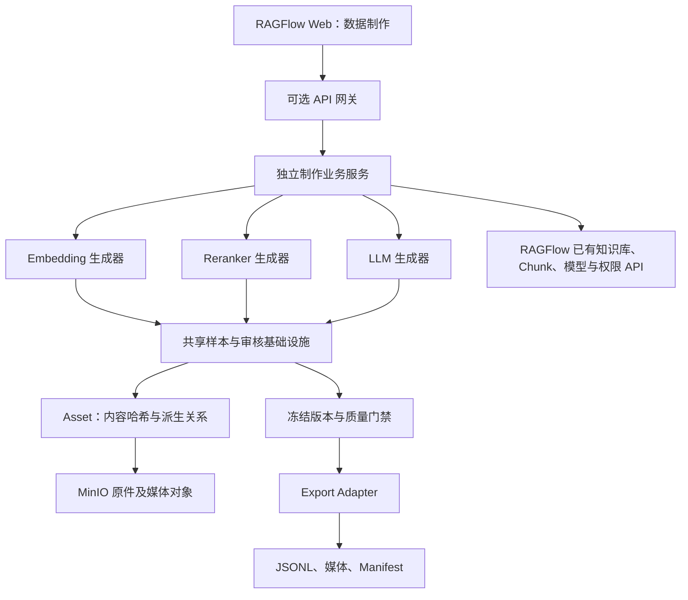

# 数据制作子系统设计

更新：2026-11-04。当前实现与部署说明见 [操作文档](数据制作操作.md)，过程见 [issue.html](issue.html#data-factory-v2)。

## 架构与边界

三个独立生成器（Embedding、Reranker、LLM）共享来源快照、资产、样本修订、审核、去重、分区、冻结和导出基础设施。模型训练和训练后评测由外部工程负责；本平台提供可复现的数据及证据，不管理训练任务、GPU、检查点或模型发布。

图的文本等价描述：Web 经可选网关调用独立服务；三个生成器读同一份授权来源快照，写统一样本外壳，各自校验任务 Payload；共享资产存 MinIO；审核通过后冻结，Adapter 转成外部模型/框架所需格式。Markdown 阅读器不支持 Mermaid 时可直接阅读本段。

后端单独容器用于资源、依赖和发布隔离；前端内嵌用于统一导航、登录、布局和组件。两者并不冲突。停用制作容器不阻断 RAGFlow 核心接口；独立 Web 可复用同一前端与网关。当前元数据使用独立 SQLite，所有写事务串行并带作业代次；不往 RAGFlow MySQL 业务表增加制作依赖。多 Worker/横向扩展前需要独立数据库与任务调度迁移，当前不宣称支持。

## 统一标准

Canonical Sample v2 包含 schema_version、sample_id、revision、task、snapshot_id、group_id、split、evidence_ids、provenance、payload。

| 层次 | 契约 |
| --- | --- |
| ContentPart | text、image、audio、video、structured；文本可内联，媒体用 SHA-256 asset_id；支持页码、归一化区域、毫秒区间 |
| Asset | 租户内内容哈希去重；元数据、对象键、MIME、大小；原件→页图/裁剪→提取文本关联 |
| Embedding Payload | query ContentPart[]、positives 证据 ID[]、negatives（证据 ID、挖掘方法、模型、分数等） |
| Reranker Payload | query 与 candidates；相关性 0/1/2，未知候选为 null，禁止未标注发布 |
| LLM Payload | messages、evidence_ids、supervised_turns，监督位置指向 assistant |
| Provenance | 来源快照、配置摘要、生成模型引用、候选检索记录、隔离候选、审核者/时间/理由 |

新模态通过 ContentPart 与 Asset 扩展，不为每个生成器新增图片/音视频表。对象键是持久引用，预签名 URL 只可用于临时传输，不进入样本权威数据。SQL 不存原始媒体 BLOB/Base64；ES 仅供检索，原件不以 ES 为权威存储。租户内去重避免跨租户存在性泄漏。

原始 PDF 由授权下载接口获取；Chunk 独立图片对象校验所属知识库。解析器使用共享临时图片桶时，从已授权 PDF 渲染页图，不直接信任临时桶地址。ContentPart 可引用图片、原始音视频和提取文本；OCR 与 VLM 文本保留为派生证据，不能无条件当作原文真值。

## 生成与质量

1. 快照捕获：分页读取启用 Chunk，核对总数和唯一 ID，两次读取一致后保存文档检查点；固化原件与资产。
2. 分区：文档家族、内容重复、近重复和共用问题形成分组；同一组只落入一个分区。保存租户内分区登记，后续任务冲突拒绝处理。没有随机按样本切分。
3. 问题：已有问题、模板或指定 LLM；结合文档标题、位置和 Chunk 文本。配置调用次数、输出长度和 Token 预留预算。
4. 检索：实例来源范围内，关键词/BM25、向量或混合；使用知识库匹配的 Embedding 模型编码。可选独立 Rerank，记录模型引用、候选排名、分数和内容哈希。
5. 负例：优先挖掘高相似但不相关候选；过滤正例、复制/近重复、包含正文及共用问题；高 Rerank 相关候选隔离待人工确认。随机配额仅按配置补充，不隐藏困难负例短缺。
6. 审核：草稿→批准/驳回，修订只追加；修改可增加多正例、跨模态配对与多轮对话。同一实例来源和分区限制不因手工修改绕过。
7. 门禁：任务 Payload、媒体归属、证据存在、分区、正负冲突、相关性标签、监督位置和疑似密钥检查。语义正确性由人工复核。

包含率/近重复启发式与 Rerank 阈值可能误排，需要审核恢复；不得把阈值视为相关性真值。不同模型返回分数含义不同。多文档全局 BM25 排序仍受当前 Chunk API 限制，按文档检索后的候选池应通过 Rerank 或人工比较。

## 模型适配与导出

Adapter 声明任务、模态与格式版本。当前支持 Canonical v2、Sentence Transformers Triplet、Reranker Pointwise、Messages 和 LLaMA-Factory ShareGPT。不支持的模态、区域/时间片段或监督语义直接拒绝，避免静默降级。

冻结版本绑定快照、配置和已批准样本修订。导出包含三个分区、provenance、媒体相对路径及 Manifest 文件大小/哈希；同一包内资产仅一份。ShareGPT 同时提供 dataset_info.json，具体模型、模板和训练参数仍由外部工程指定。[格式依据](https://github.com/hiyouga/LLaMA-Factory/blob/main/data/README.md)。

模型提供方的名称可能是可变别名。记录模型 ID/名称、调用结果和时间可追溯，但不承诺云模型权重完全可复现；数据发布包可字节级复现。

## 权限、资源与部署

复用 RAGFlow 身份、知识库和团队权限。每次读取、审核、下载重新检查来源访问；新增审核者/发布者必须是已有团队成员。来源删除或权限撤销后不继续提供训练资产。

Worker 当前单进程。作业持久化 queued/running/ready/failed/cancelled/interrupted，检查点与 attempt 令牌阻止取消后的旧结果回写。外部调用前预留预算，成功结果可复用；不确定调用禁止自动再发，防止取消和重试叠加费用。

91 Python API 与 Worker 使用 te.dev91 队列前缀，92 使用 te。制作服务的自身任务与 RAGFlow 文档解析队列独立。底层存储仍共享，队列隔离不能代替完整数据库/索引隔离。

## 验收与后续

本次以小规模真实语料验证建库、解析、生成、审核、冻结、资产打包、格式适配和移除模块后的主应用可用性。结构化、图片、音频、视频引用纳入同一契约；未引入训练子系统。

Recall@5/10、MRR、NDCG@10、跨模态 Recall@K、编码吞吐和延迟需要实际检索/编码模型运行，由外部评测工程使用冻结数据测量。当前页面提供数据质量报告，不以少量流程样本给出模型效果结论。

当前边界：单 Worker、SQLite 元数据、单文档原件 32 MiB、每实例最多 16 个文档，PDF 页图捕获上限 10 页。音视频时间区间支持标准引用，自动切段/抽帧和专用模态生成策略需后续扩展；当前复用解析管道文本结果和人工标注。
